# Result set gcc11.4-i7-11700-ubuntu22.04-wsl2

> **Preview:** at least one language is at a pre-release version (TeaScript before 0.18.0). The set will be measured again for the release.

| | |
|---|---|
| CPU | 11th Gen Intel(R) Core(TM) i7-11700 @ 2.50GHz, 8 cores, 16 threads |
| Memory | 15.5 GiB |
| OS | Ubuntu 22.04.4 LTS (Linux 6.18.58.1-microsoft-standard-WSL2) |
| Virtualization | WSL2 (a Hyper-V VM, 16 virtual CPUs) |
| Compiler | GCC 11.4.0, Release, `-O2 -DNDEBUG -march=x86-64-v3` |
| cpp-script-bench | 0.1.0 (19b31d8) |
| AngelScript | 2.38.0 (AS_64BIT_PTR AS_NO_THREADS AS_LINUX AS_X64_GCC) |
| ChaiScript | 7.0.0 (wasm-latest-36-gf635b51e); ChaiScript_Extras (v1.0.1-13-gdd116d7) |
| Lua | 5.5.1; LuaBridge3 (3.0-rc12) |
| Python | 3.14.10 (main, Nov 22 2026, 13:49:54) [GCC 11.4.0]; pybind11 3.1.0 (v3.1.0) |
| TeaScript | 0.18.0 (v0.17.0-45-g63f3c06) |
| Measured | 2026-11-22 17:05 to 2026-11-22 18:14 UTC |
| Processes | 5 per run, interleaved across the languages; pinned to logical CPU 15, priority normal |
| Per process | 3 warm-up and 10 measured calls, time budget 30 s (at least 3 calls) |
| Machine load | other processes used 0.01 logical CPUs in the median, at most 0.04 (processes of at least 1 s) |
| Status | preview |

All numbers compare only within this set. **How to read:** each cell is the median time of one call of `bench( n )` (host API benchmarks: of one sample) over all processes: the median of the medians of the processes. Below it: the factor to C++, and the spread between the processes (slowest minus fastest process median, relative to the median); "budget": the time budget limited the number of calls. The headline variant of each language is shown; the other variants follow below. The rules are in [PLAN.md](../../PLAN.md#2-fairness-rules), the raw data in [results.json](results.json).

## Core

<picture>
  <source media="(prefers-color-scheme: dark)" srcset="charts/core-dark.svg">
  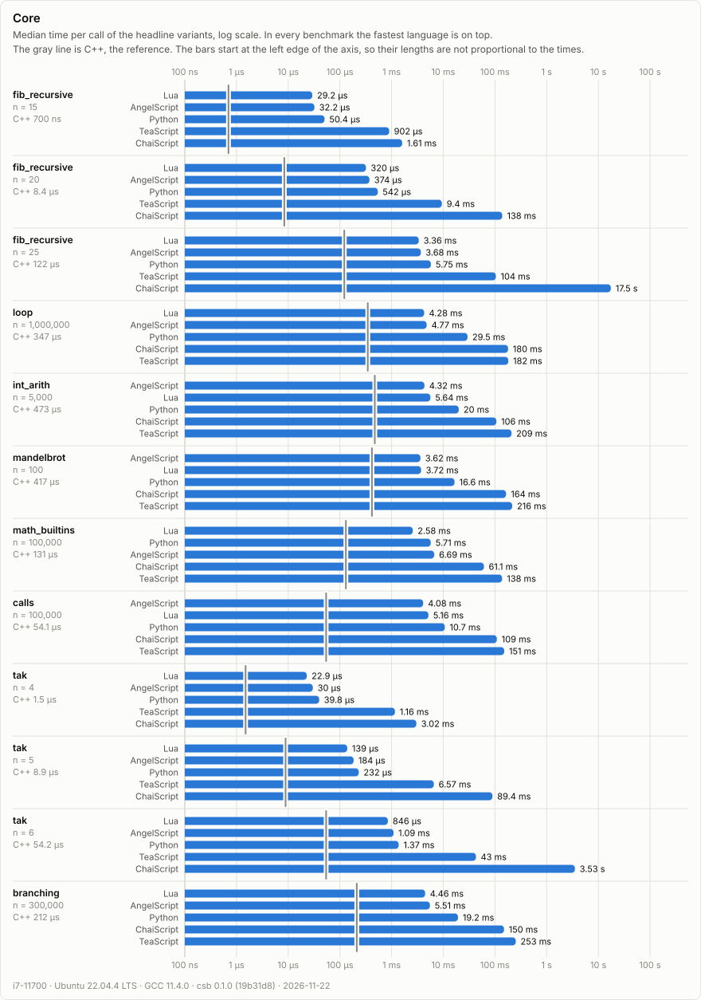
</picture>

| Benchmark | n | C++ | AngelScript no-threads-no-line-cues | ChaiScript no-threads | Lua | Python | TeaScript vm-O1 |
|---|--:|--:|--:|--:|--:|--:|--:|
| [fib_recursive](../../benchmarks/fib_recursive/README.md) | 15 | **700 ns** 14.3% | **32.2 µs** 46× · 4.0% | **1.61 ms** 2,297× · 2.1% | **29.2 µs** 41.8× · 7.9% | **50.4 µs** 72× · 6.3% | **902 µs** 1,288× · 15.6% |
| [fib_recursive](../../benchmarks/fib_recursive/README.md) | 20 | **8.4 µs** 2.4% | **374 µs** 44.5× · 13.4% | **138 ms** 16,485× · 8.0% | **320 µs** 38.1× · 4.5% | **542 µs** 64.6× · 4.6% | **9.4 ms** 1,119× · 31.6% |
| [fib_recursive](../../benchmarks/fib_recursive/README.md) | 25 | **122 µs** 0.3% | **3.68 ms** 30.2× · 2.4% | **17.5 s** 143,174× · 0.8% · budget | **3.36 ms** 27.6× · 1.2% | **5.75 ms** 47.2× · 7.9% | **104 ms** 855× · 15.0% |
| [loop](../../benchmarks/loop/README.md) | 1,000,000 | **347 µs** 0.2% | **4.77 ms** 13.8× · 0.3% | **180 ms** 517× · 1.4% | **4.28 ms** 12.3× · 1.5% | **29.5 ms** 85× · 8.0% | **182 ms** 523× · 39.6% |
| [int_arith](../../benchmarks/int_arith/README.md) | 5,000 | **473 µs** 3.6% | **4.32 ms** 9.11× · 3.4% | **106 ms** 225× · 1.7% | **5.64 ms** 11.9× · 0.4% | **20 ms** 42.2× · 1.0% | **209 ms** 441× · 26.9% |
| [mandelbrot](../../benchmarks/mandelbrot/README.md) | 100 | **417 µs** 0.4% | **3.62 ms** 8.7× · 0.7% | **164 ms** 395× · 2.6% | **3.72 ms** 8.92× · 2.8% | **16.6 ms** 39.7× · 4.3% | **216 ms** 518× · 1.7% |
| [math_builtins](../../benchmarks/math_builtins/README.md) | 100,000 | **131 µs** 0.1% | **6.69 ms** 51.2× · 0.6% | **61.1 ms** 467× · 9.1% | **2.58 ms** 19.7× · 2.7% | **5.71 ms** 43.7× · 7.3% | **138 ms** 1,052× · 4.7% |
| [calls](../../benchmarks/calls/README.md) | 100,000 | **54.1 µs** 0.1% | **4.08 ms** 75.5× · 10.6% | **109 ms** 2,007× · 15.5% | **5.16 ms** 95.4× · 4.5% | **10.7 ms** 198× · 7.8% | **151 ms** 2,795× · 20.7% |
| [tak](../../benchmarks/tak/README.md) | 4 | **1.5 µs** 0.0% | **30 µs** 20× · 6.7% | **3.02 ms** 2,012× · 9.0% | **22.9 µs** 15.3× · 3.7% | **39.8 µs** 26.5× · 4.4% | **1.16 ms** 775× · 9.9% |
| [tak](../../benchmarks/tak/README.md) | 5 | **8.9 µs** 2.2% | **184 µs** 20.7× · 14.9% | **89.4 ms** 10,041× · 1.8% | **139 µs** 15.6× · 4.1% | **232 µs** 26.1× · 2.3% | **6.57 ms** 738× · 8.1% |
| [tak](../../benchmarks/tak/README.md) | 6 | **54.2 µs** 2.3% | **1.09 ms** 20.2× · 6.9% | **3.53 s** 65,022× · 0.1% · budget | **846 µs** 15.6× · 2.4% | **1.37 ms** 25.3× · 1.6% | **43 ms** 792× · 12.8% |
| [branching](../../benchmarks/branching/README.md) | 300,000 | **212 µs** 0.3% | **5.51 ms** 25.9× · 0.7% | **150 ms** 704× · 7.8% | **4.46 ms** 21× · 0.4% | **19.2 ms** 90.5× · 0.9% | **253 ms** 1,192× · 16.1% |

## Data

<picture>
  <source media="(prefers-color-scheme: dark)" srcset="charts/data-dark.svg">
  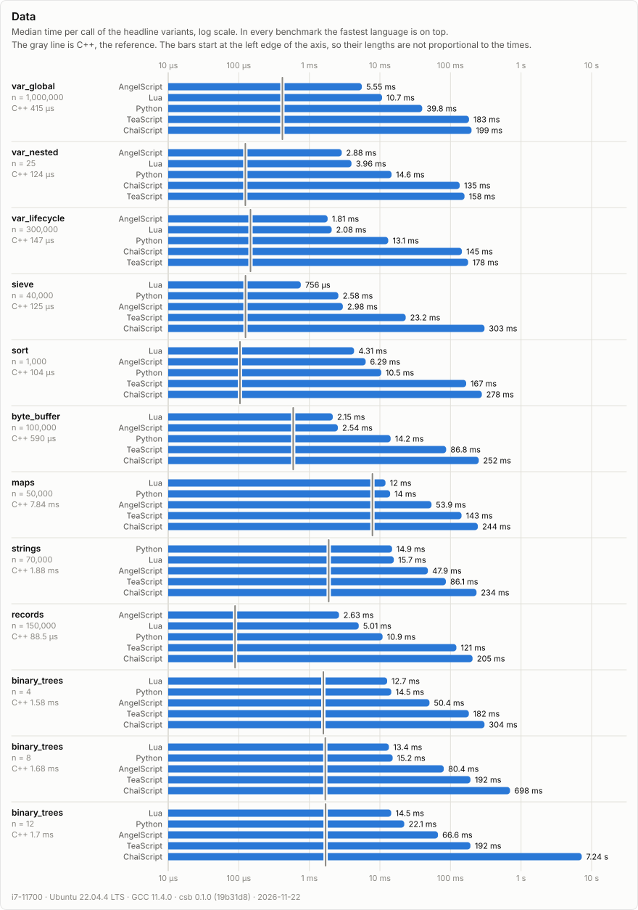
</picture>

| Benchmark | n | C++ | AngelScript no-threads-no-line-cues | ChaiScript no-threads | Lua | Python | TeaScript vm-O1 |
|---|--:|--:|--:|--:|--:|--:|--:|
| [var_global](../../benchmarks/var_global/README.md) | 1,000,000 | **415 µs** 5.8% | **5.55 ms** 13.4× · 0.2% | **199 ms** 480× · 1.7% | **10.7 ms** 25.9× · 0.9% | **39.8 ms** 95.9× · 2.3% | **183 ms** 441× · 3.8% |
| [var_nested](../../benchmarks/var_nested/README.md) | 25 | **124 µs** 3.8% | **2.88 ms** 23.3× · 0.6% | **135 ms** 1,094× · 1.9% | **3.96 ms** 32× · 0.3% | **14.6 ms** 118× · 4.2% | **158 ms** 1,277× · 4.6% |
| [var_lifecycle](../../benchmarks/var_lifecycle/README.md) | 300,000 | **147 µs** 1.7% | **1.81 ms** 12.4× · 2.3% | **145 ms** 990× · 4.4% | **2.08 ms** 14.2× · 1.5% | **13.1 ms** 89.5× · 4.2% | **178 ms** 1,213× · 32.7% |
| [sieve](../../benchmarks/sieve/README.md) | 40,000 | **125 µs** 0.4% | **2.98 ms** 23.9× · 1.2% | **303 ms** 2,436× · 3.9% | **756 µs** 6.07× · 4.1% | **2.58 ms** 20.7× · 4.6% | **23.2 ms** 186× · 2.1% |
| [sort](../../benchmarks/sort/README.md) | 1,000 | **104 µs** 0.0% | **6.29 ms** 60.5× · 6.4% | **278 ms** 2,676× · 0.4% | **4.31 ms** 41.4× · 38.9% | **10.5 ms** 101× · 12.1% | **167 ms** 1,606× · 19.6% |
| [byte_buffer](../../benchmarks/byte_buffer/README.md) | 100,000 | **590 µs** 0.6% | **2.54 ms** 4.3× · 5.7% | **252 ms** 426× · 6.7% | **2.15 ms** 3.64× · 1.5% | **14.2 ms** 24× · 8.0% | **86.8 ms** 147× · 1.4% |
| [maps](../../benchmarks/maps/README.md) | 50,000 | **7.84 ms** 1.0% | **53.9 ms** 6.87× · 1.6% | **244 ms** 31.2× · 3.8% | **12 ms** 1.53× · 0.3% | **14 ms** 1.78× · 2.3% | **143 ms** 18.3× · 4.0% |
| [strings](../../benchmarks/strings/README.md) | 70,000 | **1.88 ms** 2.1% | **47.9 ms** 25.5× · 2.8% | **234 ms** 124× · 8.7% | **15.7 ms** 8.36× · 0.3% | **14.9 ms** 7.92× · 1.0% | **86.1 ms** 45.8× · 4.3% |
| [records](../../benchmarks/records/README.md) | 150,000 | **88.5 µs** 2.3% | **2.63 ms** 29.8× · 0.6% | **205 ms** 2,321× · 1.2% | **5.01 ms** 56.6× · 0.4% | **10.9 ms** 123× · 5.1% | **121 ms** 1,372× · 1.5% |
| [binary_trees](../../benchmarks/binary_trees/README.md) | 4 | **1.58 ms** 3.2% | **50.4 ms** 31.9× · 1.1% | **304 ms** 192× · 3.2% | **12.7 ms** 8.03× · 2.2% | **14.5 ms** 9.18× · 1.0% | **182 ms** 115× · 13.2% |
| [binary_trees](../../benchmarks/binary_trees/README.md) | 8 | **1.68 ms** 1.5% | **80.4 ms** 47.7× · 2.0% | **698 ms** 414× · 2.4% | **13.4 ms** 7.97× · 1.6% | **15.2 ms** 9× · 6.6% | **192 ms** 114× · 12.6% |
| [binary_trees](../../benchmarks/binary_trees/README.md) | 12 | **1.7 ms** 2.0% | **66.6 ms** 39.1× · 1.9% | **7.24 s** 4,255× · 0.2% · budget | **14.5 ms** 8.5× · 0.8% | **22.1 ms** 13× · 1.4% | **192 ms** 113× · 12.5% |

## Interop (script <-> C++)

<picture>
  <source media="(prefers-color-scheme: dark)" srcset="charts/interop-dark.svg">
  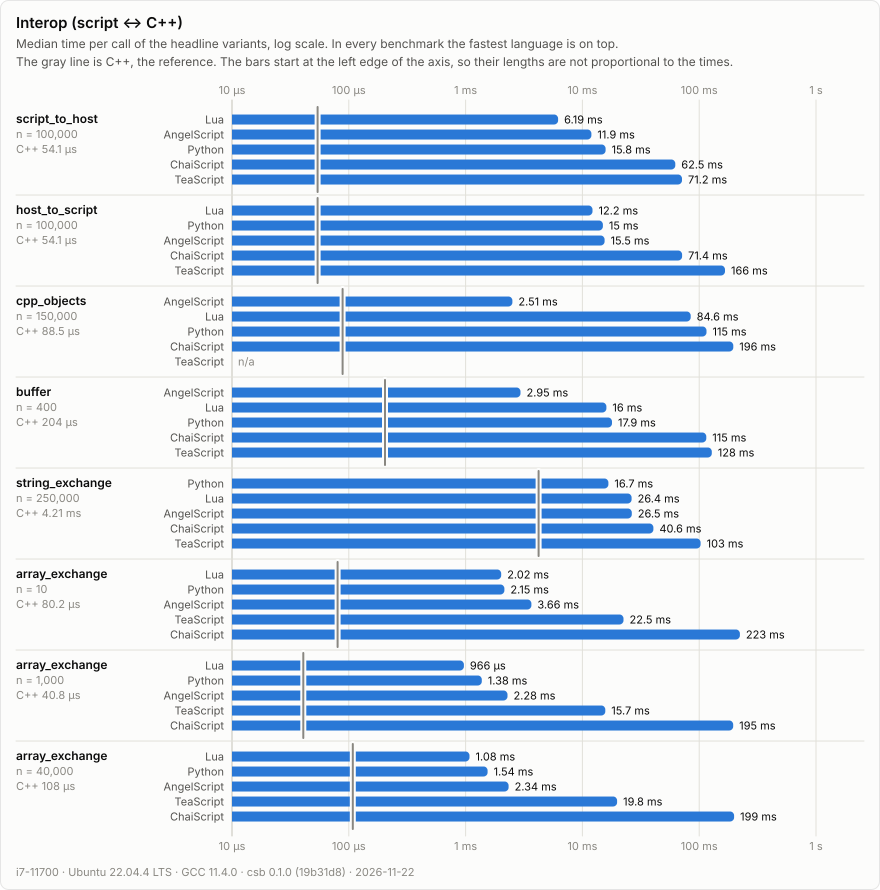
</picture>

| Benchmark | n | C++ | AngelScript no-threads-no-line-cues | ChaiScript no-threads | Lua | Python | TeaScript vm-O1 |
|---|--:|--:|--:|--:|--:|--:|--:|
| [script_to_host](../../benchmarks/script_to_host/README.md) | 100,000 | **54.1 µs** 0.7% | **11.9 ms** 221× · 1.5% | **62.5 ms** 1,156× · 9.5% | **6.19 ms** 115× · 0.6% | **15.8 ms** 292× · 2.7% | **71.2 ms** 1,317× · 2.0% |
| [host_to_script](../../benchmarks/host_to_script/README.md) | 100,000 | **54.1 µs** 1.3% | **15.5 ms** 286× · 0.7% | **71.4 ms** 1,320× · 0.5% | **12.2 ms** 226× · 0.6% | **15 ms** 277× · 0.4% | **166 ms** 3,077× · 18.0% |
| [cpp_objects](../../benchmarks/cpp_objects/README.md) | 150,000 | **88.5 µs** 0.1% | **2.51 ms** 28.4× · 0.4% | **196 ms** 2,213× · 1.2% | **84.6 ms** 956× · 1.1% | **115 ms** 1,306× · 2.6% | n/a |
| [buffer](../../benchmarks/buffer/README.md) | 400 | **204 µs** 1.2% | **2.95 ms** 14.5× · 1.0% | **115 ms** 563× · 5.8% | **16 ms** 78.6× · 1.2% | **17.9 ms** 87.7× · 4.3% | **128 ms** 627× · 1.4% |
| [string_exchange](../../benchmarks/string_exchange/README.md) | 250,000 | **4.21 ms** 1.3% | **26.5 ms** 6.28× · 0.2% | **40.6 ms** 9.62× · 0.4% | **26.4 ms** 6.26× · 1.1% | **16.7 ms** 3.96× · 1.4% | **103 ms** 24.4× · 16.6% |
| [array_exchange](../../benchmarks/array_exchange/README.md) | 10 | **80.2 µs** 109.3% | **3.66 ms** 45.6× · 0.8% | **223 ms** 2,783× · 5.2% | **2.02 ms** 25.1× · 1.6% | **2.15 ms** 26.8× · 6.1% | **22.5 ms** 280× · 1.7% |
| [array_exchange](../../benchmarks/array_exchange/README.md) | 1,000 | **40.8 µs** 2.9% | **2.28 ms** 56× · 2.5% | **195 ms** 4,791× · 5.0% | **966 µs** 23.7× · 1.2% | **1.38 ms** 33.7× · 3.2% | **15.7 ms** 385× · 3.0% |
| [array_exchange](../../benchmarks/array_exchange/README.md) | 40,000 | **108 µs** 8.7% | **2.34 ms** 21.6× · 0.7% | **199 ms** 1,838× · 0.9% | **1.08 ms** 9.98× · 0.9% | **1.54 ms** 14.3× · 7.4% | **19.8 ms** 183× · 9.8% |

## Host API (C++ level)

<picture>
  <source media="(prefers-color-scheme: dark)" srcset="charts/host-dark.svg">
  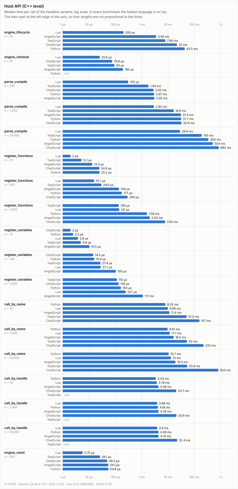
</picture>

| Benchmark | n | AngelScript no-threads-no-line-cues | ChaiScript no-threads | Lua | Python | TeaScript vm-O1 |
|---|--:|--:|--:|--:|--:|--:|
| [engine_lifecycle](../../benchmarks/engine_lifecycle/README.md) | 10 | **3.56 ms** 1.3% | **22 ms** 1.3% | **205 µs** 1.3% | **43.5 ms** 1.5% | **7.94 ms** 1.1% |
| [engine_minimal](../../benchmarks/engine_minimal/README.md) | 10 | **195 µs** 3.0% | **75.8 µs** 6.4% | **25.6 µs** 3.7% | n/a | **93 µs** 4.5% |
| [parse_compile](../../benchmarks/parse_compile/README.md) | 100 | **3.05 ms** 1.2% | **2.83 ms** 1.0% | **310 µs** 2.9% | **2.97 ms** 2.4% | **1.83 ms** 5.0% |
| [parse_compile](../../benchmarks/parse_compile/README.md) | 1,000 | **31.3 ms** 2.0% | **32.6 ms** 0.5% | **2.92 ms** 2.0% | **31.7 ms** 3.4% | **16.6 ms** 1.1% |
| [parse_compile](../../benchmarks/parse_compile/README.md) | 10,000 | **504 ms** 4.8% | **862 ms** 0.4% | **28.8 ms** 0.7% | **343 ms** 0.5% | **193 ms** 2.6% |
| [register_functions](../../benchmarks/register_functions/README.md) | 10 | **13.3 µs** 4.1% | **24.8 µs** 2.2% | **2 µs** 10.0% | **25.2 µs** 1.2% | **5.2 µs** 4.8% |
| [register_functions](../../benchmarks/register_functions/README.md) | 100 | **138 µs** 2.8% | **293 µs** 1.9% | **15.7 µs** 4.2% | **177 µs** 8.6% | **29.6 µs** 3.0% |
| [register_functions](../../benchmarks/register_functions/README.md) | 1,000 | **2.04 ms** 1.1% | **7.83 ms** 0.8% | **141 µs** 3.7% | **1.59 ms** 2.6% | **136 µs** 1.8% |
| [register_variables](../../benchmarks/register_variables/README.md) | 10 | **10.5 µs** 4.3% | **2 µs** 7.5% | **3.8 µs** 6.6% | **2.5 µs** 20.0% | **4.9 µs** 8.2% |
| [register_variables](../../benchmarks/register_variables/README.md) | 100 | **105 µs** 0.8% | **14.5 µs** 4.1% | **27.7 µs** 1.8% | **15.9 µs** 5.0% | **27.4 µs** 3.1% |
| [register_variables](../../benchmarks/register_variables/README.md) | 1,000 | **1.11 ms** 2.2% | **135 µs** 1.0% | **247 µs** 1.6% | **163 µs** 5.6% | **115 µs** 1.9% |
| [call_by_name](../../benchmarks/call_by_name/README.md) | 10 | **11.4 ms** 1.5% | **157 ms** 5.7% | **9.89 ms** 4.8% | **8.02 ms** 5.8% | **51.5 ms** 18.4% |
| [call_by_name](../../benchmarks/call_by_name/README.md) | 1,000 | **16.5 ms** 0.5% | **225 ms** 3.3% | **11.7 ms** 2.8% | **9.61 ms** 3.0% | **53 ms** 11.4% |
| [call_by_name](../../benchmarks/call_by_name/README.md) | 10,000 | **19.3 ms** 0.5% | **823 ms** 2.3% | **13 ms** 2.3% | **10.7 ms** 1.0% | **53.9 ms** 18.4% |
| [call_by_handle](../../benchmarks/call_by_handle/README.md) | 10 | **4.36 ms** 1.0% | **20.7 ms** 4.7% | **3.78 ms** 1.0% | **3.43 ms** 1.6% | n/a |
| [call_by_handle](../../benchmarks/call_by_handle/README.md) | 1,000 | **4.39 ms** 2.4% | **20.9 ms** 0.8% | **3.88 ms** 1.0% | **4.18 ms** 2.5% | n/a |
| [call_by_handle](../../benchmarks/call_by_handle/README.md) | 10,000 | **4.41 ms** 1.9% | **22.4 ms** 1.1% | **3.9 ms** 0.9% | **4.36 ms** 1.2% | n/a |
| [engine_reset](../../benchmarks/engine_reset/README.md) | 100 | **54.1 µs** 3.8% | **49.2 µs** 4.1% | **5.75 µs** 3.5% | **54.8 µs** 2.9% | **26.1 µs** 2.3% |

## Series

Benchmarks with a series of workload sizes, over n (log-log).

<picture>
  <source media="(prefers-color-scheme: dark)" srcset="charts/series-fib_recursive-dark.svg">
  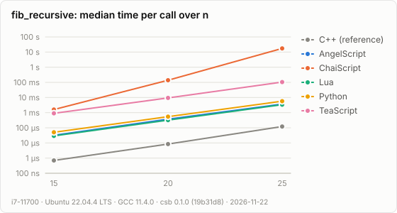
</picture>

<picture>
  <source media="(prefers-color-scheme: dark)" srcset="charts/series-tak-dark.svg">
  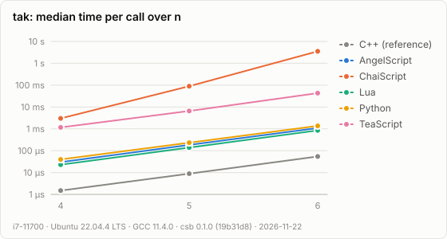
</picture>

<picture>
  <source media="(prefers-color-scheme: dark)" srcset="charts/series-binary_trees-dark.svg">
  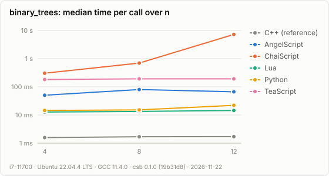
</picture>

<picture>
  <source media="(prefers-color-scheme: dark)" srcset="charts/series-array_exchange-dark.svg">
  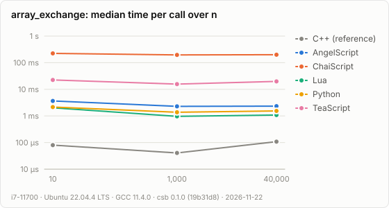
</picture>

<picture>
  <source media="(prefers-color-scheme: dark)" srcset="charts/series-parse_compile-dark.svg">
  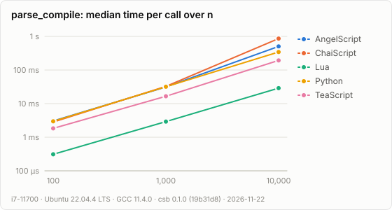
</picture>

<picture>
  <source media="(prefers-color-scheme: dark)" srcset="charts/series-register_functions-dark.svg">
  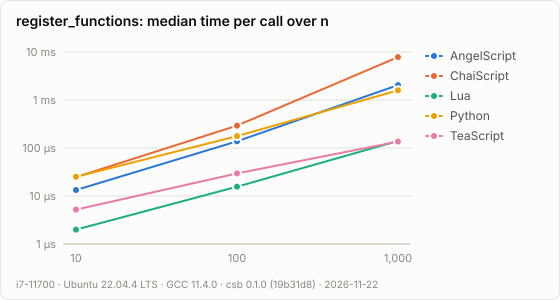
</picture>

<picture>
  <source media="(prefers-color-scheme: dark)" srcset="charts/series-register_variables-dark.svg">
  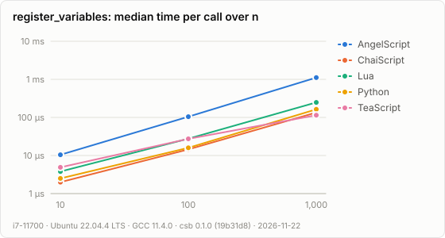
</picture>

<picture>
  <source media="(prefers-color-scheme: dark)" srcset="charts/series-call_by_name-dark.svg">
  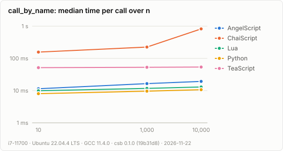
</picture>

<picture>
  <source media="(prefers-color-scheme: dark)" srcset="charts/series-call_by_handle-dark.svg">
  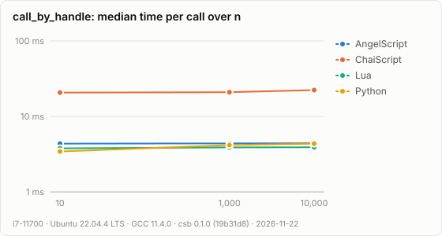
</picture>

## Variants

All variants of each language; the factor is relative to its headline variant.

### AngelScript

| Benchmark | n | no-threads-no-line-cues (headline) | default | no-line-cues | no-threads |
|---|--:|--:|--:|--:|--:|
| fib_recursive | 15 | **32.2 µs** 4.0% | **31.8 µs** 0.986× · 4.9% | **30.5 µs** 0.946× · 11.8% | **32.1 µs** 0.997× · 1.2% |
| fib_recursive | 20 | **374 µs** 13.4% | **355 µs** 0.95× · 7.7% | **338 µs** 0.905× · 4.7% | **370 µs** 0.988× · 6.7% |
| fib_recursive | 25 | **3.68 ms** 2.4% | **3.71 ms** 1.01× · 2.5% | **3.59 ms** 0.976× · 4.8% | **3.82 ms** 1.04× · 3.6% |
| loop | 1,000,000 | **4.77 ms** 0.3% | **6.57 ms** 1.38× · 0.1% | **4.32 ms** 0.904× · 0.4% | **7.19 ms** 1.51× · 0.3% |
| int_arith | 5,000 | **4.32 ms** 3.4% | **5.59 ms** 1.3× · 5.0% | **4.39 ms** 1.02× · 0.2% | **5.34 ms** 1.24× · 0.3% |
| mandelbrot | 100 | **3.62 ms** 0.7% | **3.84 ms** 1.06× · 0.6% | **3.64 ms** 1× · 0.4% | **3.85 ms** 1.06× · 0.5% |
| math_builtins | 100,000 | **6.69 ms** 0.6% | **6.97 ms** 1.04× · 1.4% | **6.78 ms** 1.01× · 1.3% | **6.94 ms** 1.04× · 0.6% |
| calls | 100,000 | **4.08 ms** 10.6% | **3.99 ms** 0.977× · 3.6% | **3.89 ms** 0.954× · 1.0% | **4.01 ms** 0.984× · 3.4% |
| tak | 4 | **30 µs** 6.7% | **31.3 µs** 1.04× · 3.4% | **30.2 µs** 1.01× · 4.5% | **31.3 µs** 1.04× · 4.5% |
| tak | 5 | **184 µs** 14.9% | **185 µs** 1× · 8.9% | **185 µs** 1× · 9.8% | **188 µs** 1.02× · 4.8% |
| tak | 6 | **1.09 ms** 6.9% | **1.13 ms** 1.04× · 16.6% | **1.09 ms** 0.999× · 5.6% | **1.12 ms** 1.02× · 3.7% |
| branching | 300,000 | **5.51 ms** 0.7% | **7.54 ms** 1.37× · 9.4% | **5.56 ms** 1.01× · 1.0% | **7.27 ms** 1.32× · 0.4% |
| var_global | 1,000,000 | **5.55 ms** 0.2% | **7.59 ms** 1.37× · 0.1% | **5.33 ms** 0.961× · 0.1% | **8.01 ms** 1.44× · 0.1% |
| var_nested | 25 | **2.88 ms** 0.6% | **3.78 ms** 1.31× · 0.3% | **2.88 ms** 1× · 0.8% | **3.8 ms** 1.32× · 0.5% |
| var_lifecycle | 300,000 | **1.81 ms** 2.3% | **2.91 ms** 1.6× · 0.6% | **1.86 ms** 1.03× · 2.2% | **3.27 ms** 1.8× · 0.6% |
| sieve | 40,000 | **2.98 ms** 1.2% | **3.28 ms** 1.1× · 0.9% | **2.98 ms** 1× · 2.8% | **3.31 ms** 1.11× · 2.4% |
| sort | 1,000 | **6.29 ms** 6.4% | **6.16 ms** 0.98× · 7.8% | **6 ms** 0.954× · 1.7% | **6.11 ms** 0.972× · 2.7% |
| byte_buffer | 100,000 | **2.54 ms** 5.7% | **4.24 ms** 1.67× · 1.8% | **4.1 ms** 1.62× · 6.4% | **3.38 ms** 1.33× · 3.4% |
| maps | 50,000 | **53.9 ms** 1.6% | **54.6 ms** 1.01× · 5.9% | **53.6 ms** 0.995× · 0.4% | **54.6 ms** 1.01× · 1.4% |
| strings | 70,000 | **47.9 ms** 2.8% | **47.7 ms** 0.996× · 0.2% | **47.3 ms** 0.988× · 0.4% | **48.5 ms** 1.01× · 3.0% |
| records | 150,000 | **2.63 ms** 0.6% | **2.97 ms** 1.13× · 0.7% | **2.63 ms** 0.997× · 0.7% | **3.12 ms** 1.19× · 1.2% |
| binary_trees | 4 | **50.4 ms** 1.1% | **59.1 ms** 1.17× · 2.0% | **58.3 ms** 1.16× · 0.9% | **50.8 ms** 1.01× · 1.9% |
| binary_trees | 8 | **80.4 ms** 2.0% | **91.1 ms** 1.13× · 2.0% | **87.6 ms** 1.09× · 2.8% | **81.4 ms** 1.01× · 3.5% |
| binary_trees | 12 | **66.6 ms** 1.9% | **78.6 ms** 1.18× · 1.6% | **74.2 ms** 1.11× · 1.8% | **68.7 ms** 1.03× · 2.3% |
| script_to_host | 100,000 | **11.9 ms** 1.5% | **12 ms** 1× · 1.3% | **11.7 ms** 0.981× · 1.2% | **12.1 ms** 1.02× · 0.4% |
| host_to_script | 100,000 | **15.5 ms** 0.7% | **16.6 ms** 1.07× · 2.5% | **16.5 ms** 1.06× · 1.0% | **15.9 ms** 1.03× · 1.1% |
| cpp_objects | 150,000 | **2.51 ms** 0.4% | **3 ms** 1.19× · 0.5% | **2.51 ms** 0.997× · 0.6% | **3.13 ms** 1.24× · 0.5% |
| buffer | 400 | **2.95 ms** 1.0% | **3.25 ms** 1.1× · 1.1% | **2.93 ms** 0.993× · 0.6% | **3.32 ms** 1.13× · 0.8% |
| string_exchange | 250,000 | **26.5 ms** 0.2% | **27.5 ms** 1.04× · 0.1% | **27.3 ms** 1.03× · 0.2% | **26.7 ms** 1.01× · 0.9% |
| array_exchange | 10 | **3.66 ms** 0.8% | **3.78 ms** 1.03× · 2.3% | **3.7 ms** 1.01× · 1.5% | **3.79 ms** 1.04× · 1.8% |
| array_exchange | 1,000 | **2.28 ms** 2.5% | **2.35 ms** 1.03× · 0.4% | **2.27 ms** 0.994× · 1.3% | **2.38 ms** 1.04× · 0.8% |
| array_exchange | 40,000 | **2.34 ms** 0.7% | **2.43 ms** 1.04× · 2.1% | **2.36 ms** 1.01× · 1.6% | **2.43 ms** 1.04× · 0.8% |
| engine_lifecycle | 10 | **3.56 ms** 1.3% | **3.83 ms** 1.08× · 2.0% | **3.83 ms** 1.08× · 0.5% | **3.54 ms** 0.993× · 0.3% |
| engine_minimal | 10 | **195 µs** 3.0% | **216 µs** 1.11× · 3.4% | **214 µs** 1.09× · 5.6% | **194 µs** 0.995× · 3.1% |
| parse_compile | 100 | **3.05 ms** 1.2% | **3.18 ms** 1.04× · 0.8% | **3.17 ms** 1.04× · 2.4% | **3.04 ms** 0.999× · 0.9% |
| parse_compile | 1,000 | **31.3 ms** 2.0% | **32.6 ms** 1.04× · 0.9% | **32.5 ms** 1.04× · 0.1% | **31.3 ms** 1× · 1.9% |
| parse_compile | 10,000 | **504 ms** 4.8% | **527 ms** 1.04× · 4.5% | **513 ms** 1.02× · 4.5% | **505 ms** 1× · 5.1% |
| register_functions | 10 | **13.3 µs** 4.1% | **14.2 µs** 1.06× · 2.8% | **14.5 µs** 1.08× · 4.2% | **13.1 µs** 0.978× · 1.5% |
| register_functions | 100 | **138 µs** 2.8% | **148 µs** 1.07× · 0.9% | **149 µs** 1.08× · 2.6% | **137 µs** 0.994× · 1.5% |
| register_functions | 1,000 | **2.04 ms** 1.1% | **2.21 ms** 1.08× · 1.6% | **2.18 ms** 1.07× · 3.6% | **2.06 ms** 1.01× · 2.0% |
| register_variables | 10 | **10.5 µs** 4.3% | **11 µs** 1.06× · 4.1% | **11 µs** 1.05× · 2.3% | **10.3 µs** 0.99× · 3.4% |
| register_variables | 100 | **105 µs** 0.8% | **109 µs** 1.04× · 3.3% | **109 µs** 1.04× · 2.9% | **104 µs** 0.998× · 1.6% |
| register_variables | 1,000 | **1.11 ms** 2.2% | **1.16 ms** 1.04× · 2.6% | **1.15 ms** 1.03× · 3.8% | **1.13 ms** 1.02× · 3.8% |
| call_by_name | 10 | **11.4 ms** 1.5% | **12.1 ms** 1.06× · 2.7% | **12.1 ms** 1.05× · 0.8% | **11.6 ms** 1.01× · 1.5% |
| call_by_name | 1,000 | **16.5 ms** 0.5% | **16.8 ms** 1.02× · 0.4% | **16.8 ms** 1.02× · 1.6% | **16.5 ms** 1× · 0.3% |
| call_by_name | 10,000 | **19.3 ms** 0.5% | **19.3 ms** 1× · 0.8% | **19.3 ms** 0.999× · 0.6% | **19.4 ms** 1× · 0.9% |
| call_by_handle | 10 | **4.36 ms** 1.0% | **4.7 ms** 1.08× · 0.7% | **4.64 ms** 1.06× · 0.8% | **4.55 ms** 1.04× · 0.9% |
| call_by_handle | 1,000 | **4.39 ms** 2.4% | **4.73 ms** 1.08× · 0.7% | **4.66 ms** 1.06× · 0.6% | **4.56 ms** 1.04× · 2.3% |
| call_by_handle | 10,000 | **4.41 ms** 1.9% | **4.8 ms** 1.09× · 1.8% | **4.7 ms** 1.07× · 1.0% | **4.58 ms** 1.04× · 1.2% |
| engine_reset | 100 | **54.1 µs** 3.8% | **55.7 µs** 1.03× · 3.5% | **55.5 µs** 1.03× · 3.7% | **54.2 µs** 1× · 3.6% |

### ChaiScript

| Benchmark | n | no-threads (headline) | default |
|---|--:|--:|--:|
| fib_recursive | 15 | **1.61 ms** 2.1% | **1.68 ms** 1.05× · 1.6% |
| fib_recursive | 20 | **138 ms** 8.0% | **139 ms** 1× · 2.1% |
| fib_recursive | 25 | **17.5 s** 0.8% · budget | **17.5 s** 1× · 0.6% · budget |
| loop | 1,000,000 | **180 ms** 1.4% | **191 ms** 1.06× · 4.7% |
| int_arith | 5,000 | **106 ms** 1.7% | **112 ms** 1.05× · 2.9% |
| mandelbrot | 100 | **164 ms** 2.6% | **167 ms** 1.02× · 38.3% |
| math_builtins | 100,000 | **61.1 ms** 9.1% | **77.1 ms** 1.26× · 10.8% |
| calls | 100,000 | **109 ms** 15.5% | **104 ms** 0.955× · 2.3% |
| tak | 4 | **3.02 ms** 9.0% | **3.09 ms** 1.02× · 8.9% |
| tak | 5 | **89.4 ms** 1.8% | **90.1 ms** 1.01× · 1.5% |
| tak | 6 | **3.53 s** 0.1% · budget | **3.53 s** 1× · 0.6% · budget |
| branching | 300,000 | **150 ms** 7.8% | **161 ms** 1.07× · 18.5% |
| var_global | 1,000,000 | **199 ms** 1.7% | **241 ms** 1.21× · 8.9% |
| var_nested | 25 | **135 ms** 1.9% | **137 ms** 1.01× · 5.0% |
| var_lifecycle | 300,000 | **145 ms** 4.4% | **185 ms** 1.27× · 21.6% |
| sieve | 40,000 | **303 ms** 3.9% | **316 ms** 1.04× · 5.0% |
| sort | 1,000 | **278 ms** 0.4% | **291 ms** 1.05× · 9.0% |
| byte_buffer | 100,000 | **252 ms** 6.7% | **280 ms** 1.11× · 1.4% |
| maps | 50,000 | **244 ms** 3.8% | **262 ms** 1.07× · 2.4% |
| strings | 70,000 | **234 ms** 8.7% | **255 ms** 1.09× · 6.2% |
| records | 150,000 | **205 ms** 1.2% | **229 ms** 1.11× · 22.8% |
| binary_trees | 4 | **304 ms** 3.2% | **324 ms** 1.07× · 4.8% |
| binary_trees | 8 | **698 ms** 2.4% | **713 ms** 1.02× · 1.9% |
| binary_trees | 12 | **7.24 s** 0.2% · budget | **7.26 s** 1× · 1.4% · budget |
| script_to_host | 100,000 | **62.5 ms** 9.5% | **70.6 ms** 1.13× · 29.9% |
| host_to_script | 100,000 | **71.4 ms** 0.5% | **73.8 ms** 1.03× · 0.5% |
| cpp_objects | 150,000 | **196 ms** 1.2% | **216 ms** 1.11× · 33.4% |
| buffer | 400 | **115 ms** 5.8% | **121 ms** 1.05× · 5.6% |
| string_exchange | 250,000 | **40.6 ms** 0.4% | **42.3 ms** 1.04× · 32.8% |
| array_exchange | 10 | **223 ms** 5.2% | **230 ms** 1.03× · 1.7% |
| array_exchange | 1,000 | **195 ms** 5.0% | **202 ms** 1.04× · 2.1% |
| array_exchange | 40,000 | **199 ms** 0.9% | **203 ms** 1.02× · 1.8% |
| engine_lifecycle | 10 | **22 ms** 1.3% | **22.2 ms** 1.01× · 0.2% |
| engine_minimal | 10 | **75.8 µs** 6.4% | **82.7 µs** 1.09× · 6.6% |
| parse_compile | 100 | **2.83 ms** 1.0% | **2.8 ms** 0.989× · 3.2% |
| parse_compile | 1,000 | **32.6 ms** 0.5% | **32.4 ms** 0.994× · 1.4% |
| parse_compile | 10,000 | **862 ms** 0.4% | **858 ms** 0.995× · 0.7% |
| register_functions | 10 | **24.8 µs** 2.2% | **25.4 µs** 1.03× · 1.4% |
| register_functions | 100 | **293 µs** 1.9% | **306 µs** 1.04× · 4.2% |
| register_functions | 1,000 | **7.83 ms** 0.8% | **7.85 ms** 1× · 0.9% |
| register_variables | 10 | **2 µs** 7.5% | **2.1 µs** 1.05× · 4.8% |
| register_variables | 100 | **14.5 µs** 4.1% | **15.2 µs** 1.05× · 2.6% |
| register_variables | 1,000 | **135 µs** 1.0% | **143 µs** 1.06× · 2.3% |
| call_by_name | 10 | **157 ms** 5.7% | **168 ms** 1.07× · 2.0% |
| call_by_name | 1,000 | **225 ms** 3.3% | **235 ms** 1.04× · 1.1% |
| call_by_name | 10,000 | **823 ms** 2.3% | **800 ms** 0.971× · 7.7% |
| call_by_handle | 10 | **20.7 ms** 4.7% | **21.5 ms** 1.04× · 3.8% |
| call_by_handle | 1,000 | **20.9 ms** 0.8% | **21.6 ms** 1.03× · 29.5% |
| call_by_handle | 10,000 | **22.4 ms** 1.1% | **23.1 ms** 1.03× · 0.8% |
| engine_reset | 100 | **49.2 µs** 4.1% | **49.8 µs** 1.01× · 1.5% |

### Lua

| Benchmark | n | (no name) (headline) | c-api |
|---|--:|--:|--:|
| script_to_host | 100,000 | **6.19 ms** 0.6% | **4.15 ms** 0.669× · 2.1% |
| host_to_script | 100,000 | **12.2 ms** 0.6% | **8.12 ms** 0.665× · 7.5% |
| cpp_objects | 150,000 | **84.6 ms** 1.1% | **45.6 ms** 0.539× · 2.7% |
| buffer | 400 | **16 ms** 1.2% | **8.13 ms** 0.507× · 1.3% |
| string_exchange | 250,000 | **26.4 ms** 1.1% | **21.2 ms** 0.803× · 1.3% |
| array_exchange | 10 | **2.02 ms** 1.6% | **1.61 ms** 0.796× · 1.3% |
| array_exchange | 1,000 | **966 µs** 1.2% | **766 µs** 0.793× · 1.0% |
| array_exchange | 40,000 | **1.08 ms** 0.9% | **924 µs** 0.855× · 2.4% |
| register_functions | 10 | **2 µs** 10.0% | **900 ns** 0.45× · 11.1% |
| register_functions | 100 | **15.7 µs** 4.2% | **7.45 µs** 0.476× · 6.7% |
| register_functions | 1,000 | **141 µs** 3.7% | **69.5 µs** 0.494× · 4.9% |
| register_variables | 10 | **3.8 µs** 6.6% | **800 ns** 0.211× · 12.5% |
| register_variables | 100 | **27.7 µs** 1.8% | **7 µs** 0.253× · 5.0% |
| register_variables | 1,000 | **247 µs** 1.6% | **68.6 µs** 0.277× · 3.3% |
| call_by_name | 10 | **9.89 ms** 4.8% | **3.05 ms** 0.309× · 12.2% |
| call_by_name | 1,000 | **11.7 ms** 2.8% | **5.2 ms** 0.443× · 2.8% |
| call_by_name | 10,000 | **13 ms** 2.3% | **6.98 ms** 0.538× · 1.4% |
| call_by_handle | 10 | **3.78 ms** 1.0% | **2.18 ms** 0.576× · 3.0% |
| call_by_handle | 1,000 | **3.88 ms** 1.0% | **2.31 ms** 0.596× · 5.5% |
| call_by_handle | 10,000 | **3.9 ms** 0.9% | **2.46 ms** 0.629× · 11.9% |

### Python

| Benchmark | n | (no name) (headline) | c-api |
|---|--:|--:|--:|
| script_to_host | 100,000 | **15.8 ms** 2.7% | **7.24 ms** 0.458× · 3.1% |
| host_to_script | 100,000 | **15 ms** 0.4% | **12.7 ms** 0.851× · 12.5% |
| cpp_objects | 150,000 | **115 ms** 2.6% | **31.3 ms** 0.271× · 7.6% |
| buffer | 400 | **17.9 ms** 4.3% | **17.9 ms** 0.997× · 1.7% |
| string_exchange | 250,000 | **16.7 ms** 1.4% | **15.6 ms** 0.934× · 0.2% |
| array_exchange | 10 | **2.15 ms** 6.1% | **1.54 ms** 0.717× · 3.2% |
| array_exchange | 1,000 | **1.38 ms** 3.2% | **1.09 ms** 0.795× · 3.7% |
| array_exchange | 40,000 | **1.54 ms** 7.4% | **1.25 ms** 0.81× · 2.7% |
| register_functions | 10 | **25.2 µs** 1.2% | **2.5 µs** 0.0994× · 12.0% |
| register_functions | 100 | **177 µs** 8.6% | **19.7 µs** 0.111× · 8.1% |
| register_functions | 1,000 | **1.59 ms** 2.6% | **185 µs** 0.116× · 4.5% |
| register_variables | 10 | **2.5 µs** 20.0% | **1.25 µs** 0.5× · 28.0% |
| register_variables | 100 | **15.9 µs** 5.0% | **11.8 µs** 0.742× · 14.8% |
| register_variables | 1,000 | **163 µs** 5.6% | **108 µs** 0.66× · 13.5% |
| call_by_name | 10 | **8.02 ms** 5.8% | **6.78 ms** 0.846× · 18.0% |
| call_by_name | 1,000 | **9.61 ms** 3.0% | **8.45 ms** 0.88× · 2.1% |
| call_by_name | 10,000 | **10.7 ms** 1.0% | **9.64 ms** 0.904× · 2.6% |
| call_by_handle | 10 | **3.43 ms** 1.6% | **2.92 ms** 0.852× · 2.2% |
| call_by_handle | 1,000 | **4.18 ms** 2.5% | **3.61 ms** 0.866× · 1.6% |
| call_by_handle | 10,000 | **4.36 ms** 1.2% | **3.85 ms** 0.882× · 1.6% |

### TeaScript

| Benchmark | n | vm-O1 (headline) | ast | vm-O0 | vm-O2 |
|---|--:|--:|--:|--:|--:|
| fib_recursive | 15 | **902 µs** 15.6% | **870 µs** 0.964× · 3.1% | **1.02 ms** 1.13× · 16.0% | **814 µs** 0.903× · 19.6% |
| fib_recursive | 20 | **9.4 ms** 31.6% | **9.17 ms** 0.976× · 2.7% | **9.34 ms** 0.994× · 14.5% | **8.61 ms** 0.916× · 19.7% |
| fib_recursive | 25 | **104 ms** 15.0% | **101 ms** 0.97× · 0.5% | **103 ms** 0.991× · 16.3% | **97.2 ms** 0.932× · 15.0% |
| loop | 1,000,000 | **182 ms** 39.6% | **137 ms** 0.753× · 2.3% | **183 ms** 1.01× · 1.6% | **173 ms** 0.951× · 5.7% |
| int_arith | 5,000 | **209 ms** 26.9% | **180 ms** 0.864× · 3.5% | **209 ms** 1× · 24.0% | **189 ms** 0.907× · 0.5% |
| mandelbrot | 100 | **216 ms** 1.7% | **170 ms** 0.79× · 1.9% | **214 ms** 0.991× · 1.7% | **215 ms** 0.994× · 8.1% |
| math_builtins | 100,000 | **138 ms** 4.7% | **111 ms** 0.81× · 1.4% | **140 ms** 1.01× · 13.1% | **136 ms** 0.985× · 13.4% |
| calls | 100,000 | **151 ms** 20.7% | **109 ms** 0.722× · 1.4% | **132 ms** 0.871× · 19.7% | **147 ms** 0.971× · 16.5% |
| tak | 4 | **1.16 ms** 9.9% | **988 µs** 0.85× · 2.7% | **1.17 ms** 1.01× · 9.8% | **1.21 ms** 1.04× · 9.8% |
| tak | 5 | **6.57 ms** 8.1% | **5.56 ms** 0.847× · 1.3% | **6.47 ms** 0.985× · 12.8% | **6.32 ms** 0.961× · 10.3% |
| tak | 6 | **43 ms** 12.8% | **34.3 ms** 0.798× · 1.0% | **42.3 ms** 0.983× · 13.6% | **41.2 ms** 0.958× · 9.7% |
| branching | 300,000 | **253 ms** 16.1% | **199 ms** 0.784× · 0.6% | **258 ms** 1.02× · 26.6% | **242 ms** 0.954× · 16.7% |
| var_global | 1,000,000 | **183 ms** 3.8% | **140 ms** 0.766× · 5.7% | **183 ms** 1× · 38.5% | **173 ms** 0.946× · 10.9% |
| var_nested | 25 | **158 ms** 4.6% | **106 ms** 0.671× · 8.2% | **159 ms** 1× · 2.4% | **154 ms** 0.976× · 2.7% |
| var_lifecycle | 300,000 | **178 ms** 32.7% | **114 ms** 0.642× · 1.9% | **175 ms** 0.983× · 15.8% | **173 ms** 0.974× · 2.0% |
| sieve | 40,000 | **23.2 ms** 2.1% | **27.2 ms** 1.17× · 1.4% | **23 ms** 0.99× · 2.3% | **21.2 ms** 0.912× · 2.9% |
| sort | 1,000 | **167 ms** 19.6% | **171 ms** 1.02× · 1.7% | **167 ms** 0.999× · 19.9% | **166 ms** 0.993× · 1.4% |
| byte_buffer | 100,000 | **86.8 ms** 1.4% | **76.8 ms** 0.884× · 1.2% | **87.6 ms** 1.01× · 2.1% | **84.2 ms** 0.97× · 2.1% |
| maps | 50,000 | **143 ms** 4.0% | **144 ms** 1.01× · 5.0% | **143 ms** 0.994× · 1.7% | **140 ms** 0.973× · 0.7% |
| strings | 70,000 | **86.1 ms** 4.3% | **66 ms** 0.767× · 10.3% | **86.2 ms** 1× · 11.5% | **83.6 ms** 0.972× · 14.3% |
| records | 150,000 | **121 ms** 1.5% | **90.2 ms** 0.743× · 1.4% | **122 ms** 1× · 7.9% | **120 ms** 0.988× · 41.5% |
| binary_trees | 4 | **182 ms** 13.2% | **176 ms** 0.967× · 1.0% | **176 ms** 0.968× · 7.2% | **176 ms** 0.965× · 7.3% |
| binary_trees | 8 | **192 ms** 12.6% | **171 ms** 0.89× · 1.2% | **189 ms** 0.984× · 6.7% | **183 ms** 0.955× · 11.5% |
| binary_trees | 12 | **192 ms** 12.5% | **179 ms** 0.929× · 0.8% | **188 ms** 0.978× · 1.2% | **206 ms** 1.07× · 11.7% |
| script_to_host | 100,000 | **71.2 ms** 2.0% | **58.2 ms** 0.818× · 3.0% | **78.9 ms** 1.11× · 14.8% | **69.4 ms** 0.976× · 2.8% |
| host_to_script | 100,000 | **166 ms** 18.0% | **76.9 ms** 0.462× · 3.8% | **167 ms** 1.01× · 13.1% | **150 ms** 0.9× · 19.7% |
| buffer | 400 | **128 ms** 1.4% | **101 ms** 0.787× · 0.5% | **130 ms** 1.01× · 3.0% | **127 ms** 0.994× · 6.1% |
| string_exchange | 250,000 | **103 ms** 16.6% | **49.7 ms** 0.484× · 0.3% | **105 ms** 1.02× · 16.7% | **102 ms** 0.994× · 16.8% |
| array_exchange | 10 | **22.5 ms** 1.7% | **19 ms** 0.847× · 1.3% | **22.3 ms** 0.99× · 1.9% | **22.1 ms** 0.984× · 2.0% |
| array_exchange | 1,000 | **15.7 ms** 3.0% | **14.2 ms** 0.906× · 2.0% | **15.5 ms** 0.985× · 3.5% | **15.1 ms** 0.961× · 3.3% |
| array_exchange | 40,000 | **19.8 ms** 9.8% | **15 ms** 0.756× · 2.2% | **19.6 ms** 0.989× · 10.1% | **19.3 ms** 0.973× · 0.7% |
| engine_lifecycle | 10 | **7.94 ms** 1.1% | **4.56 ms** 0.574× · 0.8% | **7.23 ms** 0.91× · 1.4% | **7.94 ms** 1× · 0.7% |
| engine_minimal | 10 | **93 µs** 4.5% | **91.9 µs** 0.988× · 4.5% | **91.1 µs** 0.979× · 2.6% | **93 µs** 0.999× · 6.7% |
| parse_compile | 100 | **1.83 ms** 5.0% | **1.02 ms** 0.558× · 3.1% | **1.72 ms** 0.94× · 1.3% | **1.81 ms** 0.991× · 2.6% |
| parse_compile | 1,000 | **16.6 ms** 1.1% | **9.74 ms** 0.588× · 1.2% | **19.4 ms** 1.17× · 2.0% | **16.5 ms** 0.994× · 0.9% |
| parse_compile | 10,000 | **193 ms** 2.6% | **98.5 ms** 0.511× · 1.0% | **234 ms** 1.22× · 0.3% | **192 ms** 0.999× · 1.4% |
| register_functions | 10 | **5.2 µs** 4.8% | **2.1 µs** 0.404× · 2.4% | **5.3 µs** 1.02× · 6.6% | **5.3 µs** 1.02× · 2.8% |
| register_functions | 100 | **29.6 µs** 3.0% | **13.3 µs** 0.449× · 2.3% | **29.7 µs** 1× · 2.4% | **29.5 µs** 0.997× · 2.5% |
| register_functions | 1,000 | **136 µs** 1.8% | **111 µs** 0.814× · 1.2% | **137 µs** 1.01× · 0.9% | **137 µs** 1× · 1.2% |
| register_variables | 10 | **4.9 µs** 8.2% | **1.7 µs** 0.347× · 5.9% | **4.9 µs** 1× · 4.1% | **4.95 µs** 1.01× · 7.1% |
| register_variables | 100 | **27.4 µs** 3.1% | **10.9 µs** 0.399× · 2.8% | **27.4 µs** 1× · 6.9% | **27.4 µs** 1× · 1.3% |
| register_variables | 1,000 | **115 µs** 1.9% | **89.9 µs** 0.784× · 2.8% | **115 µs** 1× · 3.4% | **115 µs** 1.01× · 0.7% |
| call_by_name | 10 | **51.5 ms** 18.4% | **21.8 ms** 0.423× · 1.0% | **47.5 ms** 0.923× · 12.1% | **44.9 ms** 0.872× · 21.0% |
| call_by_name | 1,000 | **53 ms** 11.4% | **23.6 ms** 0.446× · 1.0% | **48.5 ms** 0.915× · 12.1% | **47.1 ms** 0.889× · 20.7% |
| call_by_name | 10,000 | **53.9 ms** 18.4% | **27.6 ms** 0.511× · 1.9% | **53.7 ms** 0.996× · 1.3% | **52.8 ms** 0.98× · 12.9% |
| engine_reset | 100 | **26.1 µs** 2.3% | **15.9 µs** 0.608× · 2.2% | **28 µs** 1.07× · 1.3% | **26.1 µs** 0.998× · 2.5% |

## Peak memory

The peak memory of each process, the median over the processes of a run: the peak working set on Windows, the peak resident set on Linux. It covers the whole process: the runtime and libraries of the language, the unmeasured warm-up engine, the engine of the run and its workload. Below it: the difference to the process of the C++ runner for the same benchmark and n, which is the harness alone where C++ is "n/a" (the host API benchmarks). Headline variants.

### Core

| Benchmark | n | C++ | AngelScript no-threads-no-line-cues | ChaiScript no-threads | Lua | Python | TeaScript vm-O1 |
|---|--:|--:|--:|--:|--:|--:|--:|
| fib_recursive | 15 | 15.1 MiB | **15.1 MiB** +0.0 MiB | **15.1 MiB** +0.0 MiB | **15.1 MiB** +0.0 MiB | **15.1 MiB** +0.0 MiB | **15.1 MiB** +0.0 MiB |
| fib_recursive | 20 | 15.1 MiB | **15.1 MiB** +0.0 MiB | **15.1 MiB** +0.0 MiB | **15.1 MiB** +0.0 MiB | **15.1 MiB** +0.0 MiB | **15.1 MiB** +0.0 MiB |
| fib_recursive | 25 | 15.1 MiB | **15.1 MiB** +0.0 MiB | **50.5 MiB** +35.3 MiB | **15.1 MiB** +0.0 MiB | **15.1 MiB** +0.0 MiB | **15.1 MiB** +0.0 MiB |
| loop | 1,000,000 | 15.1 MiB | **15.1 MiB** +0.0 MiB | **15.1 MiB** +0.0 MiB | **15.1 MiB** +0.0 MiB | **15.1 MiB** +0.0 MiB | **15.1 MiB** +0.0 MiB |
| int_arith | 5,000 | 15.1 MiB | **15.1 MiB** +0.0 MiB | **15.1 MiB** +0.0 MiB | **15.1 MiB** +0.0 MiB | **15.1 MiB** +0.0 MiB | **15.1 MiB** +0.0 MiB |
| mandelbrot | 100 | 15.1 MiB | **15.1 MiB** +0.0 MiB | **15.1 MiB** +0.0 MiB | **15.1 MiB** +0.0 MiB | **15.1 MiB** +0.0 MiB | **15.1 MiB** +0.0 MiB |
| math_builtins | 100,000 | 15.1 MiB | **15.1 MiB** +0.0 MiB | **15.1 MiB** +0.0 MiB | **15.1 MiB** +0.0 MiB | **15.1 MiB** +0.0 MiB | **15.1 MiB** +0.0 MiB |
| calls | 100,000 | 15.1 MiB | **15.1 MiB** +0.0 MiB | **15.1 MiB** +0.0 MiB | **15.1 MiB** +0.0 MiB | **15.1 MiB** +0.0 MiB | **15.1 MiB** +0.0 MiB |
| tak | 4 | 15.1 MiB | **15.1 MiB** +0.0 MiB | **15.1 MiB** +0.0 MiB | **15.1 MiB** +0.0 MiB | **15.1 MiB** +0.0 MiB | **15.1 MiB** +0.0 MiB |
| tak | 5 | 15.1 MiB | **15.1 MiB** +0.0 MiB | **15.1 MiB** +0.0 MiB | **15.1 MiB** +0.0 MiB | **15.1 MiB** +0.0 MiB | **15.1 MiB** +0.0 MiB |
| tak | 6 | 15.1 MiB | **15.1 MiB** +0.0 MiB | **17.0 MiB** +1.9 MiB | **15.1 MiB** +0.0 MiB | **15.1 MiB** +0.0 MiB | **15.1 MiB** +0.0 MiB |
| branching | 300,000 | 15.1 MiB | **15.1 MiB** +0.0 MiB | **15.1 MiB** +0.0 MiB | **15.1 MiB** +0.0 MiB | **15.1 MiB** +0.0 MiB | **15.1 MiB** +0.0 MiB |

### Data

| Benchmark | n | C++ | AngelScript no-threads-no-line-cues | ChaiScript no-threads | Lua | Python | TeaScript vm-O1 |
|---|--:|--:|--:|--:|--:|--:|--:|
| var_global | 1,000,000 | 15.1 MiB | **15.1 MiB** +0.0 MiB | **15.1 MiB** +0.0 MiB | **15.1 MiB** +0.0 MiB | **15.1 MiB** +0.0 MiB | **15.1 MiB** +0.0 MiB |
| var_nested | 25 | 15.1 MiB | **15.1 MiB** +0.0 MiB | **15.1 MiB** +0.0 MiB | **15.1 MiB** +0.0 MiB | **15.1 MiB** +0.0 MiB | **15.1 MiB** +0.0 MiB |
| var_lifecycle | 300,000 | 15.1 MiB | **15.1 MiB** +0.0 MiB | **15.1 MiB** +0.0 MiB | **15.1 MiB** +0.0 MiB | **15.1 MiB** +0.0 MiB | **15.1 MiB** +0.0 MiB |
| sieve | 40,000 | 15.1 MiB | **15.1 MiB** +0.0 MiB | **15.1 MiB** +0.0 MiB | **15.1 MiB** +0.0 MiB | **15.1 MiB** +0.0 MiB | **15.3 MiB** +0.2 MiB |
| sort | 1,000 | 15.1 MiB | **15.1 MiB** +0.0 MiB | **15.1 MiB** +0.0 MiB | **15.1 MiB** +0.0 MiB | **15.1 MiB** +0.0 MiB | **15.1 MiB** +0.0 MiB |
| byte_buffer | 100,000 | 15.1 MiB | **15.1 MiB** +0.0 MiB | **24.6 MiB** +9.5 MiB | **15.1 MiB** +0.0 MiB | **15.1 MiB** +0.0 MiB | **15.1 MiB** +0.0 MiB |
| maps | 50,000 | 15.1 MiB | **15.1 MiB** +0.0 MiB | **29.9 MiB** +14.8 MiB | **15.1 MiB** +0.0 MiB | **19.3 MiB** +4.2 MiB | **30.6 MiB** +15.5 MiB |
| strings | 70,000 | 15.1 MiB | **15.1 MiB** +0.0 MiB | **15.1 MiB** +0.0 MiB | **15.1 MiB** +0.0 MiB | **15.1 MiB** +0.0 MiB | **15.1 MiB** +0.0 MiB |
| records | 150,000 | 15.1 MiB | **15.1 MiB** +0.0 MiB | **15.1 MiB** +0.0 MiB | **15.1 MiB** +0.0 MiB | **15.1 MiB** +0.0 MiB | **15.1 MiB** +0.0 MiB |
| binary_trees | 4 | 15.1 MiB | **18.0 MiB** +2.9 MiB | **15.1 MiB** +0.0 MiB | **15.1 MiB** +0.0 MiB | **15.1 MiB** +0.0 MiB | **15.1 MiB** +0.0 MiB |
| binary_trees | 8 | 15.1 MiB | **25.7 MiB** +10.5 MiB | **15.1 MiB** +0.0 MiB | **15.1 MiB** +0.0 MiB | **15.1 MiB** +0.0 MiB | **15.1 MiB** +0.0 MiB |
| binary_trees | 12 | 15.1 MiB | **26.0 MiB** +10.9 MiB | **15.1 MiB** +0.0 MiB | **15.1 MiB** +0.0 MiB | **15.1 MiB** +0.0 MiB | **15.1 MiB** +0.0 MiB |

### Interop (script <-> C++)

| Benchmark | n | C++ | AngelScript no-threads-no-line-cues | ChaiScript no-threads | Lua | Python | TeaScript vm-O1 |
|---|--:|--:|--:|--:|--:|--:|--:|
| script_to_host | 100,000 | 15.1 MiB | **15.1 MiB** +0.0 MiB | **15.1 MiB** +0.0 MiB | **15.1 MiB** +0.0 MiB | **15.1 MiB** +0.0 MiB | **15.1 MiB** +0.0 MiB |
| host_to_script | 100,000 | 15.1 MiB | **15.1 MiB** +0.0 MiB | **15.1 MiB** +0.0 MiB | **15.1 MiB** +0.0 MiB | **15.1 MiB** +0.0 MiB | **15.1 MiB** +0.0 MiB |
| cpp_objects | 150,000 | 15.1 MiB | **15.1 MiB** +0.0 MiB | **15.1 MiB** +0.0 MiB | **15.1 MiB** +0.0 MiB | **15.1 MiB** +0.0 MiB | n/a |
| buffer | 400 | 15.1 MiB | **15.1 MiB** +0.0 MiB | **15.1 MiB** +0.0 MiB | **15.1 MiB** +0.0 MiB | **15.1 MiB** +0.0 MiB | **15.1 MiB** +0.0 MiB |
| string_exchange | 250,000 | 15.1 MiB | **15.1 MiB** +0.0 MiB | **15.1 MiB** +0.0 MiB | **15.1 MiB** +0.0 MiB | **15.1 MiB** +0.0 MiB | **15.1 MiB** +0.0 MiB |
| array_exchange | 10 | 15.1 MiB | **15.1 MiB** +0.0 MiB | **15.1 MiB** +0.0 MiB | **15.1 MiB** +0.0 MiB | **15.1 MiB** +0.0 MiB | **15.1 MiB** +0.0 MiB |
| array_exchange | 1,000 | 15.1 MiB | **15.1 MiB** +0.0 MiB | **15.1 MiB** +0.0 MiB | **15.1 MiB** +0.0 MiB | **15.1 MiB** +0.0 MiB | **15.1 MiB** +0.0 MiB |
| array_exchange | 40,000 | 15.1 MiB | **15.1 MiB** +0.0 MiB | **21.6 MiB** +6.4 MiB | **15.1 MiB** +0.0 MiB | **15.1 MiB** +0.0 MiB | **24.9 MiB** +9.8 MiB |

### Host API (C++ level)

| Benchmark | n | C++ | AngelScript no-threads-no-line-cues | ChaiScript no-threads | Lua | Python | TeaScript vm-O1 |
|---|--:|--:|--:|--:|--:|--:|--:|
| engine_lifecycle | 10 | 14.5 MiB | **15.1 MiB** +0.6 MiB | **15.1 MiB** +0.6 MiB | **15.1 MiB** +0.6 MiB | **15.1 MiB** +0.6 MiB | **15.1 MiB** +0.6 MiB |
| engine_minimal | 10 | 14.5 MiB | **15.1 MiB** +0.6 MiB | **15.1 MiB** +0.6 MiB | **15.1 MiB** +0.6 MiB | n/a | **15.1 MiB** +0.6 MiB |
| parse_compile | 100 | 14.5 MiB | **15.1 MiB** +0.6 MiB | **15.1 MiB** +0.6 MiB | **15.1 MiB** +0.6 MiB | **15.1 MiB** +0.6 MiB | **15.1 MiB** +0.6 MiB |
| parse_compile | 1,000 | 14.5 MiB | **15.1 MiB** +0.6 MiB | **15.1 MiB** +0.6 MiB | **15.1 MiB** +0.6 MiB | **34.0 MiB** +19.5 MiB | **41.0 MiB** +26.4 MiB |
| parse_compile | 10,000 | 14.5 MiB | **40.4 MiB** +25.8 MiB | **90.3 MiB** +75.8 MiB | **15.3 MiB** +0.8 MiB | **258.5 MiB** +244.0 MiB | **304.1 MiB** +289.6 MiB |
| register_functions | 10 | 14.5 MiB | **15.1 MiB** +0.6 MiB | **15.1 MiB** +0.6 MiB | **15.1 MiB** +0.6 MiB | **15.1 MiB** +0.6 MiB | **15.1 MiB** +0.6 MiB |
| register_functions | 100 | 14.5 MiB | **15.1 MiB** +0.6 MiB | **15.1 MiB** +0.6 MiB | **15.1 MiB** +0.6 MiB | **15.1 MiB** +0.6 MiB | **15.1 MiB** +0.6 MiB |
| register_functions | 1,000 | 14.5 MiB | **15.1 MiB** +0.6 MiB | **15.1 MiB** +0.6 MiB | **15.1 MiB** +0.6 MiB | **15.1 MiB** +0.6 MiB | **15.1 MiB** +0.6 MiB |
| register_variables | 10 | 14.5 MiB | **15.1 MiB** +0.6 MiB | **15.1 MiB** +0.6 MiB | **15.1 MiB** +0.6 MiB | **15.1 MiB** +0.6 MiB | **15.1 MiB** +0.6 MiB |
| register_variables | 100 | 14.5 MiB | **15.1 MiB** +0.6 MiB | **15.1 MiB** +0.6 MiB | **15.1 MiB** +0.6 MiB | **15.1 MiB** +0.6 MiB | **15.1 MiB** +0.6 MiB |
| register_variables | 1,000 | 14.5 MiB | **15.1 MiB** +0.6 MiB | **15.1 MiB** +0.6 MiB | **15.1 MiB** +0.6 MiB | **15.1 MiB** +0.6 MiB | **15.1 MiB** +0.6 MiB |
| call_by_name | 10 | 14.5 MiB | **15.1 MiB** +0.6 MiB | **15.1 MiB** +0.6 MiB | **15.1 MiB** +0.6 MiB | **15.1 MiB** +0.6 MiB | **15.1 MiB** +0.6 MiB |
| call_by_name | 1,000 | 14.5 MiB | **15.1 MiB** +0.6 MiB | **15.1 MiB** +0.6 MiB | **15.1 MiB** +0.6 MiB | **17.7 MiB** +3.2 MiB | **15.1 MiB** +0.6 MiB |
| call_by_name | 10,000 | 14.5 MiB | **27.8 MiB** +13.3 MiB | **28.9 MiB** +14.4 MiB | **15.1 MiB** +0.6 MiB | **78.4 MiB** +63.9 MiB | **58.0 MiB** +43.5 MiB |
| call_by_handle | 10 | 14.5 MiB | **15.1 MiB** +0.6 MiB | **15.1 MiB** +0.6 MiB | **15.1 MiB** +0.6 MiB | **15.1 MiB** +0.6 MiB | n/a |
| call_by_handle | 1,000 | 14.5 MiB | **15.1 MiB** +0.6 MiB | **15.1 MiB** +0.6 MiB | **15.1 MiB** +0.6 MiB | **17.7 MiB** +3.2 MiB | n/a |
| call_by_handle | 10,000 | 14.5 MiB | **27.9 MiB** +13.3 MiB | **28.9 MiB** +14.4 MiB | **15.1 MiB** +0.6 MiB | **78.4 MiB** +63.9 MiB | n/a |
| engine_reset | 100 | 14.5 MiB | **15.1 MiB** +0.6 MiB | **15.1 MiB** +0.6 MiB | **15.1 MiB** +0.6 MiB | **15.1 MiB** +0.6 MiB | **15.1 MiB** +0.6 MiB |

---
Generated by `runner/report.py` from [results.json](results.json).
