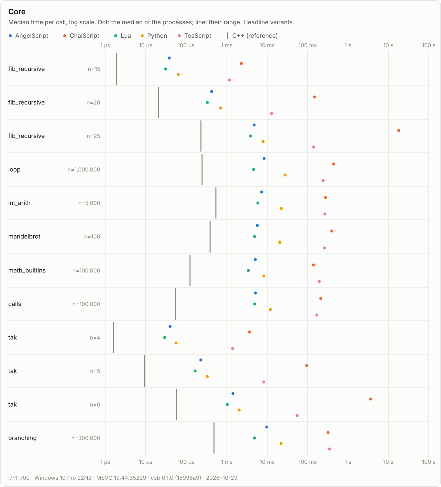
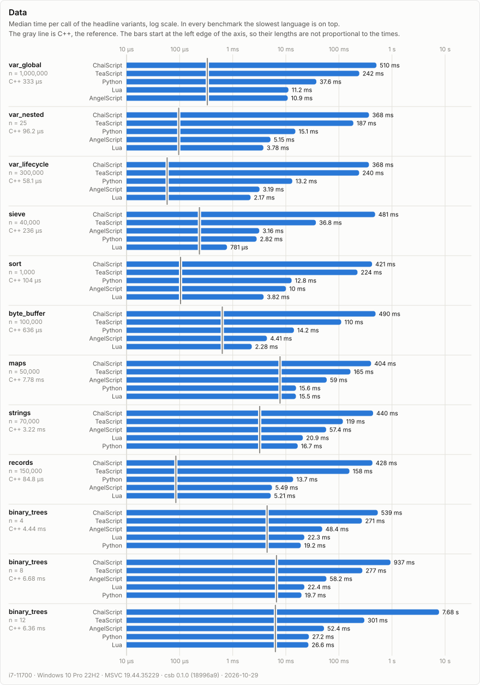
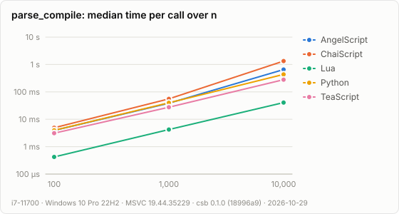
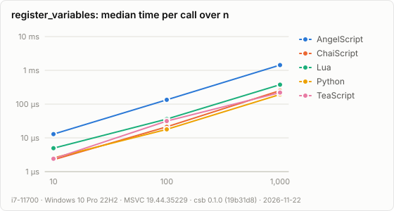
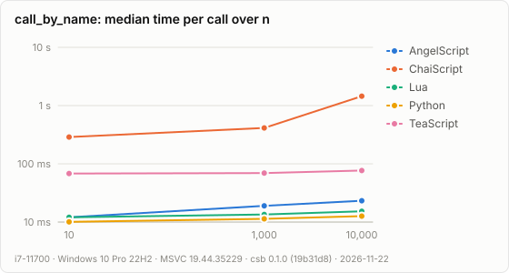
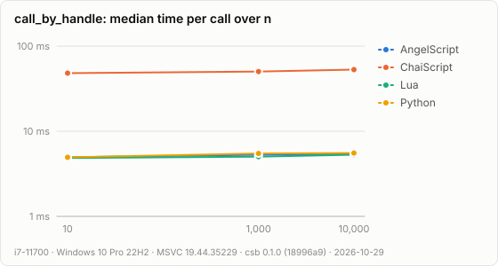

# Result set msvc19.44-i7-11700-windows10

> **Preview:** at least one language is at a pre-release version (TeaScript before 0.18.0). The set will be measured again for the release.

| | |
|---|---|
| CPU | 11th Gen Intel(R) Core(TM) i7-11700 @ 2.50GHz, 8 cores, 16 threads |
| Memory | 31.8 GiB |
| OS | Windows 10 Pro 22H2 (Windows 10.0.19045.7807) |
| Virtualization | Hyper-V is enabled: this OS runs in its root partition |
| Compiler | MSVC 19.44.35229, Release, `/DWIN32 /D_WINDOWS /EHsc /O2 /Ob2 /DNDEBUG /arch:AVX2` |
| cpp-script-bench | 0.1.0 (18996a9) |
| AngelScript | 2.38.0 (AS_64BIT_PTR AS_NO_THREADS AS_WIN AS_X64_MSVC) |
| ChaiScript | 7.0.0 (wasm-latest-36-gf635b51e); ChaiScript_Extras (v1.0.1-13-gdd116d7) |
| Lua | 5.5.1; LuaBridge3 (3.0-rc12) |
| Python | 3.14.5 (tags/v3.14.5:5607950, May 10 2026, 10:43:50) [MSC v.1944 64 bit (AMD64)]; pybind11 3.1.0 (v3.1.0) |
| TeaScript | 0.18.0 (v0.17.0-32-gbdd696c) |
| Measured | 2026-10-29 16:14 to 2026-10-29 17:47 UTC |
| Processes | 5 per run, interleaved across the languages; pinned to logical CPU 15, priority high; power: Balanced (381b4222-f694-41f0-9685-ff5bb260df2e) |
| Per process | 3 warm-up and 10 measured calls, time budget 30 s (at least 3 calls) |
| Machine load | other processes used 0.00 logical CPUs in the median, at most 0.31 (processes of at least 1 s) |
| Status | preview |

All numbers compare only within this set. **How to read:** each cell is the median time of one call of `bench( n )` (host API benchmarks: of one sample) over all processes: the median of the medians of the processes. Below it: the factor to C++, and the spread between the processes (slowest minus fastest process median, relative to the median); "budget": the time budget limited the number of calls. The headline variant of each language is shown; the other variants follow below. The rules are in [PLAN.md](../../PLAN.md#2-fairness-rules), the raw data in [results.json](results.json).

## Core

<picture>
  <source media="(prefers-color-scheme: dark)" srcset="charts/core-dark.svg">
  
</picture>

| Benchmark | n | C++ | AngelScript no-threads-no-line-cues | ChaiScript no-threads | Lua | Python | TeaScript vm-O1 |
|---|--:|--:|--:|--:|--:|--:|--:|
| [fib_recursive](../../benchmarks/fib_recursive/README.md) | 15 | **1.9 µs** 0.0% | **38.4 µs** 20.2× · 6.2% | **2.29 ms** 1,205× · 3.7% | **31.4 µs** 16.6× · 4.8% | **64.4 µs** 33.9× · 21.8% | **1.16 ms** 609× · 0.8% |
| [fib_recursive](../../benchmarks/fib_recursive/README.md) | 20 | **21.1 µs** 3.5% | **432 µs** 20.4× · 6.0% | **149 ms** 7,044× · 0.1% | **338 µs** 16× · 6.7% | **703 µs** 33.2× · 1.3% | **12.8 ms** 604× · 0.8% |
| [fib_recursive](../../benchmarks/fib_recursive/README.md) | 25 | **234 µs** 2.3% | **4.73 ms** 20.2× · 4.4% | **18.1 s** 77,185× · 0.1% · budget | **3.83 ms** 16.3× · 7.1% | **7.88 ms** 33.6× · 2.5% | **142 ms** 605× · 1.1% |
| [loop](../../benchmarks/loop/README.md) | 1,000,000 | **250 µs** 2.1% | **8.36 ms** 33.4× · 0.1% | **443 ms** 1,772× · 1.5% | **4.6 ms** 18.4× · 4.9% | **27.6 ms** 110× · 16.7% | **242 ms** 970× · 0.4% |
| [int_arith](../../benchmarks/int_arith/README.md) | 5,000 | **550 µs** 7.3% | **7.23 ms** 13.2× · 7.3% | **277 ms** 504× · 1.6% | **5.86 ms** 10.7× · 2.6% | **22.3 ms** 40.5× · 5.6% | **267 ms** 487× · 1.1% |
| [mandelbrot](../../benchmarks/mandelbrot/README.md) | 100 | **395 µs** 0.1% | **5.69 ms** 14.4× · 0.7% | **397 ms** 1,004× · 1.0% | **4.85 ms** 12.3× · 0.9% | **20.5 ms** 51.7× · 1.0% | **265 ms** 670× · 0.7% |
| [math_builtins](../../benchmarks/math_builtins/README.md) | 100,000 | **126 µs** 2.2% | **5.07 ms** 40.4× · 2.1% | **139 ms** 1,107× · 2.7% | **3.41 ms** 27.2× · 3.4% | **8.24 ms** 65.7× · 9.9% | **194 ms** 1,544× · 0.9% |
| [calls](../../benchmarks/calls/README.md) | 100,000 | **54.5 µs** 4.2% | **5.08 ms** 93.2× · 6.9% | **212 ms** 3,883× · 3.3% | **4.91 ms** 90× · 9.0% | **12 ms** 220× · 4.8% | **169 ms** 3,105× · 1.4% |
| [tak](../../benchmarks/tak/README.md) | 4 | **1.6 µs** 0.0% | **40.4 µs** 25.2× · 6.7% | **3.61 ms** 2,258× · 0.3% | **29.5 µs** 18.4× · 4.9% | **56.6 µs** 35.3× · 16.4% | **1.38 ms** 863× · 1.9% |
| [tak](../../benchmarks/tak/README.md) | 5 | **9.4 µs** 2.1% | **233 µs** 24.8× · 4.1% | **95 ms** 10,102× · 0.3% | **168 µs** 17.9× · 2.3% | **337 µs** 35.9× · 14.7% | **8.21 ms** 873× · 1.7% |
| [tak](../../benchmarks/tak/README.md) | 6 | **57.7 µs** 2.3% | **1.41 ms** 24.5× · 3.0% | **3.63 s** 62,961× · 0.0% · budget | **1.02 ms** 17.8× · 2.2% | **2.01 ms** 34.9× · 4.6% | **55 ms** 953× · 1.6% |
| [branching](../../benchmarks/branching/README.md) | 300,000 | **493 µs** 5.1% | **9.74 ms** 19.7× · 1.2% | **321 ms** 651× · 1.1% | **4.82 ms** 9.77× · 0.1% | **22 ms** 44.7× · 9.4% | **346 ms** 702× · 1.3% |

## Data

<picture>
  <source media="(prefers-color-scheme: dark)" srcset="charts/data-dark.svg">
  
</picture>

| Benchmark | n | C++ | AngelScript no-threads-no-line-cues | ChaiScript no-threads | Lua | Python | TeaScript vm-O1 |
|---|--:|--:|--:|--:|--:|--:|--:|
| [var_global](../../benchmarks/var_global/README.md) | 1,000,000 | **333 µs** 0.1% | **10.9 ms** 32.7× · 0.1% | **510 ms** 1,532× · 1.5% | **11.2 ms** 33.7× · 20.9% | **37.6 ms** 113× · 5.7% | **242 ms** 728× · 0.2% |
| [var_nested](../../benchmarks/var_nested/README.md) | 25 | **96.2 µs** 1.8% | **5.15 ms** 53.5× · 19.9% | **368 ms** 3,830× · 4.8% | **3.78 ms** 39.3× · 0.9% | **15.1 ms** 157× · 1.3% | **187 ms** 1,946× · 0.5% |
| [var_lifecycle](../../benchmarks/var_lifecycle/README.md) | 300,000 | **58.1 µs** 2.1% | **3.19 ms** 55× · 1.4% | **368 ms** 6,338× · 0.8% | **2.17 ms** 37.3× · 5.5% | **13.2 ms** 228× · 4.0% | **240 ms** 4,134× · 1.3% |
| [sieve](../../benchmarks/sieve/README.md) | 40,000 | **236 µs** 3.5% | **3.16 ms** 13.4× · 0.3% | **481 ms** 2,040× · 1.0% | **781 µs** 3.31× · 0.5% | **2.82 ms** 12× · 10.9% | **36.8 ms** 156× · 1.4% |
| [sort](../../benchmarks/sort/README.md) | 1,000 | **104 µs** 14.7% | **10 ms** 96.7× · 0.1% | **421 ms** 4,049× · 1.2% | **3.82 ms** 36.7× · 0.8% | **12.8 ms** 124× · 18.9% | **224 ms** 2,152× · 3.2% |
| [byte_buffer](../../benchmarks/byte_buffer/README.md) | 100,000 | **636 µs** 0.0% | **4.41 ms** 6.94× · 0.2% | **490 ms** 771× · 1.5% | **2.28 ms** 3.59× · 2.9% | **14.2 ms** 22.4× · 9.6% | **110 ms** 173× · 0.6% |
| [maps](../../benchmarks/maps/README.md) | 50,000 | **7.78 ms** 1.3% | **59 ms** 7.58× · 2.6% | **404 ms** 51.8× · 1.6% | **15.5 ms** 1.99× · 1.8% | **15.6 ms** 2× · 1.5% | **165 ms** 21.2× · 3.9% |
| [strings](../../benchmarks/strings/README.md) | 70,000 | **3.22 ms** 12.6% | **57.4 ms** 17.9× · 0.9% | **440 ms** 137× · 4.0% | **20.9 ms** 6.51× · 0.4% | **16.7 ms** 5.21× · 2.3% | **119 ms** 36.9× · 2.1% |
| [records](../../benchmarks/records/README.md) | 150,000 | **84.8 µs** 2.2% | **5.49 ms** 64.7× · 6.9% | **428 ms** 5,044× · 2.0% | **5.21 ms** 61.4× · 7.0% | **13.7 ms** 162× · 5.8% | **158 ms** 1,861× · 0.7% |
| [binary_trees](../../benchmarks/binary_trees/README.md) | 4 | **4.44 ms** 4.5% | **48.4 ms** 10.9× · 1.5% | **539 ms** 121× · 0.7% | **22.3 ms** 5.02× · 1.1% | **19.2 ms** 4.32× · 6.6% | **271 ms** 61.1× · 0.5% |
| [binary_trees](../../benchmarks/binary_trees/README.md) | 8 | **6.68 ms** 0.7% | **58.2 ms** 8.71× · 0.9% | **937 ms** 140× · 0.5% | **22.4 ms** 3.35× · 1.7% | **19.7 ms** 2.95× · 1.3% | **277 ms** 41.4× · 0.6% |
| [binary_trees](../../benchmarks/binary_trees/README.md) | 12 | **6.36 ms** 2.3% | **52.4 ms** 8.24× · 4.5% | **7.68 s** 1,208× · 0.2% · budget | **26.6 ms** 4.19× · 1.1% | **27.2 ms** 4.28× · 1.5% | **301 ms** 47.4× · 0.6% |

## Interop (script <-> C++)

<picture>
  <source media="(prefers-color-scheme: dark)" srcset="charts/interop-dark.svg">
  
</picture>

| Benchmark | n | C++ | AngelScript no-threads-no-line-cues | ChaiScript no-threads | Lua | Python | TeaScript vm-O1 |
|---|--:|--:|--:|--:|--:|--:|--:|
| [script_to_host](../../benchmarks/script_to_host/README.md) | 100,000 | **61.1 µs** 0.2% | **7.37 ms** 121× · 0.8% | **171 ms** 2,791× · 6.2% | **9.97 ms** 163× · 1.5% | **48.4 ms** 793× · 1.2% | **94.1 ms** 1,540× · 0.5% |
| [host_to_script](../../benchmarks/host_to_script/README.md) | 100,000 | **61.1 µs** 2.0% | **17.5 ms** 286× · 0.9% | **183 ms** 2,990× · 2.0% | **16.4 ms** 268× · 2.0% | **19.7 ms** 323× · 5.7% | **309 ms** 5,056× · 0.6% |
| [cpp_objects](../../benchmarks/cpp_objects/README.md) | 150,000 | **87.5 µs** 0.1% | **4.98 ms** 56.9× · 1.2% | **491 ms** 5,609× · 1.9% | **107 ms** 1,224× · 1.4% | **260 ms** 2,976× · 1.3% | n/a |
| [buffer](../../benchmarks/buffer/README.md) | 400 | **63.7 µs** 1.9% | **4.98 ms** 78.3× · 1.3% | **314 ms** 4,931× · 3.7% | **20.7 ms** 325× · 1.2% | **18.6 ms** 292× · 2.6% | **153 ms** 2,410× · 1.1% |
| [string_exchange](../../benchmarks/string_exchange/README.md) | 250,000 | **5.27 ms** 1.4% | **21.4 ms** 4.06× · 0.7% | **82.1 ms** 15.6× · 7.4% | **36.4 ms** 6.9× · 1.8% | **20.7 ms** 3.92× · 1.6% | **157 ms** 29.8× · 1.8% |
| [array_exchange](../../benchmarks/array_exchange/README.md) | 10 | **184 µs** 4.7% | **3.82 ms** 20.8× · 1.4% | **400 ms** 2,173× · 0.6% | **3.18 ms** 17.3× · 3.0% | **2.8 ms** 15.2× · 9.1% | **37.2 ms** 203× · 0.6% |
| [array_exchange](../../benchmarks/array_exchange/README.md) | 1,000 | **33.2 µs** 1.8% | **1.85 ms** 55.7× · 1.2% | **359 ms** 10,805× · 0.7% | **1.21 ms** 36.3× · 4.1% | **1.62 ms** 48.8× · 2.1% | **28.3 ms** 853× · 0.8% |
| [array_exchange](../../benchmarks/array_exchange/README.md) | 40,000 | **53.7 µs** 0.3% | **1.97 ms** 36.8× · 0.6% | **359 ms** 6,700× · 0.5% | **1.16 ms** 21.5× · 1.5% | **1.86 ms** 34.6× · 4.1% | **28.6 ms** 533× · 0.3% |

## Host API (C++ level)

<picture>
  <source media="(prefers-color-scheme: dark)" srcset="charts/host-dark.svg">
  
</picture>

| Benchmark | n | AngelScript no-threads-no-line-cues | ChaiScript no-threads | Lua | Python | TeaScript vm-O1 |
|---|--:|--:|--:|--:|--:|--:|
| [engine_lifecycle](../../benchmarks/engine_lifecycle/README.md) | 10 | **4.95 ms** 1.4% | **40.5 ms** 0.9% | **286 µs** 8.2% | **63 ms** 1.4% | **12.6 ms** 2.4% |
| [engine_minimal](../../benchmarks/engine_minimal/README.md) | 10 | **249 µs** 5.2% | **230 µs** 2.6% | **43.8 µs** 2.4% | n/a | **163 µs** 0.8% |
| [parse_compile](../../benchmarks/parse_compile/README.md) | 100 | **3.92 ms** 0.9% | **4.91 ms** 1.7% | **421 µs** 3.4% | **3.94 ms** 1.3% | **3.11 ms** 5.3% |
| [parse_compile](../../benchmarks/parse_compile/README.md) | 1,000 | **38.7 ms** 0.4% | **55.6 ms** 0.8% | **4.22 ms** 0.6% | **39.9 ms** 1.7% | **27.6 ms** 1.1% |
| [parse_compile](../../benchmarks/parse_compile/README.md) | 10,000 | **654 ms** 0.2% | **1.33 s** 0.5% | **40.6 ms** 0.7% | **435 ms** 0.9% | **279 ms** 0.7% |
| [register_functions](../../benchmarks/register_functions/README.md) | 10 | **20.9 µs** 1.2% | **48.5 µs** 1.5% | **2.95 µs** 6.8% | **36 µs** 4.7% | **3.25 µs** 21.5% |
| [register_functions](../../benchmarks/register_functions/README.md) | 100 | **183 µs** 2.5% | **529 µs** 1.9% | **20.2 µs** 7.2% | **256 µs** 1.8% | **41.8 µs** 5.9% |
| [register_functions](../../benchmarks/register_functions/README.md) | 1,000 | **2.65 ms** 1.6% | **12.9 ms** 4.7% | **227 µs** 2.2% | **2.37 ms** 1.9% | **299 µs** 4.3% |
| [register_variables](../../benchmarks/register_variables/README.md) | 10 | **12.8 µs** 3.9% | **2.3 µs** 6.5% | **4.95 µs** 4.0% | **2.6 µs** 13.5% | **2.3 µs** 26.1% |
| [register_variables](../../benchmarks/register_variables/README.md) | 100 | **134 µs** 1.0% | **21.3 µs** 3.1% | **36.2 µs** 2.6% | **18.3 µs** 6.0% | **31.5 µs** 6.8% |
| [register_variables](../../benchmarks/register_variables/README.md) | 1,000 | **1.43 ms** 2.8% | **255 µs** 2.1% | **381 µs** 5.8% | **194 µs** 6.5% | **221 µs** 5.8% |
| [call_by_name](../../benchmarks/call_by_name/README.md) | 10 | **12.1 ms** 0.8% | **285 ms** 1.9% | **11.8 ms** 6.3% | **10.3 ms** 12.5% | **68.3 ms** 1.4% |
| [call_by_name](../../benchmarks/call_by_name/README.md) | 1,000 | **19 ms** 0.3% | **412 ms** 0.7% | **13.4 ms** 2.1% | **11.6 ms** 2.2% | **69.3 ms** 1.2% |
| [call_by_name](../../benchmarks/call_by_name/README.md) | 10,000 | **23.2 ms** 0.4% | **1.45 s** 0.7% | **15.2 ms** 4.0% | **12.9 ms** 3.4% | **77 ms** 1.7% |
| [call_by_handle](../../benchmarks/call_by_handle/README.md) | 10 | **4.94 ms** 1.2% | **48.1 ms** 2.7% | **4.85 ms** 1.9% | **4.93 ms** 1.2% | n/a |
| [call_by_handle](../../benchmarks/call_by_handle/README.md) | 1,000 | **5.3 ms** 3.0% | **50.2 ms** 3.3% | **5.02 ms** 2.1% | **5.48 ms** 4.1% | n/a |
| [call_by_handle](../../benchmarks/call_by_handle/README.md) | 10,000 | **5.38 ms** 4.6% | **53 ms** 3.5% | **5.3 ms** 2.2% | **5.54 ms** 2.7% | n/a |
| [engine_reset](../../benchmarks/engine_reset/README.md) | 100 | **66.1 µs** 2.1% | **82.6 µs** 0.8% | **7.5 µs** 6.0% | **65.4 µs** 7.6% | **1.26 ms** 2.5% |

## Series

Benchmarks with a series of workload sizes, over n (log-log).

<picture>
  <source media="(prefers-color-scheme: dark)" srcset="charts/series-fib_recursive-dark.svg">
  
</picture>

<picture>
  <source media="(prefers-color-scheme: dark)" srcset="charts/series-tak-dark.svg">
  
</picture>

<picture>
  <source media="(prefers-color-scheme: dark)" srcset="charts/series-binary_trees-dark.svg">
  
</picture>

<picture>
  <source media="(prefers-color-scheme: dark)" srcset="charts/series-array_exchange-dark.svg">
  
</picture>

<picture>
  <source media="(prefers-color-scheme: dark)" srcset="charts/series-parse_compile-dark.svg">
  
</picture>

<picture>
  <source media="(prefers-color-scheme: dark)" srcset="charts/series-register_functions-dark.svg">
  
</picture>

<picture>
  <source media="(prefers-color-scheme: dark)" srcset="charts/series-register_variables-dark.svg">
  
</picture>

<picture>
  <source media="(prefers-color-scheme: dark)" srcset="charts/series-call_by_name-dark.svg">
  
</picture>

<picture>
  <source media="(prefers-color-scheme: dark)" srcset="charts/series-call_by_handle-dark.svg">
  
</picture>

## Variants

All variants of each language; the factor is relative to its headline variant.

### AngelScript

| Benchmark | n | no-threads-no-line-cues (headline) | default | no-line-cues | no-threads |
|---|--:|--:|--:|--:|--:|
| fib_recursive | 15 | **38.4 µs** 6.2% | **41.1 µs** 1.07× · 4.0% | **36.2 µs** 0.943× · 6.4% | **43.4 µs** 1.13× · 4.1% |
| fib_recursive | 20 | **432 µs** 6.0% | **441 µs** 1.02× · 0.2% | **386 µs** 0.893× · 5.4% | **483 µs** 1.12× · 3.8% |
| fib_recursive | 25 | **4.73 ms** 4.4% | **5.04 ms** 1.07× · 3.7% | **4.27 ms** 0.904× · 2.2% | **5.44 ms** 1.15× · 8.2% |
| loop | 1,000,000 | **8.36 ms** 0.1% | **10.9 ms** 1.3× · 0.1% | **7.52 ms** 0.9× · 0.0% | **12.1 ms** 1.45× · 0.0% |
| int_arith | 5,000 | **7.23 ms** 7.3% | **7.59 ms** 1.05× · 1.5% | **6.38 ms** 0.882× · 0.5% | **8.76 ms** 1.21× · 0.3% |
| mandelbrot | 100 | **5.69 ms** 0.7% | **5.97 ms** 1.05× · 2.5% | **5.09 ms** 0.895× · 1.1% | **6.63 ms** 1.16× · 0.8% |
| math_builtins | 100,000 | **5.07 ms** 2.1% | **5.07 ms** 1× · 2.2% | **4.78 ms** 0.944× · 21.7% | **5.45 ms** 1.08× · 1.9% |
| calls | 100,000 | **5.08 ms** 6.9% | **5.35 ms** 1.05× · 15.6% | **4.63 ms** 0.912× · 3.4% | **5.79 ms** 1.14× · 3.8% |
| tak | 4 | **40.4 µs** 6.7% | **41.4 µs** 1.03× · 5.0% | **37.5 µs** 0.929× · 5.6% | **43.9 µs** 1.09× · 2.4% |
| tak | 5 | **233 µs** 4.1% | **244 µs** 1.05× · 0.6% | **219 µs** 0.94× · 2.3% | **258 µs** 1.11× · 3.3% |
| tak | 6 | **1.41 ms** 3.0% | **1.5 ms** 1.06× · 3.3% | **1.35 ms** 0.953× · 1.5% | **1.58 ms** 1.12× · 1.2% |
| branching | 300,000 | **9.74 ms** 1.2% | **11.3 ms** 1.16× · 0.7% | **8.33 ms** 0.855× · 0.4% | **12.7 ms** 1.3× · 1.0% |
| var_global | 1,000,000 | **10.9 ms** 0.1% | **13.4 ms** 1.23× · 0.1% | **10 ms** 0.923× · 0.1% | **14.6 ms** 1.35× · 0.1% |
| var_nested | 25 | **5.15 ms** 19.9% | **6.07 ms** 1.18× · 4.1% | **4.58 ms** 0.89× · 3.7% | **6.68 ms** 1.3× · 0.0% |
| var_lifecycle | 300,000 | **3.19 ms** 1.4% | **5.07 ms** 1.59× · 0.0% | **2.95 ms** 0.922× · 0.9% | **5.45 ms** 1.71× · 0.1% |
| sieve | 40,000 | **3.16 ms** 0.3% | **3.46 ms** 1.1× · 0.6% | **2.93 ms** 0.927× · 0.5% | **3.73 ms** 1.18× · 0.8% |
| sort | 1,000 | **10 ms** 0.1% | **9 ms** 0.896× · 1.7% | **8.49 ms** 0.846× · 0.2% | **10.7 ms** 1.07× · 0.6% |
| byte_buffer | 100,000 | **4.41 ms** 0.2% | **4.76 ms** 1.08× · 0.1% | **3.83 ms** 0.867× · 0.5% | **5.42 ms** 1.23× · 0.1% |
| maps | 50,000 | **59 ms** 2.6% | **57.9 ms** 0.98× · 0.9% | **56.9 ms** 0.964× · 1.1% | **60.2 ms** 1.02× · 1.0% |
| strings | 70,000 | **57.4 ms** 0.9% | **55.8 ms** 0.971× · 9.8% | **55.3 ms** 0.963× · 1.0% | **57.8 ms** 1.01× · 1.0% |
| records | 150,000 | **5.49 ms** 6.9% | **5.45 ms** 0.994× · 0.0% | **4.64 ms** 0.845× · 0.1% | **6.42 ms** 1.17× · 0.0% |
| binary_trees | 4 | **48.4 ms** 1.5% | **57.5 ms** 1.19× · 1.0% | **56.7 ms** 1.17× · 0.8% | **48.9 ms** 1.01× · 1.0% |
| binary_trees | 8 | **58.2 ms** 0.9% | **69.2 ms** 1.19× · 2.1% | **68 ms** 1.17× · 2.3% | **58.9 ms** 1.01× · 1.0% |
| binary_trees | 12 | **52.4 ms** 4.5% | **63.8 ms** 1.22× · 4.8% | **62.7 ms** 1.2× · 1.8% | **53.5 ms** 1.02× · 1.7% |
| script_to_host | 100,000 | **7.37 ms** 0.8% | **7.18 ms** 0.975× · 1.0% | **6.87 ms** 0.933× · 1.1% | **7.78 ms** 1.06× · 1.4% |
| host_to_script | 100,000 | **17.5 ms** 0.9% | **19 ms** 1.09× · 0.7% | **18.5 ms** 1.06× · 1.4% | **17.8 ms** 1.02× · 1.1% |
| cpp_objects | 150,000 | **4.98 ms** 1.2% | **5.29 ms** 1.06× · 0.0% | **4.42 ms** 0.887× · 0.0% | **5.92 ms** 1.19× · 25.9% |
| buffer | 400 | **4.98 ms** 1.3% | **5.05 ms** 1.01× · 0.0% | **4.51 ms** 0.906× · 0.0% | **5.59 ms** 1.12× · 1.1% |
| string_exchange | 250,000 | **21.4 ms** 0.7% | **21.2 ms** 0.993× · 1.1% | **20.9 ms** 0.978× · 0.5% | **21.7 ms** 1.01× · 0.7% |
| array_exchange | 10 | **3.82 ms** 1.4% | **3.87 ms** 1.01× · 2.1% | **3.73 ms** 0.978× · 3.5% | **3.99 ms** 1.05× · 1.6% |
| array_exchange | 1,000 | **1.85 ms** 1.2% | **1.84 ms** 0.995× · 0.3% | **1.71 ms** 0.925× · 0.8% | **1.99 ms** 1.08× · 0.6% |
| array_exchange | 40,000 | **1.97 ms** 0.6% | **1.99 ms** 1.01× · 2.7% | **1.87 ms** 0.946× · 2.3% | **2.13 ms** 1.08× · 1.4% |
| engine_lifecycle | 10 | **4.95 ms** 1.4% | **5.56 ms** 1.12× · 0.8% | **5.55 ms** 1.12× · 1.3% | **4.99 ms** 1.01× · 1.3% |
| engine_minimal | 10 | **249 µs** 5.2% | **301 µs** 1.21× · 2.9% | **301 µs** 1.21× · 3.8% | **245 µs** 0.987× · 1.5% |
| parse_compile | 100 | **3.92 ms** 0.9% | **4.12 ms** 1.05× · 1.6% | **4.09 ms** 1.04× · 0.9% | **3.94 ms** 1× · 0.7% |
| parse_compile | 1,000 | **38.7 ms** 0.4% | **40.4 ms** 1.05× · 0.4% | **40.3 ms** 1.04× · 0.6% | **38.8 ms** 1× · 0.3% |
| parse_compile | 10,000 | **654 ms** 0.2% | **673 ms** 1.03× · 0.8% | **671 ms** 1.03× · 0.3% | **656 ms** 1× · 0.7% |
| register_functions | 10 | **20.9 µs** 1.2% | **23.6 µs** 1.13× · 5.7% | **25.2 µs** 1.21× · 9.3% | **20.4 µs** 0.976× · 4.4% |
| register_functions | 100 | **183 µs** 2.5% | **201 µs** 1.1× · 2.8% | **198 µs** 1.08× · 3.9% | **187 µs** 1.02× · 3.0% |
| register_functions | 1,000 | **2.65 ms** 1.6% | **2.81 ms** 1.06× · 1.5% | **2.82 ms** 1.07× · 1.6% | **2.65 ms** 1× · 1.2% |
| register_variables | 10 | **12.8 µs** 3.9% | **15.2 µs** 1.19× · 1.3% | **14.5 µs** 1.13× · 4.5% | **13.4 µs** 1.05× · 7.1% |
| register_variables | 100 | **134 µs** 1.0% | **137 µs** 1.03× · 1.8% | **136 µs** 1.02× · 1.2% | **134 µs** 0.998× · 1.5% |
| register_variables | 1,000 | **1.43 ms** 2.8% | **1.47 ms** 1.03× · 1.2% | **1.47 ms** 1.03× · 1.5% | **1.43 ms** 0.999× · 0.9% |
| call_by_name | 10 | **12.1 ms** 0.8% | **12.3 ms** 1.02× · 1.1% | **12.2 ms** 1.01× · 0.6% | **12.1 ms** 1.01× · 0.6% |
| call_by_name | 1,000 | **19 ms** 0.3% | **18.9 ms** 0.995× · 0.2% | **18.7 ms** 0.987× · 0.6% | **19.1 ms** 1.01× · 1.0% |
| call_by_name | 10,000 | **23.2 ms** 0.4% | **22.9 ms** 0.99× · 0.8% | **22.8 ms** 0.983× · 0.9% | **23.3 ms** 1.01× · 0.7% |
| call_by_handle | 10 | **4.94 ms** 1.2% | **5.59 ms** 1.13× · 1.3% | **5.51 ms** 1.11× · 1.4% | **5.07 ms** 1.03× · 1.3% |
| call_by_handle | 1,000 | **5.3 ms** 3.0% | **5.84 ms** 1.1× · 2.2% | **5.69 ms** 1.07× · 0.8% | **5.38 ms** 1.01× · 2.3% |
| call_by_handle | 10,000 | **5.38 ms** 4.6% | **5.85 ms** 1.09× · 1.4% | **5.79 ms** 1.08× · 2.3% | **5.49 ms** 1.02× · 2.4% |
| engine_reset | 100 | **66.1 µs** 2.1% | **80.4 µs** 1.21× · 1.0% | **80.4 µs** 1.21× · 5.4% | **66 µs** 0.998× · 5.9% |

### ChaiScript

| Benchmark | n | no-threads (headline) | default |
|---|--:|--:|--:|
| fib_recursive | 15 | **2.29 ms** 3.7% | **2.38 ms** 1.04× · 0.5% |
| fib_recursive | 20 | **149 ms** 0.1% | **150 ms** 1.01× · 0.2% |
| fib_recursive | 25 | **18.1 s** 0.1% · budget | **18.1 s** 1× · 0.1% · budget |
| loop | 1,000,000 | **443 ms** 1.5% | **467 ms** 1.05× · 1.4% |
| int_arith | 5,000 | **277 ms** 1.6% | **297 ms** 1.07× · 1.6% |
| mandelbrot | 100 | **397 ms** 1.0% | **423 ms** 1.07× · 1.1% |
| math_builtins | 100,000 | **139 ms** 2.7% | **134 ms** 0.963× · 1.3% |
| calls | 100,000 | **212 ms** 3.3% | **238 ms** 1.13× · 2.6% |
| tak | 4 | **3.61 ms** 0.3% | **3.7 ms** 1.02× · 0.6% |
| tak | 5 | **95 ms** 0.3% | **95.1 ms** 1× · 0.6% |
| tak | 6 | **3.63 s** 0.0% · budget | **3.62 s** 0.997× · 0.1% · budget |
| branching | 300,000 | **321 ms** 1.1% | **354 ms** 1.1× · 2.6% |
| var_global | 1,000,000 | **510 ms** 1.5% | **540 ms** 1.06× · 1.2% |
| var_nested | 25 | **368 ms** 4.8% | **376 ms** 1.02× · 1.1% |
| var_lifecycle | 300,000 | **368 ms** 0.8% | **385 ms** 1.05× · 4.2% |
| sieve | 40,000 | **481 ms** 1.0% | **516 ms** 1.07× · 0.7% |
| sort | 1,000 | **421 ms** 1.2% | **450 ms** 1.07× · 1.3% |
| byte_buffer | 100,000 | **490 ms** 1.5% | **515 ms** 1.05× · 0.5% |
| maps | 50,000 | **404 ms** 1.6% | **425 ms** 1.05× · 0.9% |
| strings | 70,000 | **440 ms** 4.0% | **459 ms** 1.04× · 3.1% |
| records | 150,000 | **428 ms** 2.0% | **467 ms** 1.09× · 2.0% |
| binary_trees | 4 | **539 ms** 0.7% | **560 ms** 1.04× · 0.4% |
| binary_trees | 8 | **937 ms** 0.5% | **990 ms** 1.06× · 0.4% |
| binary_trees | 12 | **7.68 s** 0.2% · budget | **7.71 s** 1× · 0.2% · budget |
| script_to_host | 100,000 | **171 ms** 6.2% | **167 ms** 0.977× · 3.6% |
| host_to_script | 100,000 | **183 ms** 2.0% | **189 ms** 1.03× · 1.6% |
| cpp_objects | 150,000 | **491 ms** 1.9% | **507 ms** 1.03× · 3.1% |
| buffer | 400 | **314 ms** 3.7% | **321 ms** 1.02× · 5.8% |
| string_exchange | 250,000 | **82.1 ms** 7.4% | **84.3 ms** 1.03× · 2.4% |
| array_exchange | 10 | **400 ms** 0.6% | **413 ms** 1.03× · 1.1% |
| array_exchange | 1,000 | **359 ms** 0.7% | **369 ms** 1.03× · 1.1% |
| array_exchange | 40,000 | **359 ms** 0.5% | **369 ms** 1.03× · 0.8% |
| engine_lifecycle | 10 | **40.5 ms** 0.9% | **41 ms** 1.01× · 0.9% |
| engine_minimal | 10 | **230 µs** 2.6% | **242 µs** 1.05× · 2.2% |
| parse_compile | 100 | **4.91 ms** 1.7% | **4.94 ms** 1.01× · 1.2% |
| parse_compile | 1,000 | **55.6 ms** 0.8% | **56.2 ms** 1.01× · 0.5% |
| parse_compile | 10,000 | **1.33 s** 0.5% | **1.36 s** 1.02× · 0.2% |
| register_functions | 10 | **48.5 µs** 1.5% | **51.8 µs** 1.07× · 11.0% |
| register_functions | 100 | **529 µs** 1.9% | **539 µs** 1.02× · 4.5% |
| register_functions | 1,000 | **12.9 ms** 4.7% | **13.2 ms** 1.03× · 0.3% |
| register_variables | 10 | **2.3 µs** 6.5% | **2.4 µs** 1.04× · 0.0% |
| register_variables | 100 | **21.3 µs** 3.1% | **21.9 µs** 1.03× · 3.0% |
| register_variables | 1,000 | **255 µs** 2.1% | **275 µs** 1.08× · 3.8% |
| call_by_name | 10 | **285 ms** 1.9% | **305 ms** 1.07× · 0.7% |
| call_by_name | 1,000 | **412 ms** 0.7% | **435 ms** 1.06× · 0.3% |
| call_by_name | 10,000 | **1.45 s** 0.7% | **1.55 s** 1.07× · 0.3% |
| call_by_handle | 10 | **48.1 ms** 2.7% | **50.9 ms** 1.06× · 1.3% |
| call_by_handle | 1,000 | **50.2 ms** 3.3% | **53.3 ms** 1.06× · 2.9% |
| call_by_handle | 10,000 | **53 ms** 3.5% | **55.6 ms** 1.05× · 3.1% |
| engine_reset | 100 | **82.6 µs** 0.8% | **84.2 µs** 1.02× · 1.2% |

### Lua

| Benchmark | n | (no name) (headline) | c-api |
|---|--:|--:|--:|
| script_to_host | 100,000 | **9.97 ms** 1.5% | **4.96 ms** 0.498× · 1.6% |
| host_to_script | 100,000 | **16.4 ms** 2.0% | **10.3 ms** 0.63× · 3.6% |
| cpp_objects | 150,000 | **107 ms** 1.4% | **64.6 ms** 0.603× · 8.0% |
| buffer | 400 | **20.7 ms** 1.2% | **9.79 ms** 0.473× · 3.1% |
| string_exchange | 250,000 | **36.4 ms** 1.8% | **30.7 ms** 0.845× · 2.8% |
| array_exchange | 10 | **3.18 ms** 3.0% | **2.56 ms** 0.806× · 2.3% |
| array_exchange | 1,000 | **1.21 ms** 4.1% | **947 µs** 0.786× · 3.5% |
| array_exchange | 40,000 | **1.16 ms** 1.5% | **824 µs** 0.713× · 3.2% |
| register_functions | 10 | **2.95 µs** 6.8% | **800 ns** 0.271× · 0.0% |
| register_functions | 100 | **20.2 µs** 7.2% | **8.95 µs** 0.443× · 3.4% |
| register_functions | 1,000 | **227 µs** 2.2% | **103 µs** 0.452× · 4.2% |
| register_variables | 10 | **4.95 µs** 4.0% | **800 ns** 0.162× · 6.2% |
| register_variables | 100 | **36.2 µs** 2.6% | **8.6 µs** 0.238× · 4.1% |
| register_variables | 1,000 | **381 µs** 5.8% | **104 µs** 0.272× · 17.3% |
| call_by_name | 10 | **11.8 ms** 6.3% | **3.64 ms** 0.307× · 9.3% |
| call_by_name | 1,000 | **13.4 ms** 2.1% | **5.56 ms** 0.415× · 2.2% |
| call_by_name | 10,000 | **15.2 ms** 4.0% | **8.03 ms** 0.529× · 2.0% |
| call_by_handle | 10 | **4.85 ms** 1.9% | **2.88 ms** 0.594× · 4.8% |
| call_by_handle | 1,000 | **5.02 ms** 2.1% | **3.09 ms** 0.615× · 3.5% |
| call_by_handle | 10,000 | **5.3 ms** 2.2% | **3.8 ms** 0.717× · 2.6% |

### Python

| Benchmark | n | (no name) (headline) | c-api |
|---|--:|--:|--:|
| script_to_host | 100,000 | **48.4 ms** 1.2% | **8.41 ms** 0.174× · 2.0% |
| host_to_script | 100,000 | **19.7 ms** 5.7% | **15.6 ms** 0.79× · 1.8% |
| cpp_objects | 150,000 | **260 ms** 1.3% | **31.5 ms** 0.121× · 2.7% |
| buffer | 400 | **18.6 ms** 2.6% | **18.5 ms** 0.997× · 5.4% |
| string_exchange | 250,000 | **20.7 ms** 1.6% | **17 ms** 0.822× · 8.0% |
| array_exchange | 10 | **2.8 ms** 9.1% | **2.1 ms** 0.752× · 0.8% |
| array_exchange | 1,000 | **1.62 ms** 2.1% | **1.35 ms** 0.832× · 3.8% |
| array_exchange | 40,000 | **1.86 ms** 4.1% | **1.54 ms** 0.828× · 8.3% |
| register_functions | 10 | **36 µs** 4.7% | **2.5 µs** 0.0694× · 8.0% |
| register_functions | 100 | **256 µs** 1.8% | **21.8 µs** 0.0851× · 3.2% |
| register_functions | 1,000 | **2.37 ms** 1.9% | **227 µs** 0.0957× · 3.9% |
| register_variables | 10 | **2.6 µs** 13.5% | **1.5 µs** 0.577× · 10.0% |
| register_variables | 100 | **18.3 µs** 6.0% | **12.9 µs** 0.703× · 1.6% |
| register_variables | 1,000 | **194 µs** 6.5% | **155 µs** 0.797× · 4.1% |
| call_by_name | 10 | **10.3 ms** 12.5% | **9.12 ms** 0.887× · 11.2% |
| call_by_name | 1,000 | **11.6 ms** 2.2% | **10.4 ms** 0.903× · 4.5% |
| call_by_name | 10,000 | **12.9 ms** 3.4% | **11.9 ms** 0.925× · 9.2% |
| call_by_handle | 10 | **4.93 ms** 1.2% | **4.02 ms** 0.815× · 0.9% |
| call_by_handle | 1,000 | **5.48 ms** 4.1% | **4.73 ms** 0.863× · 15.9% |
| call_by_handle | 10,000 | **5.54 ms** 2.7% | **4.89 ms** 0.882× · 10.9% |

### TeaScript

| Benchmark | n | vm-O1 (headline) | ast | vm-O0 | vm-O2 |
|---|--:|--:|--:|--:|--:|
| fib_recursive | 15 | **1.16 ms** 0.8% | **1.08 ms** 0.934× · 1.1% | **1.16 ms** 1× · 0.9% | **1.09 ms** 0.945× · 0.6% |
| fib_recursive | 20 | **12.8 ms** 0.8% | **12 ms** 0.941× · 1.1% | **12.8 ms** 1.01× · 2.5% | **12.1 ms** 0.947× · 0.8% |
| fib_recursive | 25 | **142 ms** 1.1% | **137 ms** 0.969× · 0.2% | **142 ms** 1× · 1.3% | **134 ms** 0.948× · 1.3% |
| loop | 1,000,000 | **242 ms** 0.4% | **147 ms** 0.607× · 0.3% | **242 ms** 1× · 0.6% | **229 ms** 0.945× · 0.8% |
| int_arith | 5,000 | **267 ms** 1.1% | **192 ms** 0.716× · 4.2% | **267 ms** 1× · 0.5% | **258 ms** 0.966× · 0.4% |
| mandelbrot | 100 | **265 ms** 0.7% | **221 ms** 0.833× · 0.9% | **265 ms** 1× · 0.3% | **263 ms** 0.993× · 0.9% |
| math_builtins | 100,000 | **194 ms** 0.9% | **178 ms** 0.917× · 0.8% | **193 ms** 0.998× · 0.7% | **188 ms** 0.972× · 0.8% |
| calls | 100,000 | **169 ms** 1.4% | **139 ms** 0.823× · 0.7% | **169 ms** 1× · 3.3% | **162 ms** 0.957× · 1.7% |
| tak | 4 | **1.38 ms** 1.9% | **1.42 ms** 1.03× · 1.8% | **1.38 ms** 1× · 4.7% | **1.31 ms** 0.946× · 1.8% |
| tak | 5 | **8.21 ms** 1.7% | **7.08 ms** 0.863× · 3.1% | **8.18 ms** 0.997× · 0.7% | **7.88 ms** 0.96× · 2.4% |
| tak | 6 | **55 ms** 1.6% | **43 ms** 0.782× · 1.9% | **55.8 ms** 1.02× · 3.4% | **52.7 ms** 0.959× · 3.7% |
| branching | 300,000 | **346 ms** 1.3% | **224 ms** 0.647× · 1.7% | **345 ms** 0.997× · 0.6% | **325 ms** 0.939× · 0.3% |
| var_global | 1,000,000 | **242 ms** 0.2% | **147 ms** 0.608× · 1.6% | **242 ms** 0.999× · 0.4% | **229 ms** 0.944× · 0.4% |
| var_nested | 25 | **187 ms** 0.5% | **112 ms** 0.598× · 0.3% | **187 ms** 1× · 1.6% | **182 ms** 0.971× · 1.4% |
| var_lifecycle | 300,000 | **240 ms** 1.3% | **147 ms** 0.613× · 0.6% | **243 ms** 1.01× · 2.5% | **241 ms** 1× · 3.3% |
| sieve | 40,000 | **36.8 ms** 1.4% | **45 ms** 1.22× · 0.7% | **36.9 ms** 1× · 1.1% | **34.3 ms** 0.932× · 1.9% |
| sort | 1,000 | **224 ms** 3.2% | **232 ms** 1.04× · 0.9% | **227 ms** 1.01× · 3.6% | **224 ms** 1× · 1.9% |
| byte_buffer | 100,000 | **110 ms** 0.6% | **98.8 ms** 0.895× · 0.6% | **110 ms** 1× · 0.9% | **107 ms** 0.97× · 0.4% |
| maps | 50,000 | **165 ms** 3.9% | **180 ms** 1.09× · 0.4% | **165 ms** 0.999× · 0.3% | **160 ms** 0.972× · 1.0% |
| strings | 70,000 | **119 ms** 2.1% | **89.9 ms** 0.757× · 1.2% | **120 ms** 1.01× · 2.2% | **117 ms** 0.985× · 2.9% |
| records | 150,000 | **158 ms** 0.7% | **107 ms** 0.675× · 2.9% | **158 ms** 0.999× · 0.6% | **155 ms** 0.982× · 0.5% |
| binary_trees | 4 | **271 ms** 0.5% | **262 ms** 0.965× · 1.1% | **272 ms** 1× · 1.0% | **265 ms** 0.975× · 1.0% |
| binary_trees | 8 | **277 ms** 0.6% | **262 ms** 0.946× · 0.7% | **276 ms** 0.997× · 0.9% | **268 ms** 0.968× · 0.5% |
| binary_trees | 12 | **301 ms** 0.6% | **286 ms** 0.95× · 0.1% | **301 ms** 0.998× · 0.6% | **294 ms** 0.976× · 0.2% |
| script_to_host | 100,000 | **94.1 ms** 0.5% | **81.8 ms** 0.87× · 1.0% | **94 ms** 0.999× · 0.7% | **92.9 ms** 0.988× · 1.6% |
| host_to_script | 100,000 | **309 ms** 0.6% | **270 ms** 0.874× · 0.4% | **311 ms** 1.01× · 0.6% | **305 ms** 0.988× · 0.5% |
| buffer | 400 | **153 ms** 1.1% | **114 ms** 0.742× · 2.3% | **153 ms** 1× · 1.1% | **151 ms** 0.986× · 0.8% |
| string_exchange | 250,000 | **157 ms** 1.8% | **73.6 ms** 0.469× · 1.5% | **157 ms** 1× · 0.9% | **152 ms** 0.972× · 1.6% |
| array_exchange | 10 | **37.2 ms** 0.6% | **35.9 ms** 0.965× · 1.6% | **37.1 ms** 0.996× · 1.1% | **36.5 ms** 0.979× · 1.3% |
| array_exchange | 1,000 | **28.3 ms** 0.8% | **29.9 ms** 1.06× · 1.6% | **28.6 ms** 1.01× · 0.9% | **27.3 ms** 0.963× · 2.0% |
| array_exchange | 40,000 | **28.6 ms** 0.3% | **30.7 ms** 1.07× · 0.5% | **28.7 ms** 1× · 0.4% | **27.9 ms** 0.975× · 1.5% |
| engine_lifecycle | 10 | **12.6 ms** 2.4% | **8.27 ms** 0.655× · 1.3% | **14 ms** 1.11× · 2.1% | **11.9 ms** 0.942× · 1.5% |
| engine_minimal | 10 | **163 µs** 0.8% | **157 µs** 0.96× · 7.3% | **157 µs** 0.964× · 4.3% | **157 µs** 0.961× · 3.2% |
| parse_compile | 100 | **3.11 ms** 5.3% | **1.78 ms** 0.572× · 1.4% | **3.48 ms** 1.12× · 3.0% | **2.86 ms** 0.921× · 1.4% |
| parse_compile | 1,000 | **27.6 ms** 1.1% | **17.3 ms** 0.626× · 0.7% | **31 ms** 1.12× · 0.6% | **27.7 ms** 1.01× · 0.6% |
| parse_compile | 10,000 | **279 ms** 0.7% | **171 ms** 0.613× · 0.5% | **320 ms** 1.14× · 1.2% | **280 ms** 1× · 0.6% |
| register_functions | 10 | **3.25 µs** 21.5% | **3.05 µs** 0.938× · 41.0% | **4.2 µs** 1.29× · 8.3% | **3.3 µs** 1.02× · 6.1% |
| register_functions | 100 | **41.8 µs** 5.9% | **42.5 µs** 1.02× · 2.9% | **39.9 µs** 0.955× · 4.5% | **42.1 µs** 1.01× · 3.9% |
| register_functions | 1,000 | **299 µs** 4.3% | **311 µs** 1.04× · 6.2% | **298 µs** 0.999× · 3.4% | **294 µs** 0.984× · 4.6% |
| register_variables | 10 | **2.3 µs** 26.1% | **2.4 µs** 1.04× · 8.3% | **3.4 µs** 1.48× · 7.4% | **2.55 µs** 1.11× · 3.9% |
| register_variables | 100 | **31.5 µs** 6.8% | **31.4 µs** 0.995× · 3.8% | **30.3 µs** 0.962× · 5.8% | **31.3 µs** 0.992× · 3.8% |
| register_variables | 1,000 | **221 µs** 5.8% | **229 µs** 1.04× · 3.7% | **221 µs** 1× · 3.7% | **220 µs** 0.996× · 2.3% |
| call_by_name | 10 | **68.3 ms** 1.4% | **32.2 ms** 0.472× · 1.1% | **68.2 ms** 0.999× · 1.9% | **66.7 ms** 0.978× · 1.0% |
| call_by_name | 1,000 | **69.3 ms** 1.2% | **35.9 ms** 0.518× · 0.6% | **69.5 ms** 1× · 3.3% | **67.9 ms** 0.98× · 2.6% |
| call_by_name | 10,000 | **77 ms** 1.7% | **49.6 ms** 0.644× · 1.4% | **76.3 ms** 0.991× · 1.2% | **74.6 ms** 0.969× · 0.9% |
| engine_reset | 100 | **1.26 ms** 2.5% | **791 µs** 0.627× · 1.5% | **1.37 ms** 1.08× · 6.0% | **1.18 ms** 0.937× · 2.8% |

## Peak memory

The peak memory of each process, the median over the processes of a run: the peak working set on Windows, the peak resident set on Linux. It covers the whole process: the runtime and libraries of the language, the unmeasured warm-up engine, the engine of the run and its workload. Below it: the difference to the process of the C++ runner for the same benchmark and n, which is the harness alone where C++ is "n/a" (the host API benchmarks). Headline variants.

### Core

| Benchmark | n | C++ | AngelScript no-threads-no-line-cues | ChaiScript no-threads | Lua | Python | TeaScript vm-O1 |
|---|--:|--:|--:|--:|--:|--:|--:|
| fib_recursive | 15 | 4.2 MiB | **5.1 MiB** +0.9 MiB | **6.4 MiB** +2.2 MiB | **4.5 MiB** +0.3 MiB | **9.9 MiB** +5.7 MiB | **5.9 MiB** +1.7 MiB |
| fib_recursive | 20 | 4.2 MiB | **5.1 MiB** +0.9 MiB | **10.5 MiB** +6.3 MiB | **4.5 MiB** +0.3 MiB | **9.8 MiB** +5.7 MiB | **5.9 MiB** +1.7 MiB |
| fib_recursive | 25 | 4.2 MiB | **5.1 MiB** +0.9 MiB | **51.2 MiB** +47.0 MiB | **4.5 MiB** +0.3 MiB | **9.8 MiB** +5.7 MiB | **5.9 MiB** +1.7 MiB |
| loop | 1,000,000 | 4.2 MiB | **5.1 MiB** +0.9 MiB | **6.0 MiB** +1.8 MiB | **4.5 MiB** +0.3 MiB | **9.8 MiB** +5.7 MiB | **5.8 MiB** +1.6 MiB |
| int_arith | 5,000 | 4.2 MiB | **5.1 MiB** +0.9 MiB | **6.0 MiB** +1.8 MiB | **4.5 MiB** +0.3 MiB | **10.0 MiB** +5.8 MiB | **5.9 MiB** +1.7 MiB |
| mandelbrot | 100 | 4.2 MiB | **5.1 MiB** +0.9 MiB | **6.0 MiB** +1.8 MiB | **4.5 MiB** +0.3 MiB | **9.9 MiB** +5.7 MiB | **5.6 MiB** +1.4 MiB |
| math_builtins | 100,000 | 4.2 MiB | **5.1 MiB** +0.9 MiB | **6.0 MiB** +1.9 MiB | **4.5 MiB** +0.3 MiB | **9.9 MiB** +5.7 MiB | **5.9 MiB** +1.7 MiB |
| calls | 100,000 | 4.2 MiB | **5.1 MiB** +0.9 MiB | **6.0 MiB** +1.8 MiB | **4.5 MiB** +0.3 MiB | **10.0 MiB** +5.8 MiB | **5.9 MiB** +1.7 MiB |
| tak | 4 | 4.2 MiB | **5.1 MiB** +0.9 MiB | **6.3 MiB** +2.2 MiB | **4.5 MiB** +0.3 MiB | **9.9 MiB** +5.7 MiB | **5.8 MiB** +1.6 MiB |
| tak | 5 | 4.2 MiB | **5.1 MiB** +0.9 MiB | **8.2 MiB** +4.0 MiB | **4.4 MiB** +0.3 MiB | **9.9 MiB** +5.7 MiB | **5.8 MiB** +1.6 MiB |
| tak | 6 | 4.2 MiB | **5.1 MiB** +0.9 MiB | **17.2 MiB** +13.0 MiB | **4.5 MiB** +0.3 MiB | **9.9 MiB** +5.7 MiB | **5.8 MiB** +1.6 MiB |
| branching | 300,000 | 4.2 MiB | **5.1 MiB** +0.9 MiB | **6.0 MiB** +1.8 MiB | **4.5 MiB** +0.3 MiB | **10.0 MiB** +5.9 MiB | **5.6 MiB** +1.4 MiB |

### Data

| Benchmark | n | C++ | AngelScript no-threads-no-line-cues | ChaiScript no-threads | Lua | Python | TeaScript vm-O1 |
|---|--:|--:|--:|--:|--:|--:|--:|
| var_global | 1,000,000 | 4.2 MiB | **5.1 MiB** +0.9 MiB | **6.0 MiB** +1.8 MiB | **4.5 MiB** +0.3 MiB | **9.8 MiB** +5.7 MiB | **5.6 MiB** +1.4 MiB |
| var_nested | 25 | 4.2 MiB | **5.1 MiB** +0.9 MiB | **6.0 MiB** +1.8 MiB | **4.5 MiB** +0.3 MiB | **10.0 MiB** +5.8 MiB | **5.8 MiB** +1.6 MiB |
| var_lifecycle | 300,000 | 4.2 MiB | **5.1 MiB** +0.9 MiB | **6.0 MiB** +1.8 MiB | **4.5 MiB** +0.3 MiB | **9.8 MiB** +5.7 MiB | **5.8 MiB** +1.6 MiB |
| sieve | 40,000 | 4.2 MiB | **5.2 MiB** +1.0 MiB | **13.5 MiB** +9.4 MiB | **4.6 MiB** +0.4 MiB | **10.4 MiB** +6.2 MiB | **15.1 MiB** +10.9 MiB |
| sort | 1,000 | 4.2 MiB | **5.2 MiB** +1.0 MiB | **6.3 MiB** +2.1 MiB | **4.5 MiB** +0.3 MiB | **10.0 MiB** +5.8 MiB | **5.9 MiB** +1.7 MiB |
| byte_buffer | 100,000 | 4.3 MiB | **5.2 MiB** +0.9 MiB | **24.8 MiB** +20.5 MiB | **5.2 MiB** +0.9 MiB | **10.1 MiB** +5.9 MiB | **5.6 MiB** +1.4 MiB |
| maps | 50,000 | 9.9 MiB | **13.1 MiB** +3.2 MiB | **30.3 MiB** +20.3 MiB | **10.2 MiB** +0.2 MiB | **17.8 MiB** +7.9 MiB | **28.9 MiB** +19.0 MiB |
| strings | 70,000 | 4.2 MiB | **5.2 MiB** +1.0 MiB | **6.1 MiB** +1.9 MiB | **4.6 MiB** +0.4 MiB | **9.9 MiB** +5.7 MiB | **5.8 MiB** +1.6 MiB |
| records | 150,000 | 4.2 MiB | **5.1 MiB** +0.9 MiB | **6.1 MiB** +1.9 MiB | **4.5 MiB** +0.3 MiB | **10.0 MiB** +5.9 MiB | **5.9 MiB** +1.7 MiB |
| binary_trees | 4 | 4.2 MiB | **18.1 MiB** +13.9 MiB | **6.1 MiB** +1.9 MiB | **4.5 MiB** +0.3 MiB | **10.1 MiB** +5.9 MiB | **5.6 MiB** +1.4 MiB |
| binary_trees | 8 | 4.2 MiB | **26.0 MiB** +21.8 MiB | **6.9 MiB** +2.7 MiB | **4.7 MiB** +0.5 MiB | **10.1 MiB** +5.9 MiB | **5.8 MiB** +1.6 MiB |
| binary_trees | 12 | 4.2 MiB | **26.4 MiB** +22.1 MiB | **13.2 MiB** +8.9 MiB | **7.4 MiB** +3.2 MiB | **11.7 MiB** +7.5 MiB | **11.0 MiB** +6.7 MiB |

### Interop (script <-> C++)

| Benchmark | n | C++ | AngelScript no-threads-no-line-cues | ChaiScript no-threads | Lua | Python | TeaScript vm-O1 |
|---|--:|--:|--:|--:|--:|--:|--:|
| script_to_host | 100,000 | 4.2 MiB | **5.1 MiB** +0.9 MiB | **6.0 MiB** +1.8 MiB | **4.5 MiB** +0.3 MiB | **10.1 MiB** +6.0 MiB | **5.9 MiB** +1.7 MiB |
| host_to_script | 100,000 | 4.2 MiB | **5.1 MiB** +0.9 MiB | **6.0 MiB** +1.8 MiB | **4.5 MiB** +0.3 MiB | **9.8 MiB** +5.7 MiB | **5.7 MiB** +1.5 MiB |
| cpp_objects | 150,000 | 4.2 MiB | **5.1 MiB** +0.9 MiB | **6.0 MiB** +1.9 MiB | **4.5 MiB** +0.3 MiB | **10.7 MiB** +6.5 MiB | n/a |
| buffer | 400 | 4.8 MiB | **6.8 MiB** +2.0 MiB | **7.3 MiB** +2.5 MiB | **5.7 MiB** +0.9 MiB | **11.9 MiB** +7.1 MiB | **6.5 MiB** +1.7 MiB |
| string_exchange | 250,000 | 4.2 MiB | **5.0 MiB** +0.8 MiB | **6.0 MiB** +1.8 MiB | **4.6 MiB** +0.4 MiB | **9.8 MiB** +5.6 MiB | **5.8 MiB** +1.6 MiB |
| array_exchange | 10 | 4.2 MiB | **5.2 MiB** +1.0 MiB | **6.3 MiB** +2.1 MiB | **4.5 MiB** +0.3 MiB | **10.0 MiB** +5.8 MiB | **5.9 MiB** +1.8 MiB |
| array_exchange | 1,000 | 4.2 MiB | **5.2 MiB** +1.0 MiB | **6.6 MiB** +2.4 MiB | **4.5 MiB** +0.3 MiB | **9.9 MiB** +5.7 MiB | **6.0 MiB** +1.8 MiB |
| array_exchange | 40,000 | 4.3 MiB | **5.7 MiB** +1.4 MiB | **21.4 MiB** +17.2 MiB | **5.4 MiB** +1.2 MiB | **11.4 MiB** +7.1 MiB | **24.2 MiB** +20.0 MiB |

### Host API (C++ level)

| Benchmark | n | C++ | AngelScript no-threads-no-line-cues | ChaiScript no-threads | Lua | Python | TeaScript vm-O1 |
|---|--:|--:|--:|--:|--:|--:|--:|
| engine_lifecycle | 10 | 4.2 MiB | **4.8 MiB** +0.6 MiB | **6.1 MiB** +1.9 MiB | **4.4 MiB** +0.3 MiB | **10.6 MiB** +6.4 MiB | **6.0 MiB** +1.8 MiB |
| engine_minimal | 10 | 4.2 MiB | **4.6 MiB** +0.4 MiB | **4.5 MiB** +0.4 MiB | **4.3 MiB** +0.1 MiB | n/a | **4.6 MiB** +0.4 MiB |
| parse_compile | 100 | 4.2 MiB | **5.7 MiB** +1.5 MiB | **7.0 MiB** +2.9 MiB | **4.6 MiB** +0.4 MiB | **13.6 MiB** +9.4 MiB | **8.6 MiB** +4.4 MiB |
| parse_compile | 1,000 | 4.2 MiB | **8.9 MiB** +4.7 MiB | **14.6 MiB** +10.5 MiB | **5.7 MiB** +1.6 MiB | **37.0 MiB** +32.8 MiB | **31.2 MiB** +27.0 MiB |
| parse_compile | 10,000 | 4.2 MiB | **41.6 MiB** +37.4 MiB | **92.4 MiB** +88.3 MiB | **15.5 MiB** +11.3 MiB | **269.9 MiB** +265.7 MiB | **263.3 MiB** +259.2 MiB |
| register_functions | 10 | 4.2 MiB | **5.1 MiB** +0.9 MiB | **6.1 MiB** +2.0 MiB | **4.5 MiB** +0.4 MiB | **11.6 MiB** +7.4 MiB | **5.9 MiB** +1.7 MiB |
| register_functions | 100 | 4.2 MiB | **5.1 MiB** +1.0 MiB | **6.2 MiB** +2.1 MiB | **4.6 MiB** +0.4 MiB | **11.5 MiB** +7.3 MiB | **5.9 MiB** +1.7 MiB |
| register_functions | 1,000 | 4.2 MiB | **6.1 MiB** +1.9 MiB | **7.2 MiB** +3.1 MiB | **4.8 MiB** +0.6 MiB | **12.0 MiB** +7.8 MiB | **5.9 MiB** +1.7 MiB |
| register_variables | 10 | 4.2 MiB | **5.1 MiB** +0.9 MiB | **6.1 MiB** +2.0 MiB | **4.5 MiB** +0.4 MiB | **11.5 MiB** +7.3 MiB | **5.9 MiB** +1.7 MiB |
| register_variables | 100 | 4.2 MiB | **5.1 MiB** +1.0 MiB | **6.1 MiB** +2.0 MiB | **4.6 MiB** +0.4 MiB | **11.5 MiB** +7.3 MiB | **5.9 MiB** +1.7 MiB |
| register_variables | 1,000 | 4.2 MiB | **5.4 MiB** +1.2 MiB | **6.2 MiB** +2.1 MiB | **4.9 MiB** +0.7 MiB | **11.7 MiB** +7.5 MiB | **6.0 MiB** +1.9 MiB |
| call_by_name | 10 | 4.2 MiB | **5.1 MiB** +0.9 MiB | **6.0 MiB** +1.8 MiB | **4.5 MiB** +0.3 MiB | **10.0 MiB** +5.9 MiB | **5.7 MiB** +1.5 MiB |
| call_by_name | 1,000 | 4.2 MiB | **7.3 MiB** +3.1 MiB | **8.3 MiB** +4.1 MiB | **5.0 MiB** +0.8 MiB | **17.5 MiB** +13.3 MiB | **11.7 MiB** +7.5 MiB |
| call_by_name | 10,000 | 4.2 MiB | **28.8 MiB** +24.6 MiB | **29.9 MiB** +25.8 MiB | **10.9 MiB** +6.8 MiB | **82.2 MiB** +78.1 MiB | **55.4 MiB** +51.2 MiB |
| call_by_handle | 10 | 4.2 MiB | **5.1 MiB** +0.9 MiB | **6.0 MiB** +1.8 MiB | **4.5 MiB** +0.3 MiB | **10.1 MiB** +5.9 MiB | n/a |
| call_by_handle | 1,000 | 4.2 MiB | **7.3 MiB** +3.1 MiB | **8.4 MiB** +4.2 MiB | **5.0 MiB** +0.8 MiB | **17.6 MiB** +13.4 MiB | n/a |
| call_by_handle | 10,000 | 4.2 MiB | **28.8 MiB** +24.6 MiB | **30.9 MiB** +26.7 MiB | **11.4 MiB** +7.2 MiB | **82.3 MiB** +78.2 MiB | n/a |
| engine_reset | 100 | 4.2 MiB | **5.2 MiB** +1.0 MiB | **6.2 MiB** +2.0 MiB | **4.5 MiB** +0.4 MiB | **10.5 MiB** +6.3 MiB | **6.0 MiB** +1.9 MiB |

---
Generated by `runner/report.py` from [results.json](results.json).
