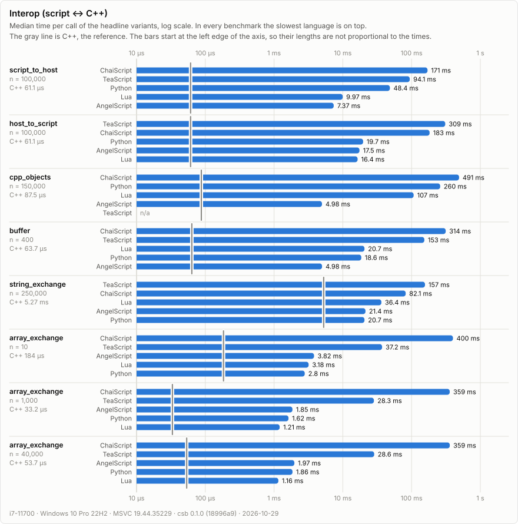
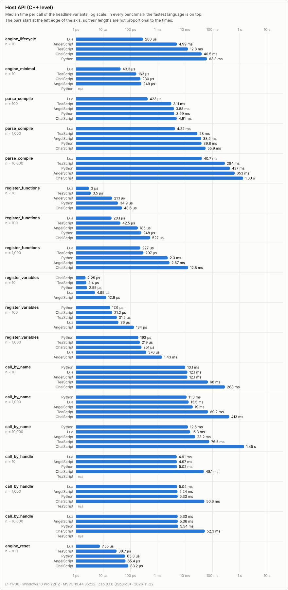
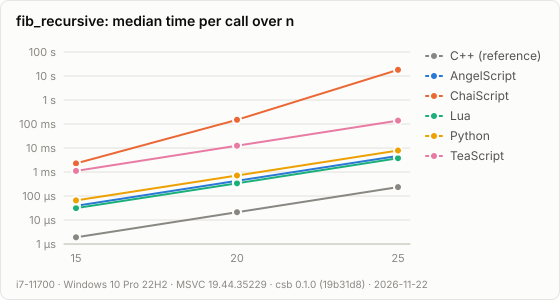
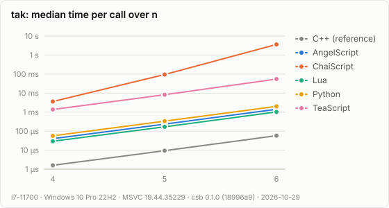
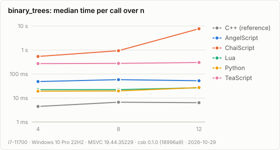
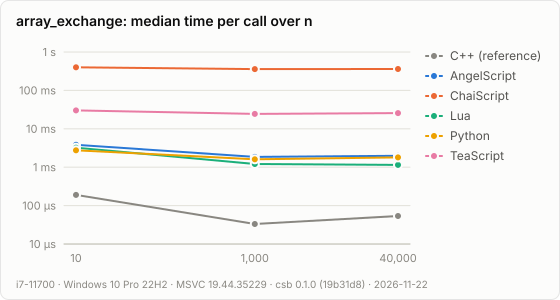
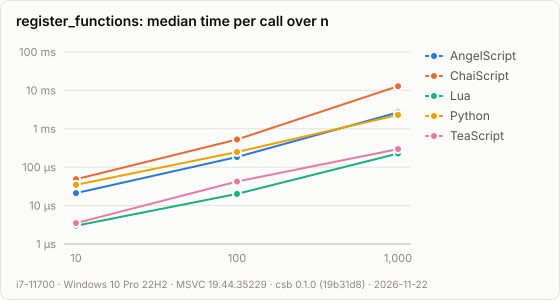

# Result set msvc19.44-i7-11700-windows10

> **Preview:** at least one language is at a pre-release version (TeaScript before 0.18.0). The set will be measured again for the release.

| | |
|---|---|
| CPU | 11th Gen Intel(R) Core(TM) i7-11700 @ 2.50GHz, 8 cores, 16 threads |
| Memory | 31.8 GiB |
| OS | Windows 10 Pro 22H2 (Windows 10.0.19045.7846) |
| Virtualization | Hyper-V is enabled: this OS runs in its root partition |
| Compiler | MSVC 19.44.35229, Release, `/DWIN32 /D_WINDOWS /EHsc /O2 /Ob2 /DNDEBUG /arch:AVX2` |
| cpp-script-bench | 0.1.0 (19b31d8) |
| AngelScript | 2.38.0 (AS_64BIT_PTR AS_NO_THREADS AS_WIN AS_X64_MSVC) |
| ChaiScript | 7.0.0 (wasm-latest-36-gf635b51e); ChaiScript_Extras (v1.0.1-13-gdd116d7) |
| Lua | 5.5.1; LuaBridge3 (3.0-rc12) |
| Python | 3.14.10 (tags/v3.14.10:b703b2c, Oct 25 2026, 17:36:52) [MSC v.1944 64 bit (AMD64)]; pybind11 3.1.0 (v3.1.0) |
| TeaScript | 0.18.0 (v0.17.0-45-g63f3c06) |
| Measured | 2026-11-22 15:32 to 2026-11-22 17:04 UTC |
| Processes | 5 per run, interleaved across the languages; pinned to logical CPU 15, priority high; power: Balanced (381b4222-f694-41f0-9685-ff5bb260df2e) |
| Per process | 3 warm-up and 10 measured calls, time budget 30 s (at least 3 calls) |
| Machine load | other processes used 0.00 logical CPUs in the median, at most 3.47 (processes of at least 1 s) |
| Status | preview |

All numbers compare only within this set. **How to read:** each cell is the median time of one call of `bench( n )` (host API benchmarks: of one sample) over all processes: the median of the medians of the processes. Below it: the factor to C++, and the spread between the processes (slowest minus fastest process median, relative to the median); "budget": the time budget limited the number of calls. The headline variant of each language is shown; the other variants follow below. The rules are in [PLAN.md](../../PLAN.md#2-fairness-rules), the raw data in [results.json](results.json).

## Core

<picture>
  <source media="(prefers-color-scheme: dark)" srcset="charts/core-dark.svg">
  
</picture>

| Benchmark | n | C++ | AngelScript no-threads-no-line-cues | ChaiScript no-threads | Lua | Python | TeaScript vm-O1 |
|---|--:|--:|--:|--:|--:|--:|--:|
| [fib_recursive](../../benchmarks/fib_recursive/README.md) | 15 | **1.9 µs** 5.3% | **39.1 µs** 20.6× · 9.0% | **2.27 ms** 1,196× · 0.6% | **31.4 µs** 16.6× · 4.1% | **65.4 µs** 34.4× · 12.2% | **1.11 ms** 586× · 0.7% |
| [fib_recursive](../../benchmarks/fib_recursive/README.md) | 20 | **21.1 µs** 3.1% | **428 µs** 20.3× · 8.6% | **149 ms** 7,047× · 0.2% | **339 µs** 16× · 3.0% | **717 µs** 33.9× · 2.2% | **12.5 ms** 589× · 1.6% |
| [fib_recursive](../../benchmarks/fib_recursive/README.md) | 25 | **234 µs** 2.1% | **4.69 ms** 20× · 5.5% | **18.1 s** 77,316× · 0.1% · budget | **3.75 ms** 16× · 1.2% | **7.9 ms** 33.7× · 1.2% | **139 ms** 593× · 4.1% |
| [loop](../../benchmarks/loop/README.md) | 1,000,000 | **250 µs** 0.0% | **8.36 ms** 33.4× · 0.0% | **448 ms** 1,794× · 0.8% | **4.44 ms** 17.8× · 4.5% | **27.1 ms** 109× · 6.2% | **220 ms** 881× · 0.4% |
| [int_arith](../../benchmarks/int_arith/README.md) | 5,000 | **547 µs** 2.4% | **7.23 ms** 13.2× · 0.2% | **278 ms** 508× · 1.7% | **5.85 ms** 10.7× · 0.4% | **22.4 ms** 41× · 8.1% | **247 ms** 452× · 0.7% |
| [mandelbrot](../../benchmarks/mandelbrot/README.md) | 100 | **396 µs** 0.1% | **5.72 ms** 14.5× · 0.8% | **404 ms** 1,021× · 2.8% | **4.85 ms** 12.3× · 0.1% | **20.8 ms** 52.7× · 3.8% | **240 ms** 608× · 0.7% |
| [math_builtins](../../benchmarks/math_builtins/README.md) | 100,000 | **126 µs** 10.9% | **5.21 ms** 41.5× · 11.1% | **141 ms** 1,127× · 4.0% | **3.4 ms** 27.1× · 85.4% | **8.02 ms** 63.9× · 50.2% | **180 ms** 1,431× · 3.6% |
| [calls](../../benchmarks/calls/README.md) | 100,000 | **54.5 µs** 4.4% | **5.03 ms** 92.3× · 2.9% | **215 ms** 3,948× · 5.8% | **4.95 ms** 90.8× · 7.7% | **12 ms** 220× · 8.9% | **164 ms** 3,012× · 2.8% |
| [tak](../../benchmarks/tak/README.md) | 4 | **1.6 µs** 6.3% | **39.7 µs** 24.8× · 8.3% | **3.62 ms** 2,262× · 4.8% | **29.1 µs** 18.2× · 5.7% | **57.1 µs** 35.7× · 6.1% | **1.33 ms** 830× · 7.4% |
| [tak](../../benchmarks/tak/README.md) | 5 | **9.4 µs** 9.6% | **233 µs** 24.8× · 2.9% | **95.1 ms** 10,113× · 7.5% | **171 µs** 18.2× · 9.7% | **342 µs** 36.4× · 14.1% | **8.86 ms** 943× · 3.0% |
| [tak](../../benchmarks/tak/README.md) | 6 | **57.7 µs** 4.2% | **1.43 ms** 24.8× · 3.8% | **3.64 s** 63,010× · 5.1% · budget | **1.03 ms** 17.8× · 4.3% | **2.03 ms** 35.1× · 2.6% | **52.1 ms** 903× · 5.2% |
| [branching](../../benchmarks/branching/README.md) | 300,000 | **493 µs** 8.6% | **9.63 ms** 19.5× · 4.4% | **322 ms** 652× · 5.4% | **4.82 ms** 9.78× · 4.4% | **23.3 ms** 47.3× · 6.2% | **321 ms** 650× · 2.9% |

## Data

<picture>
  <source media="(prefers-color-scheme: dark)" srcset="charts/data-dark.svg">
  
</picture>

| Benchmark | n | C++ | AngelScript no-threads-no-line-cues | ChaiScript no-threads | Lua | Python | TeaScript vm-O1 |
|---|--:|--:|--:|--:|--:|--:|--:|
| [var_global](../../benchmarks/var_global/README.md) | 1,000,000 | **333 µs** 4.4% | **10.9 ms** 32.7× · 3.6% | **513 ms** 1,542× · 3.4% | **11.1 ms** 33.5× · 18.3% | **39.2 ms** 118× · 7.0% | **220 ms** 662× · 2.8% |
| [var_nested](../../benchmarks/var_nested/README.md) | 25 | **96.3 µs** 8.7% | **5.02 ms** 52.2× · 3.5% | **361 ms** 3,750× · 3.0% | **3.77 ms** 39.2× · 0.8% | **15.2 ms** 158× · 5.9% | **171 ms** 1,772× · 2.3% |
| [var_lifecycle](../../benchmarks/var_lifecycle/README.md) | 300,000 | **58.1 µs** 4.3% | **3.19 ms** 55× · 0.2% | **371 ms** 6,390× · 2.4% | **2.11 ms** 36.4× · 5.0% | **13.9 ms** 240× · 10.8% | **220 ms** 3,787× · 1.9% |
| [sieve](../../benchmarks/sieve/README.md) | 40,000 | **237 µs** 2.7% | **3.16 ms** 13.4× · 2.7% | **485 ms** 2,051× · 4.0% | **781 µs** 3.3× · 2.4% | **2.91 ms** 12.3× · 7.3% | **34.9 ms** 147× · 11.6% |
| [sort](../../benchmarks/sort/README.md) | 1,000 | **104 µs** 15.2% | **10 ms** 96.7× · 3.2% | **422 ms** 4,065× · 4.4% | **3.83 ms** 36.9× · 3.5% | **12.4 ms** 119× · 5.9% | **206 ms** 1,987× · 4.2% |
| [byte_buffer](../../benchmarks/byte_buffer/README.md) | 100,000 | **636 µs** 2.1% | **4.41 ms** 6.93× · 2.1% | **494 ms** 777× · 4.4% | **2.27 ms** 3.58× · 3.1% | **14.1 ms** 22.2× · 4.1% | **102 ms** 160× · 3.2% |
| [maps](../../benchmarks/maps/README.md) | 50,000 | **7.8 ms** 1.9% | **59.7 ms** 7.65× · 1.8% | **402 ms** 51.6× · 5.7% | **15.6 ms** 2.01× · 3.2% | **15.3 ms** 1.96× · 1.6% | **160 ms** 20.5× · 2.9% |
| [strings](../../benchmarks/strings/README.md) | 70,000 | **3.18 ms** 9.0% | **57.5 ms** 18.1× · 12.6% | **444 ms** 139× · 5.3% | **20.9 ms** 6.56× · 9.4% | **16.7 ms** 5.24× · 7.7% | **111 ms** 34.7× · 9.9% |
| [records](../../benchmarks/records/README.md) | 150,000 | **84.8 µs** 4.5% | **5.85 ms** 69× · 7.1% | **436 ms** 5,144× · 3.3% | **5.21 ms** 61.5× · 2.4% | **13.6 ms** 161× · 7.0% | **155 ms** 1,827× · 1.1% |
| [binary_trees](../../benchmarks/binary_trees/README.md) | 4 | **4.41 ms** 9.4% | **48.6 ms** 11× · 2.2% | **541 ms** 123× · 0.6% | **22.3 ms** 5.05× · 2.4% | **19.2 ms** 4.35× · 5.2% | **271 ms** 61.3× · 1.1% |
| [binary_trees](../../benchmarks/binary_trees/README.md) | 8 | **6.63 ms** 2.1% | **57.9 ms** 8.73× · 4.0% | **937 ms** 141× · 1.4% | **22.4 ms** 3.38× · 1.3% | **19.6 ms** 2.95× · 1.5% | **271 ms** 40.8× · 0.4% |
| [binary_trees](../../benchmarks/binary_trees/README.md) | 12 | **6.42 ms** 4.1% | **52.7 ms** 8.22× · 1.8% | **7.69 s** 1,199× · 0.4% · budget | **26.5 ms** 4.14× · 1.2% | **27.1 ms** 4.22× · 0.7% | **296 ms** 46.2× · 0.6% |

## Interop (script <-> C++)

<picture>
  <source media="(prefers-color-scheme: dark)" srcset="charts/interop-dark.svg">
  
</picture>

| Benchmark | n | C++ | AngelScript no-threads-no-line-cues | ChaiScript no-threads | Lua | Python | TeaScript vm-O1 |
|---|--:|--:|--:|--:|--:|--:|--:|
| [script_to_host](../../benchmarks/script_to_host/README.md) | 100,000 | **61.1 µs** 2.1% | **7.37 ms** 121× · 1.1% | **169 ms** 2,774× · 4.8% | **10 ms** 164× · 2.1% | **48.2 ms** 789× · 1.4% | **90.7 ms** 1,486× · 1.2% |
| [host_to_script](../../benchmarks/host_to_script/README.md) | 100,000 | **61.1 µs** 0.2% | **17.7 ms** 289× · 1.7% | **187 ms** 3,056× · 6.3% | **16.1 ms** 264× · 1.9% | **20.2 ms** 331× · 3.1% | **225 ms** 3,678× · 0.7% |
| [cpp_objects](../../benchmarks/cpp_objects/README.md) | 150,000 | **87.5 µs** 2.2% | **4.98 ms** 57× · 0.7% | **496 ms** 5,675× · 3.5% | **107 ms** 1,229× · 2.1% | **258 ms** 2,949× · 0.5% | n/a |
| [buffer](../../benchmarks/buffer/README.md) | 400 | **62.9 µs** 0.6% | **4.98 ms** 79.2× · 2.8% | **317 ms** 5,033× · 1.8% | **20.9 ms** 332× · 1.7% | **17.9 ms** 285× · 2.8% | **148 ms** 2,360× · 0.8% |
| [string_exchange](../../benchmarks/string_exchange/README.md) | 250,000 | **5.25 ms** 1.8% | **21.4 ms** 4.07× · 1.4% | **78 ms** 14.8× · 2.9% | **36.6 ms** 6.96× · 0.9% | **20.4 ms** 3.88× · 7.8% | **159 ms** 30.2× · 0.7% |
| [array_exchange](../../benchmarks/array_exchange/README.md) | 10 | **190 µs** 7.5% | **3.83 ms** 20.2× · 1.2% | **400 ms** 2,109× · 0.5% | **3.22 ms** 16.9× · 4.8% | **2.76 ms** 14.5× · 7.7% | **30.2 ms** 159× · 14.9% |
| [array_exchange](../../benchmarks/array_exchange/README.md) | 1,000 | **33.2 µs** 0.3% | **1.85 ms** 55.8× · 0.7% | **358 ms** 10,777× · 0.9% | **1.21 ms** 36.5× · 3.9% | **1.6 ms** 48.2× · 2.3% | **24.4 ms** 735× · 0.6% |
| [array_exchange](../../benchmarks/array_exchange/README.md) | 40,000 | **53.6 µs** 0.2% | **1.98 ms** 37× · 2.2% | **360 ms** 6,717× · 0.6% | **1.15 ms** 21.4× · 1.6% | **1.8 ms** 33.5× · 2.1% | **25.6 ms** 478× · 0.2% |

## Host API (C++ level)

<picture>
  <source media="(prefers-color-scheme: dark)" srcset="charts/host-dark.svg">
  
</picture>

| Benchmark | n | AngelScript no-threads-no-line-cues | ChaiScript no-threads | Lua | Python | TeaScript vm-O1 |
|---|--:|--:|--:|--:|--:|--:|
| [engine_lifecycle](../../benchmarks/engine_lifecycle/README.md) | 10 | **4.99 ms** 1.2% | **40.5 ms** 0.9% | **288 µs** 1.8% | **63.3 ms** 0.7% | **12.8 ms** 0.8% |
| [engine_minimal](../../benchmarks/engine_minimal/README.md) | 10 | **249 µs** 1.6% | **230 µs** 3.1% | **43.3 µs** 6.2% | n/a | **163 µs** 5.3% |
| [parse_compile](../../benchmarks/parse_compile/README.md) | 100 | **3.88 ms** 2.4% | **4.91 ms** 0.5% | **423 µs** 4.6% | **3.99 ms** 2.1% | **3.11 ms** 4.5% |
| [parse_compile](../../benchmarks/parse_compile/README.md) | 1,000 | **38.5 ms** 0.2% | **55.9 ms** 0.5% | **4.22 ms** 1.0% | **39.8 ms** 1.2% | **28 ms** 1.0% |
| [parse_compile](../../benchmarks/parse_compile/README.md) | 10,000 | **653 ms** 0.3% | **1.33 s** 0.3% | **40.7 ms** 0.6% | **437 ms** 0.2% | **284 ms** 0.4% |
| [register_functions](../../benchmarks/register_functions/README.md) | 10 | **21.1 µs** 21.8% | **48.6 µs** 0.8% | **3 µs** 3.3% | **34.9 µs** 9.2% | **3.5 µs** 12.9% |
| [register_functions](../../benchmarks/register_functions/README.md) | 100 | **185 µs** 4.1% | **527 µs** 1.5% | **20.1 µs** 2.2% | **248 µs** 3.0% | **42.5 µs** 3.1% |
| [register_functions](../../benchmarks/register_functions/README.md) | 1,000 | **2.67 ms** 1.1% | **12.8 ms** 0.3% | **227 µs** 1.3% | **2.3 ms** 1.5% | **297 µs** 4.2% |
| [register_variables](../../benchmarks/register_variables/README.md) | 10 | **12.9 µs** 3.9% | **2.25 µs** 4.4% | **4.95 µs** 4.0% | **2.55 µs** 15.7% | **2.4 µs** 12.5% |
| [register_variables](../../benchmarks/register_variables/README.md) | 100 | **134 µs** 2.3% | **21.2 µs** 2.1% | **36 µs** 1.2% | **17.9 µs** 4.2% | **31.5 µs** 1.9% |
| [register_variables](../../benchmarks/register_variables/README.md) | 1,000 | **1.43 ms** 0.7% | **251 µs** 1.8% | **376 µs** 2.9% | **193 µs** 4.1% | **219 µs** 2.6% |
| [call_by_name](../../benchmarks/call_by_name/README.md) | 10 | **12.1 ms** 1.7% | **288 ms** 1.1% | **12.1 ms** 4.1% | **10.1 ms** 8.0% | **68 ms** 3.0% |
| [call_by_name](../../benchmarks/call_by_name/README.md) | 1,000 | **19 ms** 1.0% | **413 ms** 1.1% | **13.5 ms** 2.6% | **11.3 ms** 4.0% | **69.2 ms** 2.1% |
| [call_by_name](../../benchmarks/call_by_name/README.md) | 10,000 | **23.2 ms** 0.5% | **1.45 s** 0.5% | **15.3 ms** 5.1% | **12.6 ms** 0.7% | **76.5 ms** 0.8% |
| [call_by_handle](../../benchmarks/call_by_handle/README.md) | 10 | **4.97 ms** 0.8% | **48.1 ms** 1.8% | **4.91 ms** 6.8% | **5.02 ms** 3.2% | n/a |
| [call_by_handle](../../benchmarks/call_by_handle/README.md) | 1,000 | **5.24 ms** 1.9% | **50.6 ms** 3.2% | **5.04 ms** 2.2% | **5.33 ms** 1.7% | n/a |
| [call_by_handle](../../benchmarks/call_by_handle/README.md) | 10,000 | **5.36 ms** 2.2% | **52.3 ms** 1.1% | **5.33 ms** 0.8% | **5.54 ms** 2.0% | n/a |
| [engine_reset](../../benchmarks/engine_reset/README.md) | 100 | **65.4 µs** 0.9% | **83.2 µs** 2.1% | **7.55 µs** 2.6% | **63.3 µs** 11.8% | **30.7 µs** 2.9% |

## Series

Benchmarks with a series of workload sizes, over n (log-log).

<picture>
  <source media="(prefers-color-scheme: dark)" srcset="charts/series-fib_recursive-dark.svg">
  
</picture>

<picture>
  <source media="(prefers-color-scheme: dark)" srcset="charts/series-tak-dark.svg">
  
</picture>

<picture>
  <source media="(prefers-color-scheme: dark)" srcset="charts/series-binary_trees-dark.svg">
  
</picture>

<picture>
  <source media="(prefers-color-scheme: dark)" srcset="charts/series-array_exchange-dark.svg">
  
</picture>

<picture>
  <source media="(prefers-color-scheme: dark)" srcset="charts/series-parse_compile-dark.svg">
  
</picture>

<picture>
  <source media="(prefers-color-scheme: dark)" srcset="charts/series-register_functions-dark.svg">
  
</picture>

<picture>
  <source media="(prefers-color-scheme: dark)" srcset="charts/series-register_variables-dark.svg">
  
</picture>

<picture>
  <source media="(prefers-color-scheme: dark)" srcset="charts/series-call_by_name-dark.svg">
  
</picture>

<picture>
  <source media="(prefers-color-scheme: dark)" srcset="charts/series-call_by_handle-dark.svg">
  
</picture>

## Variants

All variants of each language; the factor is relative to its headline variant.

### AngelScript

| Benchmark | n | no-threads-no-line-cues (headline) | default | no-line-cues | no-threads |
|---|--:|--:|--:|--:|--:|
| fib_recursive | 15 | **39.1 µs** 9.0% | **41.5 µs** 1.06× · 4.5% | **35.6 µs** 0.91× · 5.5% | **43.8 µs** 1.12× · 5.0% |
| fib_recursive | 20 | **428 µs** 8.6% | **441 µs** 1.03× · 1.3% | **386 µs** 0.901× · 4.2% | **477 µs** 1.11× · 3.0% |
| fib_recursive | 25 | **4.69 ms** 5.5% | **4.91 ms** 1.05× · 3.0% | **4.26 ms** 0.908× · 3.5% | **5.42 ms** 1.15× · 2.4% |
| loop | 1,000,000 | **8.36 ms** 0.0% | **10.9 ms** 1.3× · 0.1% | **7.52 ms** 0.9× · 0.1% | **12.1 ms** 1.45× · 0.1% |
| int_arith | 5,000 | **7.23 ms** 0.2% | **7.58 ms** 1.05× · 0.3% | **6.39 ms** 0.883× · 0.2% | **8.76 ms** 1.21× · 0.2% |
| mandelbrot | 100 | **5.72 ms** 0.8% | **5.97 ms** 1.04× · 0.8% | **5.09 ms** 0.89× · 0.4% | **6.63 ms** 1.16× · 0.9% |
| math_builtins | 100,000 | **5.21 ms** 11.1% | **5.05 ms** 0.969× · 39.6% | **4.74 ms** 0.911× · 121.7% | **5.46 ms** 1.05× · 6.5% |
| calls | 100,000 | **5.03 ms** 2.9% | **5.27 ms** 1.05× · 4.0% | **4.58 ms** 0.91× · 7.0% | **5.79 ms** 1.15× · 9.0% |
| tak | 4 | **39.7 µs** 8.3% | **41.8 µs** 1.05× · 9.0% | **38 µs** 0.958× · 6.8% | **43.4 µs** 1.09× · 7.8% |
| tak | 5 | **233 µs** 2.9% | **246 µs** 1.05× · 7.9% | **225 µs** 0.964× · 6.9% | **258 µs** 1.1× · 4.9% |
| tak | 6 | **1.43 ms** 3.8% | **1.5 ms** 1.05× · 8.1% | **1.37 ms** 0.96× · 4.5% | **1.59 ms** 1.12× · 4.1% |
| branching | 300,000 | **9.63 ms** 4.4% | **11.3 ms** 1.17× · 4.4% | **8.36 ms** 0.868× · 2.9% | **12.7 ms** 1.32× · 3.2% |
| var_global | 1,000,000 | **10.9 ms** 3.6% | **13.4 ms** 1.23× · 4.6% | **10 ms** 0.923× · 3.3% | **14.6 ms** 1.35× · 4.4% |
| var_nested | 25 | **5.02 ms** 3.5% | **6.07 ms** 1.21× · 1.4% | **4.61 ms** 0.917× · 5.5% | **6.68 ms** 1.33× · 0.2% |
| var_lifecycle | 300,000 | **3.19 ms** 0.2% | **5.07 ms** 1.59× · 0.4% | **2.94 ms** 0.922× · 0.2% | **5.45 ms** 1.71× · 0.0% |
| sieve | 40,000 | **3.16 ms** 2.7% | **3.46 ms** 1.09× · 3.2% | **2.93 ms** 0.926× · 1.3% | **3.72 ms** 1.18× · 2.6% |
| sort | 1,000 | **10 ms** 3.2% | **8.99 ms** 0.895× · 3.1% | **8.5 ms** 0.846× · 2.8% | **10.7 ms** 1.06× · 3.3% |
| byte_buffer | 100,000 | **4.41 ms** 2.1% | **4.76 ms** 1.08× · 2.2% | **3.82 ms** 0.867× · 2.8% | **5.42 ms** 1.23× · 1.4% |
| maps | 50,000 | **59.7 ms** 1.8% | **58.2 ms** 0.976× · 5.3% | **57.2 ms** 0.959× · 5.7% | **59.8 ms** 1× · 2.0% |
| strings | 70,000 | **57.5 ms** 12.6% | **55.7 ms** 0.969× · 18.2% | **55.4 ms** 0.964× · 3.3% | **57.9 ms** 1.01× · 0.9% |
| records | 150,000 | **5.85 ms** 7.1% | **5.45 ms** 0.931× · 0.9% | **4.64 ms** 0.792× · 1.1% | **6.42 ms** 1.1× · 7.7% |
| binary_trees | 4 | **48.6 ms** 2.2% | **57.5 ms** 1.18× · 1.3% | **57.1 ms** 1.17× · 5.7% | **48.8 ms** 1× · 0.9% |
| binary_trees | 8 | **57.9 ms** 4.0% | **68.4 ms** 1.18× · 3.4% | **67.9 ms** 1.17× · 2.6% | **59.1 ms** 1.02× · 3.1% |
| binary_trees | 12 | **52.7 ms** 1.8% | **63.8 ms** 1.21× · 1.0% | **62.5 ms** 1.19× · 1.1% | **53.6 ms** 1.02× · 1.6% |
| script_to_host | 100,000 | **7.37 ms** 1.1% | **7.22 ms** 0.98× · 0.8% | **6.85 ms** 0.929× · 0.7% | **7.72 ms** 1.05× · 0.8% |
| host_to_script | 100,000 | **17.7 ms** 1.7% | **19 ms** 1.07× · 1.0% | **18.6 ms** 1.05× · 0.8% | **17.9 ms** 1.02× · 1.8% |
| cpp_objects | 150,000 | **4.98 ms** 0.7% | **5.29 ms** 1.06× · 0.4% | **4.42 ms** 0.887× · 0.0% | **5.92 ms** 1.19× · 0.1% |
| buffer | 400 | **4.98 ms** 2.8% | **5.05 ms** 1.01× · 0.0% | **4.52 ms** 0.907× · 3.4% | **5.59 ms** 1.12× · 2.8% |
| string_exchange | 250,000 | **21.4 ms** 1.4% | **21.2 ms** 0.993× · 0.7% | **20.9 ms** 0.978× · 0.5% | **21.7 ms** 1.01× · 0.7% |
| array_exchange | 10 | **3.83 ms** 1.2% | **3.86 ms** 1.01× · 1.6% | **3.71 ms** 0.969× · 1.7% | **4.01 ms** 1.05× · 1.2% |
| array_exchange | 1,000 | **1.85 ms** 0.7% | **1.83 ms** 0.991× · 0.6% | **1.71 ms** 0.921× · 0.8% | **2 ms** 1.08× · 0.7% |
| array_exchange | 40,000 | **1.98 ms** 2.2% | **1.98 ms** 0.998× · 2.1% | **1.88 ms** 0.946× · 1.9% | **2.13 ms** 1.07× · 0.1% |
| engine_lifecycle | 10 | **4.99 ms** 1.2% | **5.68 ms** 1.14× · 1.6% | **5.65 ms** 1.13× · 0.7% | **5.02 ms** 1.01× · 1.8% |
| engine_minimal | 10 | **249 µs** 1.6% | **302 µs** 1.21× · 2.9% | **302 µs** 1.21× · 2.5% | **246 µs** 0.988× · 1.8% |
| parse_compile | 100 | **3.88 ms** 2.4% | **4.14 ms** 1.07× · 1.8% | **4.11 ms** 1.06× · 0.5% | **3.91 ms** 1.01× · 0.6% |
| parse_compile | 1,000 | **38.5 ms** 0.2% | **40.6 ms** 1.05× · 0.5% | **40.4 ms** 1.05× · 1.0% | **38.6 ms** 1× · 0.8% |
| parse_compile | 10,000 | **653 ms** 0.3% | **679 ms** 1.04× · 0.6% | **674 ms** 1.03× · 0.4% | **654 ms** 1× · 0.2% |
| register_functions | 10 | **21.1 µs** 21.8% | **23.8 µs** 1.13× · 3.2% | **25.2 µs** 1.19× · 5.8% | **20.4 µs** 0.964× · 2.7% |
| register_functions | 100 | **185 µs** 4.1% | **201 µs** 1.09× · 1.7% | **198 µs** 1.07× · 2.0% | **186 µs** 1.01× · 0.9% |
| register_functions | 1,000 | **2.67 ms** 1.1% | **2.82 ms** 1.06× · 1.0% | **2.84 ms** 1.06× · 1.5% | **2.66 ms** 0.997× · 1.0% |
| register_variables | 10 | **12.9 µs** 3.9% | **15.4 µs** 1.19× · 1.6% | **14.7 µs** 1.14× · 3.1% | **13.3 µs** 1.03× · 1.9% |
| register_variables | 100 | **134 µs** 2.3% | **137 µs** 1.02× · 1.7% | **137 µs** 1.02× · 1.8% | **134 µs** 0.999× · 0.8% |
| register_variables | 1,000 | **1.43 ms** 0.7% | **1.47 ms** 1.03× · 0.9% | **1.48 ms** 1.03× · 0.6% | **1.44 ms** 1× · 1.6% |
| call_by_name | 10 | **12.1 ms** 1.7% | **12.4 ms** 1.03× · 1.6% | **12.3 ms** 1.01× · 0.6% | **12.1 ms** 1.01× · 2.1% |
| call_by_name | 1,000 | **19 ms** 1.0% | **18.8 ms** 0.992× · 0.6% | **18.7 ms** 0.988× · 0.8% | **19.3 ms** 1.02× · 1.6% |
| call_by_name | 10,000 | **23.2 ms** 0.5% | **22.9 ms** 0.99× · 0.7% | **22.7 ms** 0.981× · 0.7% | **23.3 ms** 1.01× · 0.9% |
| call_by_handle | 10 | **4.97 ms** 0.8% | **5.61 ms** 1.13× · 0.8% | **5.49 ms** 1.11× · 1.1% | **5.06 ms** 1.02× · 1.4% |
| call_by_handle | 1,000 | **5.24 ms** 1.9% | **5.82 ms** 1.11× · 1.7% | **5.73 ms** 1.09× · 1.0% | **5.39 ms** 1.03× · 1.5% |
| call_by_handle | 10,000 | **5.36 ms** 2.2% | **5.85 ms** 1.09× · 1.7% | **5.8 ms** 1.08× · 1.6% | **5.47 ms** 1.02× · 2.7% |
| engine_reset | 100 | **65.4 µs** 0.9% | **82.9 µs** 1.27× · 1.0% | **83.2 µs** 1.27× · 1.3% | **65.1 µs** 0.995× · 4.9% |

### ChaiScript

| Benchmark | n | no-threads (headline) | default |
|---|--:|--:|--:|
| fib_recursive | 15 | **2.27 ms** 0.6% | **2.4 ms** 1.06× · 1.2% |
| fib_recursive | 20 | **149 ms** 0.2% | **150 ms** 1.01× · 0.1% |
| fib_recursive | 25 | **18.1 s** 0.1% · budget | **18.1 s** 1× · 0.1% · budget |
| loop | 1,000,000 | **448 ms** 0.8% | **469 ms** 1.05× · 0.4% |
| int_arith | 5,000 | **278 ms** 1.7% | **297 ms** 1.07× · 1.2% |
| mandelbrot | 100 | **404 ms** 2.8% | **425 ms** 1.05× · 1.6% |
| math_builtins | 100,000 | **141 ms** 4.0% | **133 ms** 0.943× · 6.2% |
| calls | 100,000 | **215 ms** 5.8% | **240 ms** 1.12× · 5.8% |
| tak | 4 | **3.62 ms** 4.8% | **3.7 ms** 1.02× · 2.8% |
| tak | 5 | **95.1 ms** 7.5% | **95.1 ms** 1× · 9.5% |
| tak | 6 | **3.64 s** 5.1% · budget | **3.63 s** 0.997× · 5.8% · budget |
| branching | 300,000 | **322 ms** 5.4% | **355 ms** 1.11× · 3.8% |
| var_global | 1,000,000 | **513 ms** 3.4% | **542 ms** 1.06× · 3.6% |
| var_nested | 25 | **361 ms** 3.0% | **379 ms** 1.05× · 3.4% |
| var_lifecycle | 300,000 | **371 ms** 2.4% | **389 ms** 1.05× · 2.0% |
| sieve | 40,000 | **485 ms** 4.0% | **517 ms** 1.06× · 4.1% |
| sort | 1,000 | **422 ms** 4.4% | **447 ms** 1.06× · 3.2% |
| byte_buffer | 100,000 | **494 ms** 4.4% | **516 ms** 1.04× · 1.1% |
| maps | 50,000 | **402 ms** 5.7% | **426 ms** 1.06× · 1.7% |
| strings | 70,000 | **444 ms** 5.3% | **463 ms** 1.04× · 9.8% |
| records | 150,000 | **436 ms** 3.3% | **466 ms** 1.07× · 10.0% |
| binary_trees | 4 | **541 ms** 0.6% | **562 ms** 1.04× · 1.0% |
| binary_trees | 8 | **937 ms** 1.4% | **991 ms** 1.06× · 1.0% |
| binary_trees | 12 | **7.69 s** 0.4% · budget | **7.71 s** 1× · 0.1% · budget |
| script_to_host | 100,000 | **169 ms** 4.8% | **166 ms** 0.983× · 6.0% |
| host_to_script | 100,000 | **187 ms** 6.3% | **192 ms** 1.03× · 2.4% |
| cpp_objects | 150,000 | **496 ms** 3.5% | **501 ms** 1.01× · 2.3% |
| buffer | 400 | **317 ms** 1.8% | **317 ms** 1× · 4.7% |
| string_exchange | 250,000 | **78 ms** 2.9% | **84.2 ms** 1.08× · 2.5% |
| array_exchange | 10 | **400 ms** 0.5% | **412 ms** 1.03× · 0.7% |
| array_exchange | 1,000 | **358 ms** 0.9% | **368 ms** 1.03× · 0.8% |
| array_exchange | 40,000 | **360 ms** 0.6% | **370 ms** 1.03× · 0.9% |
| engine_lifecycle | 10 | **40.5 ms** 0.9% | **41.2 ms** 1.02× · 0.8% |
| engine_minimal | 10 | **230 µs** 3.1% | **240 µs** 1.04× · 2.5% |
| parse_compile | 100 | **4.91 ms** 0.5% | **4.96 ms** 1.01× · 0.9% |
| parse_compile | 1,000 | **55.9 ms** 0.5% | **56.3 ms** 1.01× · 0.5% |
| parse_compile | 10,000 | **1.33 s** 0.3% | **1.36 s** 1.02× · 0.2% |
| register_functions | 10 | **48.6 µs** 0.8% | **52 µs** 1.07× · 3.9% |
| register_functions | 100 | **527 µs** 1.5% | **540 µs** 1.02× · 1.1% |
| register_functions | 1,000 | **12.8 ms** 0.3% | **13.2 ms** 1.03× · 0.2% |
| register_variables | 10 | **2.25 µs** 4.4% | **2.4 µs** 1.07× · 6.3% |
| register_variables | 100 | **21.2 µs** 2.1% | **21.9 µs** 1.03× · 0.5% |
| register_variables | 1,000 | **251 µs** 1.8% | **269 µs** 1.07× · 0.5% |
| call_by_name | 10 | **288 ms** 1.1% | **304 ms** 1.05× · 1.5% |
| call_by_name | 1,000 | **413 ms** 1.1% | **437 ms** 1.06× · 0.7% |
| call_by_name | 10,000 | **1.45 s** 0.5% | **1.55 s** 1.07× · 0.6% |
| call_by_handle | 10 | **48.1 ms** 1.8% | **51.1 ms** 1.06× · 1.6% |
| call_by_handle | 1,000 | **50.6 ms** 3.2% | **53.4 ms** 1.05× · 2.5% |
| call_by_handle | 10,000 | **52.3 ms** 1.1% | **54.8 ms** 1.05× · 1.5% |
| engine_reset | 100 | **83.2 µs** 2.1% | **84.4 µs** 1.01× · 0.5% |

### Lua

| Benchmark | n | (no name) (headline) | c-api |
|---|--:|--:|--:|
| script_to_host | 100,000 | **10 ms** 2.1% | **4.97 ms** 0.496× · 2.1% |
| host_to_script | 100,000 | **16.1 ms** 1.9% | **10.5 ms** 0.651× · 1.9% |
| cpp_objects | 150,000 | **107 ms** 2.1% | **64.9 ms** 0.604× · 7.4% |
| buffer | 400 | **20.9 ms** 1.7% | **9.85 ms** 0.472× · 1.2% |
| string_exchange | 250,000 | **36.6 ms** 0.9% | **30.5 ms** 0.834× · 1.5% |
| array_exchange | 10 | **3.22 ms** 4.8% | **2.57 ms** 0.798× · 3.7% |
| array_exchange | 1,000 | **1.21 ms** 3.9% | **954 µs** 0.788× · 7.1% |
| array_exchange | 40,000 | **1.15 ms** 1.6% | **834 µs** 0.727× · 3.0% |
| register_functions | 10 | **3 µs** 3.3% | **800 ns** 0.267× · 0.0% |
| register_functions | 100 | **20.1 µs** 2.2% | **8.85 µs** 0.439× · 4.0% |
| register_functions | 1,000 | **227 µs** 1.3% | **105 µs** 0.462× · 5.6% |
| register_variables | 10 | **4.95 µs** 4.0% | **800 ns** 0.162× · 6.3% |
| register_variables | 100 | **36 µs** 1.2% | **8.6 µs** 0.239× · 4.1% |
| register_variables | 1,000 | **376 µs** 2.9% | **100 µs** 0.267× · 3.8% |
| call_by_name | 10 | **12.1 ms** 4.1% | **3.61 ms** 0.299× · 13.8% |
| call_by_name | 1,000 | **13.5 ms** 2.6% | **5.63 ms** 0.418× · 2.0% |
| call_by_name | 10,000 | **15.3 ms** 5.1% | **8.06 ms** 0.528× · 1.9% |
| call_by_handle | 10 | **4.91 ms** 6.8% | **2.94 ms** 0.599× · 6.0% |
| call_by_handle | 1,000 | **5.04 ms** 2.2% | **3.11 ms** 0.616× · 2.8% |
| call_by_handle | 10,000 | **5.33 ms** 0.8% | **3.81 ms** 0.714× · 3.5% |

### Python

| Benchmark | n | (no name) (headline) | c-api |
|---|--:|--:|--:|
| script_to_host | 100,000 | **48.2 ms** 1.4% | **8.49 ms** 0.176× · 3.8% |
| host_to_script | 100,000 | **20.2 ms** 3.1% | **15.9 ms** 0.787× · 3.4% |
| cpp_objects | 150,000 | **258 ms** 0.5% | **33.3 ms** 0.129× · 10.6% |
| buffer | 400 | **17.9 ms** 2.8% | **17.9 ms** 0.999× · 6.5% |
| string_exchange | 250,000 | **20.4 ms** 7.8% | **17 ms** 0.834× · 9.1% |
| array_exchange | 10 | **2.76 ms** 7.7% | **2.12 ms** 0.768× · 1.2% |
| array_exchange | 1,000 | **1.6 ms** 2.3% | **1.35 ms** 0.843× · 1.7% |
| array_exchange | 40,000 | **1.8 ms** 2.1% | **1.54 ms** 0.855× · 6.2% |
| register_functions | 10 | **34.9 µs** 9.2% | **2.7 µs** 0.0775× · 25.9% |
| register_functions | 100 | **248 µs** 3.0% | **22 µs** 0.0886× · 3.6% |
| register_functions | 1,000 | **2.3 ms** 1.5% | **225 µs** 0.0976× · 3.6% |
| register_variables | 10 | **2.55 µs** 15.7% | **1.5 µs** 0.588× · 6.7% |
| register_variables | 100 | **17.9 µs** 4.2% | **12.8 µs** 0.715× · 4.7% |
| register_variables | 1,000 | **193 µs** 4.1% | **154 µs** 0.798× · 4.0% |
| call_by_name | 10 | **10.1 ms** 8.0% | **9.32 ms** 0.925× · 8.9% |
| call_by_name | 1,000 | **11.3 ms** 4.0% | **10.6 ms** 0.936× · 3.0% |
| call_by_name | 10,000 | **12.6 ms** 0.7% | **12 ms** 0.95× · 4.1% |
| call_by_handle | 10 | **5.02 ms** 3.2% | **3.98 ms** 0.792× · 2.2% |
| call_by_handle | 1,000 | **5.33 ms** 1.7% | **4.61 ms** 0.864× · 3.9% |
| call_by_handle | 10,000 | **5.54 ms** 2.0% | **4.8 ms** 0.866× · 2.6% |

### TeaScript

| Benchmark | n | vm-O1 (headline) | ast | vm-O0 | vm-O2 |
|---|--:|--:|--:|--:|--:|
| fib_recursive | 15 | **1.11 ms** 0.7% | **1.09 ms** 0.975× · 2.6% | **1.12 ms** 1× · 2.7% | **1.04 ms** 0.938× · 3.8% |
| fib_recursive | 20 | **12.5 ms** 1.6% | **12 ms** 0.964× · 1.3% | **12.4 ms** 0.992× · 0.7% | **11.6 ms** 0.93× · 1.2% |
| fib_recursive | 25 | **139 ms** 4.1% | **147 ms** 1.06× · 0.6% | **137 ms** 0.988× · 3.0% | **128 ms** 0.922× · 0.8% |
| loop | 1,000,000 | **220 ms** 0.4% | **151 ms** 0.686× · 0.1% | **220 ms** 0.999× · 0.3% | **204 ms** 0.927× · 0.3% |
| int_arith | 5,000 | **247 ms** 0.7% | **198 ms** 0.8× · 0.6% | **247 ms** 0.998× · 0.6% | **235 ms** 0.952× · 0.6% |
| mandelbrot | 100 | **240 ms** 0.7% | **208 ms** 0.864× · 0.5% | **241 ms** 1× · 0.7% | **241 ms** 1× · 0.9% |
| math_builtins | 100,000 | **180 ms** 3.6% | **171 ms** 0.952× · 2.4% | **179 ms** 1× · 6.2% | **177 ms** 0.984× · 8.7% |
| calls | 100,000 | **164 ms** 2.8% | **141 ms** 0.859× · 6.7% | **163 ms** 0.995× · 4.2% | **157 ms** 0.956× · 6.2% |
| tak | 4 | **1.33 ms** 7.4% | **1.3 ms** 0.98× · 8.9% | **1.34 ms** 1.01× · 11.9% | **1.26 ms** 0.946× · 8.5% |
| tak | 5 | **8.86 ms** 3.0% | **7.04 ms** 0.794× · 5.4% | **8.87 ms** 1× · 4.7% | **8.44 ms** 0.953× · 4.3% |
| tak | 6 | **52.1 ms** 5.2% | **43.3 ms** 0.83× · 4.6% | **51.3 ms** 0.984× · 5.8% | **49 ms** 0.941× · 2.1% |
| branching | 300,000 | **321 ms** 2.9% | **230 ms** 0.717× · 3.5% | **321 ms** 1× · 0.3% | **299 ms** 0.933× · 2.9% |
| var_global | 1,000,000 | **220 ms** 2.8% | **151 ms** 0.686× · 3.5% | **220 ms** 1× · 3.5% | **204 ms** 0.926× · 1.7% |
| var_nested | 25 | **171 ms** 2.3% | **113 ms** 0.665× · 3.8% | **171 ms** 1× · 3.6% | **164 ms** 0.963× · 2.5% |
| var_lifecycle | 300,000 | **220 ms** 1.9% | **148 ms** 0.675× · 2.1% | **220 ms** 0.999× · 1.4% | **220 ms** 0.998× · 0.9% |
| sieve | 40,000 | **34.9 ms** 11.6% | **43.1 ms** 1.23× · 11.8% | **34.9 ms** 1× · 10.0% | **31.7 ms** 0.908× · 9.4% |
| sort | 1,000 | **206 ms** 4.2% | **234 ms** 1.13× · 4.1% | **207 ms** 1× · 3.9% | **208 ms** 1.01× · 3.9% |
| byte_buffer | 100,000 | **102 ms** 3.2% | **101 ms** 0.993× · 3.1% | **102 ms** 1× · 2.1% | **98.3 ms** 0.967× · 3.7% |
| maps | 50,000 | **160 ms** 2.9% | **179 ms** 1.12× · 5.7% | **160 ms** 0.999× · 1.9% | **155 ms** 0.971× · 2.1% |
| strings | 70,000 | **111 ms** 9.9% | **89.4 ms** 0.808× · 5.9% | **110 ms** 0.998× · 2.7% | **109 ms** 0.987× · 9.8% |
| records | 150,000 | **155 ms** 1.1% | **107 ms** 0.688× · 1.4% | **155 ms** 1× · 8.5% | **153 ms** 0.987× · 1.2% |
| binary_trees | 4 | **271 ms** 1.1% | **260 ms** 0.963× · 0.7% | **271 ms** 1× · 0.8% | **263 ms** 0.97× · 0.5% |
| binary_trees | 8 | **271 ms** 0.4% | **266 ms** 0.982× · 2.3% | **270 ms** 0.998× · 2.4% | **262 ms** 0.969× · 1.6% |
| binary_trees | 12 | **296 ms** 0.6% | **291 ms** 0.981× · 0.7% | **296 ms** 0.998× · 0.4% | **287 ms** 0.968× · 0.4% |
| script_to_host | 100,000 | **90.7 ms** 1.2% | **83.2 ms** 0.917× · 0.9% | **90.6 ms** 0.999× · 0.5% | **89.4 ms** 0.985× · 1.1% |
| host_to_script | 100,000 | **225 ms** 0.7% | **108 ms** 0.479× · 2.0% | **225 ms** 0.999× · 1.1% | **217 ms** 0.967× · 1.1% |
| buffer | 400 | **148 ms** 0.8% | **117 ms** 0.79× · 2.5% | **148 ms** 1× · 0.8% | **146 ms** 0.984× · 0.9% |
| string_exchange | 250,000 | **159 ms** 0.7% | **281 ms** 1.77× · 0.3% | **160 ms** 1.01× · 0.6% | **155 ms** 0.979× · 0.6% |
| array_exchange | 10 | **30.2 ms** 14.9% | **33.5 ms** 1.11× · 1.4% | **29.5 ms** 0.978× · 2.9% | **29 ms** 0.96× · 0.8% |
| array_exchange | 1,000 | **24.4 ms** 0.6% | **26.2 ms** 1.08× · 0.7% | **24.2 ms** 0.992× · 0.5% | **23.6 ms** 0.966× · 1.0% |
| array_exchange | 40,000 | **25.6 ms** 0.2% | **28.1 ms** 1.1× · 1.9% | **25.5 ms** 0.997× · 0.5% | **24.9 ms** 0.972× · 0.5% |
| engine_lifecycle | 10 | **12.8 ms** 0.8% | **8.36 ms** 0.655× · 1.6% | **13.9 ms** 1.09× · 3.4% | **11.8 ms** 0.923× · 4.7% |
| engine_minimal | 10 | **163 µs** 5.3% | **156 µs** 0.961× · 4.0% | **157 µs** 0.965× · 2.4% | **157 µs** 0.965× · 3.7% |
| parse_compile | 100 | **3.11 ms** 4.5% | **1.78 ms** 0.572× · 2.4% | **3.42 ms** 1.1× · 3.3% | **2.73 ms** 0.878× · 3.5% |
| parse_compile | 1,000 | **28 ms** 1.0% | **17.3 ms** 0.617× · 1.2% | **31.2 ms** 1.11× · 0.8% | **28.2 ms** 1.01× · 0.6% |
| parse_compile | 10,000 | **284 ms** 0.4% | **172 ms** 0.607× · 0.7% | **324 ms** 1.14× · 0.6% | **286 ms** 1.01× · 0.6% |
| register_functions | 10 | **3.5 µs** 12.9% | **3.9 µs** 1.11× · 24.4% | **4.45 µs** 1.27× · 5.6% | **3.5 µs** 1× · 5.7% |
| register_functions | 100 | **42.5 µs** 3.1% | **42.8 µs** 1.01× · 3.2% | **40.6 µs** 0.955× · 3.2% | **42.5 µs** 0.999× · 2.9% |
| register_functions | 1,000 | **297 µs** 4.2% | **305 µs** 1.03× · 6.4% | **296 µs** 0.999× · 4.6% | **299 µs** 1.01× · 2.7% |
| register_variables | 10 | **2.4 µs** 12.5% | **1.6 µs** 0.667× · 112.5% | **3.4 µs** 1.42× · 16.2% | **2.75 µs** 1.15× · 3.6% |
| register_variables | 100 | **31.5 µs** 1.9% | **32.7 µs** 1.04× · 4.0% | **31.1 µs** 0.989× · 2.6% | **33.1 µs** 1.05× · 6.2% |
| register_variables | 1,000 | **219 µs** 2.6% | **235 µs** 1.07× · 9.5% | **222 µs** 1.01× · 8.3% | **221 µs** 1.01× · 1.7% |
| call_by_name | 10 | **68 ms** 3.0% | **32.1 ms** 0.473× · 1.7% | **68.1 ms** 1× · 1.2% | **66.4 ms** 0.977× · 0.7% |
| call_by_name | 1,000 | **69.2 ms** 2.1% | **35.6 ms** 0.514× · 1.5% | **68.9 ms** 0.996× · 2.2% | **67.5 ms** 0.975× · 0.9% |
| call_by_name | 10,000 | **76.5 ms** 0.8% | **49.1 ms** 0.642× · 1.3% | **76.1 ms** 0.994× · 1.1% | **74.7 ms** 0.977× · 1.6% |
| engine_reset | 100 | **30.7 µs** 2.9% | **20.7 µs** 0.674× · 1.4% | **32.5 µs** 1.06× · 3.2% | **30.8 µs** 1× · 3.7% |

## Peak memory

The peak memory of each process, the median over the processes of a run: the peak working set on Windows, the peak resident set on Linux. It covers the whole process: the runtime and libraries of the language, the unmeasured warm-up engine, the engine of the run and its workload. Below it: the difference to the process of the C++ runner for the same benchmark and n, which is the harness alone where C++ is "n/a" (the host API benchmarks). Headline variants.

### Core

| Benchmark | n | C++ | AngelScript no-threads-no-line-cues | ChaiScript no-threads | Lua | Python | TeaScript vm-O1 |
|---|--:|--:|--:|--:|--:|--:|--:|
| fib_recursive | 15 | 4.2 MiB | **5.1 MiB** +0.9 MiB | **6.4 MiB** +2.2 MiB | **4.4 MiB** +0.3 MiB | **9.8 MiB** +5.7 MiB | **5.6 MiB** +1.4 MiB |
| fib_recursive | 20 | 4.2 MiB | **5.1 MiB** +0.9 MiB | **10.5 MiB** +6.3 MiB | **4.4 MiB** +0.3 MiB | **9.8 MiB** +5.7 MiB | **5.6 MiB** +1.4 MiB |
| fib_recursive | 25 | 4.2 MiB | **5.1 MiB** +0.9 MiB | **51.2 MiB** +47.0 MiB | **4.5 MiB** +0.3 MiB | **9.8 MiB** +5.7 MiB | **5.6 MiB** +1.4 MiB |
| loop | 1,000,000 | 4.2 MiB | **5.1 MiB** +0.9 MiB | **6.0 MiB** +1.8 MiB | **4.5 MiB** +0.3 MiB | **9.8 MiB** +5.7 MiB | **5.6 MiB** +1.4 MiB |
| int_arith | 5,000 | 4.2 MiB | **5.1 MiB** +0.9 MiB | **6.0 MiB** +1.8 MiB | **4.5 MiB** +0.3 MiB | **10.0 MiB** +5.8 MiB | **5.6 MiB** +1.5 MiB |
| mandelbrot | 100 | 4.2 MiB | **5.1 MiB** +0.9 MiB | **6.0 MiB** +1.8 MiB | **4.5 MiB** +0.3 MiB | **10.1 MiB** +5.9 MiB | **5.6 MiB** +1.5 MiB |
| math_builtins | 100,000 | 4.2 MiB | **5.1 MiB** +0.9 MiB | **6.0 MiB** +1.9 MiB | **4.5 MiB** +0.3 MiB | **9.9 MiB** +5.7 MiB | **5.9 MiB** +1.7 MiB |
| calls | 100,000 | 4.2 MiB | **5.1 MiB** +0.9 MiB | **6.0 MiB** +1.8 MiB | **4.5 MiB** +0.3 MiB | **9.8 MiB** +5.7 MiB | **5.6 MiB** +1.5 MiB |
| tak | 4 | 4.2 MiB | **5.1 MiB** +0.9 MiB | **6.3 MiB** +2.2 MiB | **4.5 MiB** +0.3 MiB | **9.8 MiB** +5.7 MiB | **5.6 MiB** +1.4 MiB |
| tak | 5 | 4.2 MiB | **5.1 MiB** +0.9 MiB | **8.2 MiB** +4.0 MiB | **4.4 MiB** +0.3 MiB | **9.8 MiB** +5.7 MiB | **5.6 MiB** +1.4 MiB |
| tak | 6 | 4.2 MiB | **5.1 MiB** +0.9 MiB | **17.2 MiB** +13.0 MiB | **4.4 MiB** +0.3 MiB | **9.8 MiB** +5.7 MiB | **5.6 MiB** +1.4 MiB |
| branching | 300,000 | 4.2 MiB | **5.1 MiB** +0.9 MiB | **6.0 MiB** +1.8 MiB | **4.5 MiB** +0.3 MiB | **10.1 MiB** +5.9 MiB | **5.6 MiB** +1.4 MiB |

### Data

| Benchmark | n | C++ | AngelScript no-threads-no-line-cues | ChaiScript no-threads | Lua | Python | TeaScript vm-O1 |
|---|--:|--:|--:|--:|--:|--:|--:|
| var_global | 1,000,000 | 4.2 MiB | **5.1 MiB** +0.9 MiB | **6.0 MiB** +1.8 MiB | **4.5 MiB** +0.3 MiB | **9.8 MiB** +5.7 MiB | **5.6 MiB** +1.4 MiB |
| var_nested | 25 | 4.2 MiB | **5.1 MiB** +0.9 MiB | **6.0 MiB** +1.8 MiB | **4.5 MiB** +0.3 MiB | **9.9 MiB** +5.7 MiB | **5.6 MiB** +1.5 MiB |
| var_lifecycle | 300,000 | 4.2 MiB | **5.1 MiB** +0.9 MiB | **6.0 MiB** +1.8 MiB | **4.5 MiB** +0.3 MiB | **9.8 MiB** +5.6 MiB | **5.8 MiB** +1.6 MiB |
| sieve | 40,000 | 4.2 MiB | **5.2 MiB** +1.0 MiB | **13.5 MiB** +9.4 MiB | **4.6 MiB** +0.4 MiB | **11.0 MiB** +6.9 MiB | **14.1 MiB** +9.9 MiB |
| sort | 1,000 | 4.2 MiB | **5.2 MiB** +1.0 MiB | **6.3 MiB** +2.1 MiB | **4.5 MiB** +0.3 MiB | **9.9 MiB** +5.8 MiB | **5.9 MiB** +1.8 MiB |
| byte_buffer | 100,000 | 4.3 MiB | **5.2 MiB** +0.9 MiB | **24.8 MiB** +20.5 MiB | **5.2 MiB** +0.9 MiB | **9.9 MiB** +5.7 MiB | **5.6 MiB** +1.4 MiB |
| maps | 50,000 | 9.9 MiB | **13.1 MiB** +3.2 MiB | **30.3 MiB** +20.3 MiB | **10.2 MiB** +0.2 MiB | **17.9 MiB** +7.9 MiB | **28.8 MiB** +18.9 MiB |
| strings | 70,000 | 4.2 MiB | **5.2 MiB** +1.0 MiB | **6.1 MiB** +1.9 MiB | **4.5 MiB** +0.4 MiB | **9.9 MiB** +5.7 MiB | **5.7 MiB** +1.5 MiB |
| records | 150,000 | 4.2 MiB | **5.1 MiB** +1.0 MiB | **6.0 MiB** +1.9 MiB | **4.5 MiB** +0.3 MiB | **9.9 MiB** +5.7 MiB | **5.7 MiB** +1.5 MiB |
| binary_trees | 4 | 4.2 MiB | **18.5 MiB** +14.3 MiB | **6.1 MiB** +1.9 MiB | **4.5 MiB** +0.3 MiB | **10.1 MiB** +5.9 MiB | **5.6 MiB** +1.5 MiB |
| binary_trees | 8 | 4.2 MiB | **26.0 MiB** +21.8 MiB | **6.9 MiB** +2.7 MiB | **4.7 MiB** +0.5 MiB | **10.1 MiB** +5.9 MiB | **5.7 MiB** +1.4 MiB |
| binary_trees | 12 | 4.2 MiB | **26.3 MiB** +22.1 MiB | **13.2 MiB** +8.9 MiB | **7.4 MiB** +3.2 MiB | **11.7 MiB** +7.4 MiB | **10.9 MiB** +6.7 MiB |

### Interop (script <-> C++)

| Benchmark | n | C++ | AngelScript no-threads-no-line-cues | ChaiScript no-threads | Lua | Python | TeaScript vm-O1 |
|---|--:|--:|--:|--:|--:|--:|--:|
| script_to_host | 100,000 | 4.2 MiB | **5.1 MiB** +0.9 MiB | **6.0 MiB** +1.8 MiB | **4.5 MiB** +0.3 MiB | **10.3 MiB** +6.1 MiB | **5.6 MiB** +1.5 MiB |
| host_to_script | 100,000 | 4.2 MiB | **5.1 MiB** +0.9 MiB | **6.0 MiB** +1.8 MiB | **4.5 MiB** +0.3 MiB | **9.8 MiB** +5.7 MiB | **5.9 MiB** +1.7 MiB |
| cpp_objects | 150,000 | 4.2 MiB | **5.1 MiB** +0.9 MiB | **6.0 MiB** +1.8 MiB | **4.5 MiB** +0.3 MiB | **10.7 MiB** +6.5 MiB | n/a |
| buffer | 400 | 4.8 MiB | **6.8 MiB** +2.0 MiB | **7.2 MiB** +2.5 MiB | **5.7 MiB** +0.9 MiB | **12.1 MiB** +7.3 MiB | **6.5 MiB** +1.7 MiB |
| string_exchange | 250,000 | 4.2 MiB | **5.0 MiB** +0.8 MiB | **5.9 MiB** +1.8 MiB | **4.6 MiB** +0.4 MiB | **9.8 MiB** +5.6 MiB | **5.8 MiB** +1.6 MiB |
| array_exchange | 10 | 4.2 MiB | **5.2 MiB** +1.0 MiB | **6.3 MiB** +2.1 MiB | **4.5 MiB** +0.3 MiB | **9.8 MiB** +5.7 MiB | **5.7 MiB** +1.6 MiB |
| array_exchange | 1,000 | 4.2 MiB | **5.2 MiB** +1.0 MiB | **6.6 MiB** +2.4 MiB | **4.5 MiB** +0.3 MiB | **9.8 MiB** +5.7 MiB | **5.9 MiB** +1.7 MiB |
| array_exchange | 40,000 | 4.3 MiB | **5.7 MiB** +1.4 MiB | **21.4 MiB** +17.2 MiB | **5.4 MiB** +1.2 MiB | **11.0 MiB** +6.7 MiB | **23.3 MiB** +19.0 MiB |

### Host API (C++ level)

| Benchmark | n | C++ | AngelScript no-threads-no-line-cues | ChaiScript no-threads | Lua | Python | TeaScript vm-O1 |
|---|--:|--:|--:|--:|--:|--:|--:|
| engine_lifecycle | 10 | 4.2 MiB | **4.8 MiB** +0.6 MiB | **6.1 MiB** +1.9 MiB | **4.4 MiB** +0.3 MiB | **10.6 MiB** +6.5 MiB | **5.9 MiB** +1.7 MiB |
| engine_minimal | 10 | 4.2 MiB | **4.6 MiB** +0.4 MiB | **4.5 MiB** +0.4 MiB | **4.3 MiB** +0.1 MiB | n/a | **4.6 MiB** +0.4 MiB |
| parse_compile | 100 | 4.2 MiB | **5.7 MiB** +1.5 MiB | **7.0 MiB** +2.9 MiB | **4.6 MiB** +0.4 MiB | **13.9 MiB** +9.7 MiB | **8.9 MiB** +4.7 MiB |
| parse_compile | 1,000 | 4.2 MiB | **8.9 MiB** +4.7 MiB | **14.6 MiB** +10.5 MiB | **5.7 MiB** +1.6 MiB | **36.9 MiB** +32.7 MiB | **31.1 MiB** +26.9 MiB |
| parse_compile | 10,000 | 4.2 MiB | **41.5 MiB** +37.4 MiB | **92.1 MiB** +88.0 MiB | **15.5 MiB** +11.3 MiB | **270.0 MiB** +265.8 MiB | **263.5 MiB** +259.3 MiB |
| register_functions | 10 | 4.2 MiB | **5.1 MiB** +1.0 MiB | **6.2 MiB** +2.0 MiB | **4.5 MiB** +0.4 MiB | **11.6 MiB** +7.4 MiB | **5.9 MiB** +1.8 MiB |
| register_functions | 100 | 4.2 MiB | **5.1 MiB** +1.0 MiB | **6.2 MiB** +2.1 MiB | **4.6 MiB** +0.4 MiB | **11.6 MiB** +7.4 MiB | **5.9 MiB** +1.7 MiB |
| register_functions | 1,000 | 4.2 MiB | **6.1 MiB** +1.9 MiB | **7.2 MiB** +3.0 MiB | **4.8 MiB** +0.6 MiB | **12.1 MiB** +7.9 MiB | **6.0 MiB** +1.8 MiB |
| register_variables | 10 | 4.2 MiB | **5.1 MiB** +0.9 MiB | **6.1 MiB** +2.0 MiB | **4.5 MiB** +0.4 MiB | **11.5 MiB** +7.4 MiB | **5.9 MiB** +1.7 MiB |
| register_variables | 100 | 4.2 MiB | **5.1 MiB** +1.0 MiB | **6.1 MiB** +2.0 MiB | **4.6 MiB** +0.4 MiB | **11.6 MiB** +7.4 MiB | **5.9 MiB** +1.7 MiB |
| register_variables | 1,000 | 4.2 MiB | **5.4 MiB** +1.2 MiB | **6.2 MiB** +2.1 MiB | **4.9 MiB** +0.7 MiB | **11.7 MiB** +7.5 MiB | **6.0 MiB** +1.9 MiB |
| call_by_name | 10 | 4.2 MiB | **5.1 MiB** +0.9 MiB | **6.0 MiB** +1.9 MiB | **4.5 MiB** +0.3 MiB | **10.1 MiB** +5.9 MiB | **5.7 MiB** +1.5 MiB |
| call_by_name | 1,000 | 4.2 MiB | **7.3 MiB** +3.1 MiB | **8.3 MiB** +4.1 MiB | **5.0 MiB** +0.8 MiB | **17.6 MiB** +13.4 MiB | **11.7 MiB** +7.5 MiB |
| call_by_name | 10,000 | 4.2 MiB | **28.8 MiB** +24.6 MiB | **29.9 MiB** +25.8 MiB | **10.9 MiB** +6.8 MiB | **82.2 MiB** +78.1 MiB | **55.4 MiB** +51.2 MiB |
| call_by_handle | 10 | 4.2 MiB | **5.1 MiB** +0.9 MiB | **6.0 MiB** +1.8 MiB | **4.5 MiB** +0.3 MiB | **10.1 MiB** +5.9 MiB | n/a |
| call_by_handle | 1,000 | 4.2 MiB | **7.3 MiB** +3.1 MiB | **8.4 MiB** +4.2 MiB | **5.0 MiB** +0.8 MiB | **17.7 MiB** +13.6 MiB | n/a |
| call_by_handle | 10,000 | 4.2 MiB | **28.8 MiB** +24.6 MiB | **30.9 MiB** +26.7 MiB | **11.5 MiB** +7.3 MiB | **82.2 MiB** +78.0 MiB | n/a |
| engine_reset | 100 | 4.2 MiB | **5.2 MiB** +1.0 MiB | **6.2 MiB** +2.0 MiB | **4.5 MiB** +0.4 MiB | **10.5 MiB** +6.4 MiB | **5.9 MiB** +1.7 MiB |

---
Generated by `runner/report.py` from [results.json](results.json).
